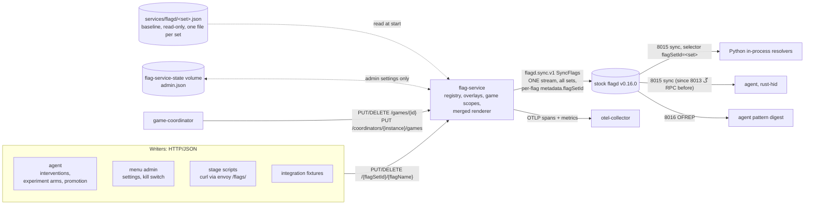

# Flag service: in-memory runtime flags as a gRPC sync source for flagd

> **Historical / decision record (status: implemented, #1417).** Section 1 describes the pre-#1417 world, where every writer edited the flagd JSON files in place; that file-writer design no longer exists. Who writes each flag today is [flags.md §13](../specs/flags.md#13-mutable-flag-registry). Kept in place because specs and test cases cite its decisions. Normative content now lives in [services.md §7](../specs/services.md#7-flag-service-epic-1407), [flags.md §13](../specs/flags.md#13-mutable-flag-registry) and [telemetry.md §10](../specs/telemetry.md#10-flag-service-epic-1407).

> Architecture note. Status: **implemented** (epic #1407, delivered in one PR, #1417). Written 2026-10-16 against `main`; revised the same day
> with the maintainer's decisions on the review of PR #1417 (§1, decisions D3, D4, D10 to D13), and again with
> the decisions on the re-review (N1 to N6: sync fan-out §5.4, event-list reader §6, persistence on request D10
> and §10.1, read-only mounts at the checkpoint). Implementation starts in the same PR (#1408 to #1410).
> Spec rows: [UC-053](../use_cases/UC-053.md), FR-130 to FR-139, NFR-050 to NFR-053, C-030 to C-033
> ([requirements](../requirements.md)); [services.md §7](../specs/services.md#7-flag-service-epic-1407),
> [flags.md §13](../specs/flags.md#13-mutable-flag-registry), [telemetry.md §10](../specs/telemetry.md#10-flag-service-epic-1407),
> entities MUTABLE_FLAG_POLICY, GAME_SCOPE, FLAG_OVERLAY in the [entity model](../entity_model.md).

## 1. Summary

Today every runtime flag change is a read-modify-write of a JSON file in `services/flagd/` that flagd
picks up by polling the file's mtime (about 1 s). Seven production writers and a dozen test helpers
edit the same nine files in place, without a cross-process lock, and per-game and per-player state is
encoded as targeting ladders that nobody prunes. That design produced a run of safety bugs: game
scoping (#1269), replayed edge interventions (#1299 / PR #1306), `end_game` ending the wrong game
(#1310), re-granted shields (#1313, both fixed in PR #1315), and unbounded flag-file growth (#1323).

The maintainer's idea, in their words:

> "a flag mgmt service (without a db, just inmemory) ... we could send a game information to it, and
> the player, and the flag mgmt service could store the configuration in memory, and create the flagd
> configuration. it could be a grpc sync source for flagd. instead of writing to a file, we would be
> writing to the flag mgmt service (maybe it is just one binary with flagd included). at startup, it
> could load the files from the files, but never persist any thing into the files. this would also
> allow us to be more decisive with which flags are changable"

and, on the review of the first draft:

> "we can have multiple paths for listening for flagd, but one service which accepts the changes on one
> endpoints per flag file, with a flag name and other properties which need to be used. - admin settings
> can be persisted. this is a local game we do not care about the roles or possible violations"

> "flagd also has flagset ids - which we can use to store all flags in one file, it just gets messier to
> read. but we should also utilize flagset ids"

> "the endpoint can also look like /flagsetId/flagname"

The **flag service** (`services/flag-service/`, Go) holds the runtime flag state, merges every flag set
into one flagd configuration in which each flag carries its `metadata.flagSetId`, and serves it to a
stock flagd through flagd's gRPC sync source. Writers call one resource-style HTTP endpoint,
`PUT /{flagSetId}/{flagName}`, with the value and the scope properties (game, serial, experiment, arm,
game kind); the service generates the targeting. A mutable-flag registry decides which flag may change
and within which bounds. The game coordinator tells the service when a game starts and ends, and
game-scoped state dies with its game.

### Decisions

| # | Decision | Status |
|---|---|---|
| D1 | No database. At start the service loads the baseline flag files (`services/flagd/<set>.json`, or `ci/<set>.json`) and **never writes them**. Runtime state is in memory, except admin settings (D10). A restart returns to the baseline plus the persisted admin settings (C-030). | decided by the maintainer |
| D2 | The service is a **gRPC sync source** (`flagd.sync.v1.FlagSyncService`). Every OpenFeature client keeps evaluating on **stock flagd** (C-031). | decided by the maintainer |
| D3 | **flagSetIds partition the flags; flagd gets ONE gRPC sync source.** The service merges the per-set files at load time into one configuration whose flags each carry `metadata.flagSetId`; flagd's full replace per source then covers every set at once. Clients keep their `flagSetId=<set>` selectors. Verified against flagd v0.16.0 / core v0.15.6 (§5.2). Separate per-set sync paths are the documented fallback, not used (§5.3). | decided by the maintainer; verified |
| D4 | **One write endpoint per flag set, addressed by path**: `PUT` / `DELETE` / `GET /{flagSetId}/{flagName}`, `GET /{flagSetId}`, and the game lifecycle as `PUT` / `DELETE /games/{gameId}`. Served as **plain HTTP/JSON** (§9). | decided by the maintainer; HTTP/JSON recommended |
| D5 | **Separate containers**: stock flagd plus the flag service. Embedding flagd is rejected for now (§7.1). | recommendation |
| D6 | The **game coordinator** reports the game lifecycle, not the agent; each coordinator instance reconciles only its own games (§8). | recommendation |
| D7 | **One-shot interventions stay flags**, as a per-game **event list** object (`{"epoch","seq","events"}`), rendered on `gameId` only with the serial in the payload (§6). | decided by default (maintainer did not object) |
| D8 | A **mutable-flag registry** declares every runtime-mutable flag and its bounds; every other flag is read-only baseline ([flags.md §13](../specs/flags.md#13-mutable-flag-registry)). | decided by the maintainer |
| D9 | Every write is an OTel span and a metric ([telemetry.md §10](../specs/telemetry.md#10-flag-service-epic-1407)). | decided by the maintainer |
| D10 | **Admin settings are persisted** to a service-owned state file (`FLAG_SERVICE_STATE_FILE`, default `/var/lib/flag-service/admin.json` on the stack's own `flag-service-state` volume), never to `services/flagd/*.json`. Persistence is a property of the flag: every stack write of a registry row with `persist: yes` persists, whoever writes it (#2803, replacing "on request" of re-review N4). Persisted values survive restarts (FR-018 stays). Details §10.1. | decided by the maintainer (re-review N4; by the flag, #2803) |
| D11 | **No roles, no tokens, no authorization.** This is a local party game: a write is validated only against the registry (mutable? in bounds?), the game scope (is the game registered?) and the sync stream (is flagd connected?). The `writer` field is an informational label for the trace. Authorization is out of scope by decision. | decided by the maintainer |
| D12 | **Full migration before the talk**, then delete the file-write paths, nonce baselines and prune logic. No file-based fallback. A readiness checkpoint at T−14 days is a stabilisation gate. | decided by the maintainer |
| D13 | **Overlays substitute `defaultVariant`**, so baseline targeting (for example the Werewolf rule on `sensitivity`) still wins, as it does today (§10). | decided by default |

## 2. Target architecture



Nothing changes on the read side: flagd keeps its ports 8013 / 8014 / 8015 / 8016, the Python
services keep the in-process resolver against `flagd:8015` with `flagSetId=<set>` selectors, the agent
and rust-hid keep the RPC resolver on 8013 (no selector; keys are unique across sets, §5.2), and the
agent's pattern digest keeps OFREP on 8016 with `Flagd-Selector: flagSetId=<set>`. (Since #1713 the agent and rust-hid also use the in-process resolver on 8015 with `flagSetId` selectors; [flags.md §1.1](../specs/flags.md#11-clients).)

The flag service mounts the flag directory **read-only** from the start. In the end state the menu, the
agent and the connect-proxy lose their writable `./services/flagd` mounts (today nothing else is mounted `:ro`,
and the `:ro` claims in `services/agent/experiment/*.go` comments are stale), and the `flag-dir-init` busybox
containers that make the directory group-writable are removed, so C-033 is enforced by the filesystem. That
removal waits for the **last** file writer to move: it is an item of the readiness checkpoint #1414, done after
every set is cut over, not part of any one set's cutover (re-review N3).

## 5. flagd integration

### 5.1 One gRPC sync source

flagd gets **one** gRPC sync source instead of nine `--uri file:` sources:

```text
--sources='[{"uri":"flag-service:50064","provider":"grpc"}]'
```

(in `--sources` the `uri` is a bare `host:port`; the `--uri grpc://flag-service:50064` shorthand is
equivalent). The service sends one `flag_configuration` holding **every** flag of every served set, each
flag with `metadata.flagSetId`. flagd treats each message as a full replace **for that source**
([store.go](https://github.com/open-feature/flagd/blob/main/core/pkg/store/store.go)), so one source
carrying all sets is the configuration in which a full replace cannot wipe another set (review C1: with
several sources on one shared URI, each replace would delete the other sets' flags). The service sends
no `selector` filter of its own; it answers an empty selector with everything and a `flagSetId=<set>`
selector (from the body or the `flagd-selector` header) with that set only.

The source files stay **one per flag set** for readability; the merged, "messier" configuration exists
only in memory and on the wire.

### 5.2 Verification: per-flag flagSetId in one payload (flagd v0.16.0, core v0.15.6)

Read from the release tarballs `flagd/v0.16.0` (whose `flagd/go.mod` requires
`github.com/open-feature/flagd/core v0.15.6`) and `core/v0.15.6`:

- `core/pkg/store/store.go` `Store.Update`: each flag's metadata is `patchMetadata(setMetadata,
  flagMetadata)` (flag keys win), then `flagSetId` is taken from the patched metadata, and the flag is
  stored under the identifier `(flagSetId, key)`. A per-flag `metadata.flagSetId` therefore overrides the
  payload's top-level one, and flags of different sets coexist in one payload.
- `Store.Get` with a non-empty selector queries the `flagSetId` index with the key; without a selector it
  returns the highest-priority flag with that key across all sets. `core/pkg/model/flag.go` declares
  `Metadata` on every flag (`json:"metadata,omitempty"`).
- `flagd/pkg/service/flag-sync/handler.go` (`SyncFlags`): the selector comes from the `Flagd-Selector`
  header, else the body; the stream watches `store.Watch(ctx, &selector, ...)` and sends only the flags
  that match. So the in-process resolvers on 8015 with `flagSetId=<set>` receive exactly their set, and
  RPC evaluation with a `flagd-selector` header resolves within the set.
- **Duplicate keys.** One payload is a JSON object keyed by flag key, so a key can appear only once
  across all merged sets. Today there is one duplicate, `bluetooth_backend` in
  `services/flagd/controller.ci-rust.json`, a file that nothing loads (flags.md §11); `services/flagd/ci/`
  has none. The service loads an explicit list of nine files (not a glob) and refuses to start on a
  duplicate key. A future duplicate across sets would need per-set sync paths (§5.3).
- Clients without a selector (agent RPC, rust-hid) keep working because keys are unique.

#1408's exit test makes this executable: **every flag of every set resolves through its
`flagSetId=<set>` selector with a reason other than `DEFAULT` and `ERROR`** (untargeted flags resolve
`STATIC`; a flag whose baseline targeting falls through is probed with a context that matches a rule),
on the in-process resolver (8015) and on RPC (8013).

### 5.3 Fallback: one sync path per set (not used)

If a future flagd stopped honouring per-flag `flagSetId`, flagd would read each set through **its own
source address** on the same service (one network alias per set, e.g. `flagset-agent:50064`, or one
port per set), because flagd keys the full replace by source URI. Not needed today (§5.2).

The same per-set source addresses are the **fallback if the sync fan-out is too costly** (§5.4): with one
source, every write re-inserts every flag, so flagd wakes every set's watcher. If #1413 measures the fan-out
beyond NFR-050 with flagd at `cpus: 0.25`, flagd gets one source per set (`flagset-<set>:50064` aliases) and a
write wakes only its own set.

### 5.4 Proto, keepalive, start-up, outage

- **Proto.** `flagd.sync.v1` ([sync.proto](https://github.com/open-feature/flagd-schemas/blob/main/protobuf/flagd/sync/v1/sync.proto),
  `buf.build/open-feature/flagd`): `SyncFlags(SyncFlagsRequest{provider_id, selector}) returns (stream
  SyncFlagsResponse{flag_configuration, sync_context})`, `FetchAllFlags`, deprecated `GetMetadata`. The
  legacy `sync.v1` package with its `ALL/ADD/UPDATE/DELETE/PING` enum is not implemented.
- **Keepalive.** flagd v0.16.0's outbound sync client sets no keepalive, so the **service sends
  server-side keepalive pings** (`keepalive.ServerParameters{Time: 30s, Timeout: 10s}`) to detect a dead
  flagd, and allows client pings (`EnforcementPolicy{MinTime: 10s, PermitWithoutStream: true}`) for the
  in-process SDK clients that ping every 30 s
  ([ADR: sync server keepalive](https://github.com/open-feature/flagd/blob/main/docs/architecture-decisions/sync-server-keepalive-enforcement.md)).
- **Selector header.** The selector header name is configurable in flagd; the service reads
  `flagd-selector` (case-insensitive) and the body. An unknown selector key is `INVALID_ARGUMENT`,
  counted in `flagservice_sync_rejected_total{reason="unknown_selector"}` and alerted on: it means a
  client or flagd is misconfigured.
- **Start-up order.** flagd **exits** when a gRPC source is unreachable at its start (the first
  `SyncFlags` is not retried; `start.go` calls `Fatal`), so compose starts flagd with
  `depends_on: flag-service: condition: service_healthy` and `restart: unless-stopped`
  ([runtime.go](https://github.com/open-feature/flagd/blob/main/flagd/pkg/runtime/runtime.go),
  [start.go](https://github.com/open-feature/flagd/blob/main/flagd/cmd/start.go)). **No flagd `readyz`
  health check**: in v0.16.0 `readyz` never turns true with more than one gRPC sync source (flagd #1985);
  services that depend on flagd keep `condition: service_started`.
- **Outage and restart.** When the stream drops, flagd keeps serving its last snapshot and retries
  after 4 s, 16 s, 64 s, then every 60 s; the first message after a reconnect is a full replace.
  - A flag-service outage is invisible to readers; writes fail closed at the writer (500 ms deadline).
  - While flagd has **no open sync stream**, the service rejects flag writes with
    `503 no_sync_stream` (review Important 3): a write flagd cannot see must not look accepted. The game
    lifecycle calls (`PUT` / `DELETE /games/{gameId}`, `PUT /coordinators/{instance}/games`) are **exempt**:
    they change no flag value flagd must see first, and a coordinator must be able to register its games
    while flagd reconnects (re-review N6).
  - An **unplanned** restart leaves flagd on the old snapshot until it reconnects (at most about 64 s
    after the service is healthy again); `flagservice_sync_streams` makes it visible.
  - A **planned** restart restarts flagd too (compose `depends_on ... restart: true` and
    `scripts/flags.sh restart`, owned by #1408), so flagd serves the baseline within 5 s.
- **Latency.** No published numbers; flagd's path from `Recv` to `SetState` to the event and sync
  streams has no debounce, only channel hops and a JSON parse of the snapshot. The whole merged
  configuration (every flag; `make specs-counts` prints the number) is re-sent per write; NFR-051 bounds its size. NFR-050 sets the target,
  #1413 measures it.
- **Fan-out (re-review N1).** flagd's `Store.Update` re-inserts every flag of the source on each update, so
  with one source every write wakes the watcher of **every** set: each Python in-process domain provider then
  fires `PROVIDER_CONFIGURATION_CHANGED`, and OpenFeature's API-level handlers run once per domain. The
  decision is to keep the one source and absorb the fan-out in the readers:
  - the game coordinator's `evaluate_all` is **single-flight**: a change event that arrives while a pass runs
    marks the pass dirty and the running pass loops once more, so N overlapping events cost at most two passes;
  - the pass advances the last-applied `(epoch, seq)` of an event list, and the last-applied variant of a grant,
    **under the lock before** it dispatches, so a second pass can never apply the same event or grant again;
  - #1413 measures the fan-out against NFR-050 with flagd at `cpus: 0.25` (its compose limit); if it is too
    costly, flagd moves to the per-set source addresses of §5.3.
- **Single stream.** flagd opens one `SyncFlags` stream that carries every served set; the stream count, the
  `503 no_sync_stream` check and the `flagservice_sync_streams` gauge are about that one stream, not per set.
- **Version.** flagd v0.16.0 stays pinned; v0.17.0 and v0.18.0 (CBOR fractional hashing) are separate
  upgrades.

## 6. One-shot interventions: flags or commands

`end_game`, `eliminate_player`, `revive_player`, `audio_cue` and `controller_effect` are events, not
states.

| | Keep them as flags | Explicit commands (coordinator RPC) |
|---|---|---|
| Talk theme ("Two Standards": OTel + OpenFeature) | every agent effect is an OpenFeature flag change | a second control channel; contradicts C-002 and C-005 |
| Replay into the next game (#1299) | gone: a game's event list starts empty | gone |
| Wrong game (#1310) | gone: rendered on `gameId` | gone |
| Lost events | none: the event list holds the last K events (below) | none |

**Decision (by default, the maintainer did not object): keep them as flags, as a per-game event list.**

- Each one-shot flag becomes an **object** flag (object flags resolve over every resolver; array flags do
  not, #1221). Its value in a game is
  `{"epoch":"<service boot id>","seq":<last seq>,"events":[{"seq":n,"payload":{...}}, ...]}` holding the
  last K = 16 events. The baseline value is `{"epoch":"","seq":0,"events":[]}`.
- It is rendered on **`gameId` only**; a player-targeted event carries the serial in its payload
  (`{"serial":"MOCK0003"}`, `{"serial":"...","effect":"rumble"}`), so one game's events are one value and
  a burst of events for different players never collapses (review Important 1 and C2).
- `POST /interventions/{flag}` with `scope.game_id` appends an event and returns its `seq`.
- **Coordinator changes** (#1410 lands the reader behind a switch, `INTERVENTION_EVENT_LIST_READER`,
  default off; #1411 switches the flags and turns it on): per (game, flag) it keeps the last `(epoch, seq)` it applied, starting at `("", 0)` when
  the game registers; on each configuration change it evaluates the flag with `{gameId}` and applies, in
  order, every event with `seq` above the last one. The nonce parsing, `_UnknownNonce` and the per-game nonce
  baseline go away (#1416). Today's change detection is replaced, not kept. The reader **never replays**
  (re-review N2):
  - a **failed read** (an `error_code` is set or the reason is `ERROR`) does nothing: it neither applies nor
    moves the last-applied `(epoch, seq)`. The OpenFeature default `{"epoch":"","seq":0,"events":[]}` is never
    mistaken for a new epoch;
  - only a **non-empty, different epoch** resets the last seq to 0 (a service restart; a new epoch starts with
    an empty list). An empty epoch is the baseline value: nothing to apply, nothing reset;
  - a value whose `seq` is below the last applied one within the same epoch is ignored;
  - when the oldest event in the list is newer than `last + 1` (more than K = 16 events arrived between two
    reads), the reader applies what it has and logs the gap;
  - the last-applied `(epoch, seq)` advances under the manager's lock **before** the events are dispatched,
    and `evaluate_all` is single-flight (§5.4), so overlapping passes cannot apply an event twice.
- Grants (`shield_seconds`, `toughness_boost_seconds`, `soft_penalty_action`) stay per-player state flags
  rendered on `gameId` + `targetingKey`, with a fresh opaque variant per grant (`r<epoch>_<n>`). The
  coordinator fires a grant when a player's variant changes during the game; the first value it sees
  after registration counts as a change, because a fresh game scope resolves the neutral default.

## 7. Alternatives considered

### 7.1 One binary with flagd embedded (rejected for now)

- `github.com/open-feature/flagd/core` is a v0 module; its semver ADR puts the Sync, Evaluation and
  OFREP APIs outside semver ([pkg.go.dev](https://pkg.go.dev/github.com/open-feature/flagd/core),
  [semantic versioning ADR](https://github.com/open-feature/flagd/blob/main/docs/architecture-decisions/semantic-versioning-policy.md)).
- The daemon has no plugin hook for custom syncs; appending an `ISync` to the exported `Runtime.Syncs`
  relies on undocumented internals, and we would own the evaluation, sync and OFREP servers.
- The talk is about **stock** OpenFeature and OTel.
- Embedding would avoid the reconnect backoff and one container; §5.4 covers both. Revisit when
  flagd-core is versioned independently.

### 7.2 Keep the files, fix the writers

Each fix so far (#1306, #1315) added state to the coordinator, and #1323 lists the next ones. PR #1418
(interim pruning of retired games' per-player entries, #1323 / #1317) still merges as the interim fix;
#1416 deletes that pruning with the file paths. Rejected as the end state.

### 7.3 flagd's HTTP sync (polling)

`provider: http` polls every `interval` (default 5 s); it adds up to one interval to every write, which
defeats NFR-050. Rejected.

### 7.4 One sync source per set

Needed only if per-flag `flagSetId` were not honoured (§5.3). Rejected in favour of D3: more sources,
more streams, no benefit.

### 7.5 In-process clients straight to the flag service

Rejected: it would split evaluation between flagd and the service (C-031).

### 7.6 Typed RPC per intervention (first draft)

Replaced by the generic per-set endpoint (D4) at the maintainer's request: the registry's `kind` and
bounds carry the per-flag knowledge, and new mutable flags need a registry row, not a new RPC.

## 8. Game lifecycle: who reports it

**Recommendation: the game coordinator.**

- It admits and retires **every** game, real and shadow; it knows the id, kind, serials, experiment and
  arm before the game loop evaluates any flag; the agent learns of a game from OTel after the batch delay.
- It has an existing retire hook on the coordinator side: `InterventionManager.forget_session` (`services/game_coordinator/interventions.py`); `prime_session` no longer exists.
- **Instance scoping (review C3).** `PUT /games/{gameId}` carries `coordinator_instance` (`FLAG_SERVICE_INSTANCE`, set per
  coordinator in compose and stable across a restart or recreate; the boot id is only logged). `PUT /coordinators/{instance}/games` (the reconcile call, at coordinator start and when its
  connection to the service recovers) drops only that instance's other games:
  a second coordinator (a separate compose service with its own instance id) must never drop the
  other's games.
- **Registration race (review Important 7).** The coordinator awaits `PUT /games/{id}` for at most
  200 ms **before the game is RUNNING**, outside `_sessions_lock` (no network call under the lock). On
  timeout or error the game still starts (C-004), the coordinator retries in the background, and agent
  writes for that game get `409 game_not_live` until it succeeds. The agent retries a `game_not_live`
  write once after 250 ms.
- A write for a game no coordinator registered is rejected, which closes the fallback-partition
  `session-N` case of #1323 by construction. A scope older than 1 h expires.

## 9. The write API: HTTP/JSON, addressed by path

**Recommendation: plain HTTP/JSON** (Go `net/http`, port 8070), not gRPC with `google.api.http`
annotations and not Connect:

- The stage and operator scripts are shell; `curl -X PUT .../flags/agent/decision.backend -d '{...}'`
  is the whole client. A Connect or annotated gRPC API would need generated stubs or a gateway to get the
  same paths.
- The other writers already speak HTTP (Go `net/http` in the agent and connect-proxy; Python `httpx` /
  `urllib` in the menu and the tests).
- The only gRPC the service needs is `flagd.sync.v1` for flagd, which stays as is on 50064.
- The paths follow the maintainer's `/flagsetId/flagname`; the flag set is part of the path, so there is
  one endpoint per flag set. `games`, `coordinators`, `state` and `healthz` are reserved and cannot be
  flag-set ids.

Envoy routes `/flags/` to `flag-service:8070` (prefix stripped), so scripts on the host use
`http://localhost/flags/...` and C-015 holds (no new host port). The endpoint is unauthenticated on the
LAN **by decision** (D11).

Request and response shapes, status codes and the registry kinds: [services.md §7](../specs/services.md#7-flag-service-epic-1407).

## 10. Rendering

Per flag the service keeps the baseline (parsed once), the persisted admin value (D10), stack overlays
(stage, operator, promotion; optional TTL), experiment arms, and game-scoped values. On each accepted
write it re-renders the merged configuration and pushes it to every open stream.

- **Stack overlays substitute `defaultVariant`** (D13): if the value is a declared variant the
  `defaultVariant` points at it; otherwise the service adds an opaque variant `o<epoch>_<n>` and points
  at that. Baseline targeting is kept unchanged, so a baseline rule (the Werewolf rule on `sensitivity`)
  still wins over an admin or stage overlay, exactly as today's `defaultVariant` writes behave
  (review Important 6).
- **Game and experiment values are prepended as targeting rungs**, the baseline targeting staying the
  final `else`: game + serial, then game, then experiment + arm (with `game_kind != "real"`), then the
  baseline rule or `null` (= `defaultVariant`).
- Variant names are opaque and carry the boot epoch (`r<epoch>_<n>`), so a name from before a restart
  is never reused (review Important 2); `GET /state` exposes the epoch.

```json
"shield_seconds": {
  "state": "ENABLED",
  "defaultVariant": "none",
  "metadata": {"flagSetId": "interventions"},
  "variants": {"none": 0, "short": 3, "default": 5, "long": 10, "r7f3a_17": 5, "r7f3a_18": 3},
  "targeting": {"if": [
    {"and": [{"==": [{"var": "gameId"}, "game_0a1b2c3d4e5f"]}, {"==": [{"var": "targetingKey"}, "MOCK0001"]}]}, "r7f3a_17",
    {"and": [{"==": [{"var": "gameId"}, "game_9f8e7d6c5b4a"]}, {"==": [{"var": "targetingKey"}, "MOCK0007"]}]}, "r7f3a_18",
    null
  ]}
}
```

### 10.1 Admin persistence (re-review N4)

- **By the flag (#2803).** Every stack-scope `PUT` or `DELETE` of a flag whose registry row says `persist: yes`
  is persisted, whoever writes it; such a flag has one stack value, never an in-memory overlay over a persisted
  one, and takes no `ttl_seconds` (`400 malformed`). Every other write stays in memory and dies with a restart.
  The request's `persist` changes nothing; it stays `400 malformed` where no value is persisted (flags.md §13).
- **One state file per stack.** `FLAG_SERVICE_STATE_FILE` names it; each compose stack that runs the service
  gets its own named volume (`flag-service-state`, project-scoped by compose), so the CI and dry-run
  stacks never read the production stack's admin settings.
- **Atomic write.** The service writes a temporary file in the same directory and renames it over the state
  file (the state file is on a named volume, not a single-file bind mount, so rename is safe). A failed write
  is logged and counted in `flagservice_admin_persist_errors_total`, and the stack `PUT` or `DELETE` of a `persist: yes` row that caused it is rolled back and answered `500 persist_failed`, so memory never differs from the file (a cleared value would otherwise return after a restart; #2368). A persisted kill switch (the set in flags.md §13, today `interventions_allowed`) is the exception: it applies in memory and answers `persisted: false` or `X-Flag-Persisted: false`, because a safety stop must work now. Persistence switched off (`off`) never fails: the write applies in memory and reports `persisted: false`.
- **Corrupt file.** A state file that does not parse is moved aside to `admin.json.corrupt-<unix ts>`; the
  service logs it, counts it in `flagservice_admin_state_corrupt_total`, starts from the baseline and **never
  refuses to start** because of it.
- **Stale entries.** At load, an entry for a flag that is unknown, no longer persistable, or whose variant is
  no longer declared (or value no longer in bounds) is dropped with a warning; the rest load.
- **`DELETE` of a persisted value** removes it from the state file. Fixtures `DELETE` every value they set.

Size is bounded by live games × players × mutable flags (NFR-051), not by history. Readers that
evaluate an intervention flag without `gameId` resolve the baseline, never a game's value. #1410 found
two, both display-only:

| Reader | Reads | Effect of per-game rendering |
|---|---|---|
| menu admin feedback on the controller (formerly `services/menu/handlers/admin.py`, `_state_manager.interventions_client`) | `global_sensitivity_override` without context | could only ever show the baseline, so the branch was removed (PR #1417 review B); the admin feedback shows the admin setting |
| agent pattern digest (`services/agent/patterngame/digest.go`, OFREP, `interventions: {"*"}`) | every `interventions` key without `gameId` | digests the baseline; a game's interventions are not part of the replay digest, which is the intent (UC-046) |

## 11. Risks

| Risk | Mitigation |
|---|---|
| flagd's 4–64 s reconnect after an unplanned restart serves a stale snapshot | joint restart for planned restarts; writes rejected with `503 no_sync_stream` meanwhile; `flagservice_sync_streams` metric, pre-flight check and alert |
| flagd exits if the service is down at its start; `readyz` broken with several gRPC sources (#1985) | `depends_on: service_healthy` on the service, `restart: unless-stopped`; no flagd `readyz` check |
| A duplicate flag key across sets would collide in the merged payload | explicit file list, refuse to start on a duplicate; fallback §5.3 |
| Whole configuration re-sent per write | every flag (`make specs-counts` prints the number); NFR-051 bounds the snapshot at 1 MiB; measured in #1413 |
| One source: every write wakes every set's watcher and every Python domain provider (fan-out) | single-flight `evaluate_all` in the coordinator, last-applied state advanced before dispatch; #1413 measures against NFR-050 with flagd at `cpus: 0.25`; fallback: per-set source addresses (§5.3) |
| Anyone on the LAN can change flags | accepted by decision (D11): local party game |
| A promoted default disappears on restart; the #1065 revert cooldown is lost | intended for the default (the PR route persists it); #1415 re-implements the cooldown |
| One more container on the Pi (NFR-020) | Go binary, memory limit 64 MiB (NFR-051); also in `docker-compose.lite.yml` |
| Coordinator registration failure or slow registration | bounded 200 ms await before RUNNING, background retry, agent retries `game_not_live` once |
| Conflicting edits with PR #1381 (NFR-014, the flags.md header rows, the entity-model ER diagram) | whichever merges second rebases; additive rows only here |

## 14. Sources

- flagd sync configuration: https://flagd.dev/reference/sync-configuration/ and https://flagd.dev/concepts/syncs/
- flagd selector syntax: https://flagd.dev/reference/selector-syntax/
- flagd provider specification: https://flagd.dev/reference/specifications/providers/
- `flagd.sync.v1` proto: https://github.com/open-feature/flagd-schemas/blob/main/protobuf/flagd/sync/v1/sync.proto
- flagd v0.16.0 and core v0.15.6 source (verified 2026-10-16 from the release tarballs):
  https://github.com/open-feature/flagd/tree/flagd/v0.16.0/flagd/pkg/service/flag-sync,
  https://github.com/open-feature/flagd/blob/core/v0.15.6/core/pkg/store/store.go,
  https://github.com/open-feature/flagd/blob/core/v0.15.6/core/pkg/model/flag.go
- flagd gRPC sync client, runtime and start-up: https://github.com/open-feature/flagd/blob/main/core/pkg/sync/grpc/grpc_sync.go,
  https://github.com/open-feature/flagd/blob/main/flagd/pkg/runtime/runtime.go, https://github.com/open-feature/flagd/blob/main/flagd/cmd/start.go
- ADRs: https://github.com/open-feature/flagd/blob/main/docs/architecture-decisions/decouple-flag-source-and-set.md,
  https://github.com/open-feature/flagd/blob/main/docs/architecture-decisions/sync-server-keepalive-enforcement.md,
  https://github.com/open-feature/flagd/blob/main/docs/architecture-decisions/semantic-versioning-policy.md
- flagd changelog and releases: https://github.com/open-feature/flagd/blob/main/flagd/CHANGELOG.md, https://github.com/open-feature/flagd/releases
- flagd core as a Go module: https://pkg.go.dev/github.com/open-feature/flagd/core
