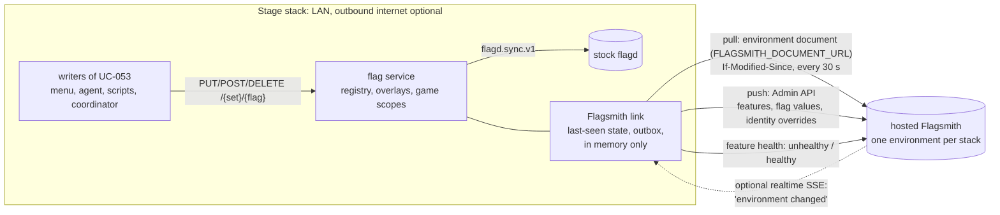

# Flagsmith link: hosted Flagsmith as a writer and audit view of the flag service

> Architecture note. Status: **proposed** (no issue yet). Written 2026-11-15 against `main` and the Flagsmith API
> source at v2.269 (`Flagsmith/flagsmith`, `api/`). Spec rows: [UC-054](../use_cases/UC-054.md),
> [UC-055](../use_cases/UC-055.md), FR-206 to FR-215, NFR-057, NFR-058, C-036, C-037, the C-008 amendment
> ([requirements](../requirements.md)); [services.md §7.3](../specs/services.md#73-flagsmith-link-planned-uc-054-uc-055),
> [flags.md §13.6](../specs/flags.md#136-flagsmith-link-planned-uc-054-uc-055),
> [telemetry.md §10.4](../specs/telemetry.md#104-flagsmith-link-planned-uc-054-uc-055).
> Builds on the flag service ([flag-service.md](flag-service.md)); nothing there changes for a stack without the link.

## 1. Summary

The maintainer wants runtime flag changes visible in hosted Flagsmith (SaaS), wants to change flags there, and
wants the stage stack to keep working offline:

> "each flag change is also send to flagsmith. furthermore, i would love to reintegrate chnges in flagsmith into
> the flagservice. Ideally the flagservice fetches the files for in memory storage, but also fetches from
> flagsmith (where flagsmith wins) if we are online."

> "flagsmith is a SAAS so in a offline scenario this should still work"

The **Flagsmith link** is a component inside the flag service (`services/flag-service/flagsmith/`). It does two things, both
in the background:

- **Out** ([UC-055](../use_cases/UC-055.md)): every accepted write, overlay end and game lifecycle change is
  sent to the stack's Flagsmith environment.
- **In** ([UC-054](../use_cases/UC-054.md)): the flag service fetches the Flagsmith environment, works out what
  a person changed there, and applies each change as an ordinary registry-validated write with writer label
  `flagsmith`.

flagd stays the only evaluator and the flag service its only sync source (C-031). Flagsmith is never on the path
of a local write or of a game (NFR-057), and the stack starts, plays and accepts writes without it (FR-212).



Every arrow to Flagsmith starts at the stack (C-037): no webhook reaches the Pi, no port is opened.

### Decisions

| # | Decision | Status |
|---|---|---|
| F1 | **Flagsmith is a writer, not an evaluator.** Pulled changes are `flagsmith`-labelled writes through the registry (C-032, C-036); no OpenFeature client talks to Flagsmith (C-031). | decided by the maintainer |
| F2 | **Every registry flag is synced**, every scope is shown (stack, game, player, experiment arm, `real`, fraction, event lists). Read-only baseline flags are not features. | decided by the maintainer ("Everything") |
| F3 | **Flagsmith may set stack, game, player values and game events**; experiment-arm, `real` and fraction values are shown only, so a Flagsmith value never competes with an agent experiment or promotion (UC-054 BR-003). | decided in the review of UC-054 |
| F4 | **Flagsmith wins a conflict, kill switches tighten** (UC-054 BR-005, §6). | decided by the maintainer |
| F5 | **No disk copy.** The last-seen state and the outbox are in memory only (C-030 unchanged). An offline restart runs baseline + admin settings. | decided by the maintainer ("Keep, no cache") |
| F6 | **Agent limits under full Flagsmith control**, capped by the env ceilings of C-034; on a conflict they tighten (F4). | decided by the maintainer |
| F7 | **Restart rule by authorship** (UC-054 BR-006): only values a person (a Flagsmith user) set in Flagsmith, and admin settings, come back; every value made with an API key (the link's own, Terraform, the Flagsmith MCP server) is cleared in Flagsmith at start. Flagsmith's audit API shows the author but not which API key, so any API key counts as the link. | decided by the maintainer, 2026-11-15 |
| F8 | **Pull, not webhooks.** Polling the environment document (conditional `GET`) is the baseline; realtime SSE only shortens the delay. Flagsmith webhooks are rejected (§9.1). | recommendation |
| F9 | **Non-stack scopes are identities.** Game, player, experiment-arm, `real` and fraction values are identity overrides on identities named after the scope (§4.2). | recommendation |
| F10 | **Off by default.** `FLAGSMITH_LINK=off` in every stack; CI and the dry-run stacks never call the SaaS; the stage stack opts in through `.env.local`. | recommendation |

## 2. Flagsmith model and the mapping

| JoustMania | Flagsmith | Notes |
|---|---|---|
| stack (stage, CI, dry run) | one **environment** of one project `joustmania` | each stack has its own environment and keys, so CI never touches the stage values |
| registry flag `<set>/<key>` | one **feature** named `<key>`, tagged `<set>`, description = registry `description` | keys are unique across sets (flag-service.md §5.2); one tag per flag set, created on demand |
| stack overlay (in memory or persisted) | the feature's **environment value**: `enabled=true`, value = §4.1 | |
| no stack overlay | `enabled=false`, value = the baseline default (shown for reference) | `enabled=false` never means "flag off"; it means "baseline applies" |
| game value | override on identity `game:<gameId>` | identity traits `game_kind`, `coordinator_instance` (best effort) |
| player value in a game | override on identity `game:<gameId>:<serial>` | no traits (the identifier names the game and serial) |
| experiment-arm value | override on identity `experiment:<id>:<arm>` | shown only (F3) |
| `real` overlay | override on identity `real` | shown only (F3) |
| fraction overlay | override on identity `fraction`, value `{"variant":…, "fraction_percent":…}` | shown only (F3) |
| event list (one-shot interventions) | override on `game:<gameId>` with the list's latest value | a JSON payload set there by a person is appended as one event (§4.3) |
| writer label | not stored on the value; the push records it in the change's audit entry via the Admin API key (§7) and on the span | |

Identities are the one Flagsmith object that carries per-target overrides without segment rules. Using one
identity per scope keeps the mapping 1:1 and lets game cleanup be one identity delete. Segments
(`game_id == X`) were considered and rejected: a segment per live game churns project-level objects and every
segment change touches every environment (§9.2).

### 2.1 Values

Flagsmith stores `string`, `integer` and `boolean` (`FeatureValueType`, `api/features/feature_states/models.py`).

| Registry bound | Flagsmith type | Encoding |
|---|---|---|
| declared variants | string | the variant name (`jev`, `standard`) |
| integer range | integer | the number |
| float range | string | decimal text (`1.25`), parsed by the flag service |
| `free string` | string | the string |
| object flags (`windows`, `goal.profile`, event lists, fraction) | string | compact JSON text |

The pull hands the value to the same parser as `PUT /{set}/{flag}`: a string that names a declared variant selects
it, anything else is a `value` checked against the bounds. A value Flagsmith shows with another type than the
table is refused (`flagsmith_type_mismatch`, A4 of UC-054).

## 3. The link's state (in memory)

Per flag and scope (`(set, key, scope)`), the link holds:

| Field | Meaning |
|---|---|
| `remote` | last state **seen** from Flagsmith (enabled + value), or none | 
| `pending` | latest local value not yet confirmed by Flagsmith (the outbox entry), or none |
| `in_sync` | `remote` equals what the stack runs |
| `refused` | reason of the last refusal on either side, cleared on the next accepted change |

Plus link-wide: `state` (`off`, `starting`, `online`, `offline`), `last_pull_at`, `last_modified` (for the
conditional pull), the boot epoch of the flag service and the Flagsmith ids it resolved (project, environment,
feature ids, tag ids, identity ids). Nothing of this is written to disk (F5); the entity model gains no persisted
entity.

## 4. Data flows

### 4.1 Out (UC-055)

1. An accepted write, an overlay expiry, a `DELETE`, a game registration or a game end puts the new target state of
   `(set, key, scope)` into `pending`, replacing an older pending entry (merge, BR-001 of UC-055).
2. One sender goroutine drains `pending` in order of first change, at most `FLAGSMITH_PUSH_RATE` requests per
   second (default 5), and stops on `429` for the `Retry-After` the API answers.
3. Stack value: `PATCH /api/__future__/environments/{env_key}/features/{feature_id}/` with
   `{"environment_default": {"enabled": …, "value": {"type": "string|integer|boolean", "value": "<text>"}}}` (the
   experimental flag API, `api/features/future/serializers.py` `UpdateFlagSerializer`; the inner `value` is always
   text). A cleared overlay sends `enabled: false` with the baseline default as the value. An environment that
   requires change requests answers `409 change_requests_enabled` (A4 of UC-055). Fallback for a Flagsmith without
   `__future__` (a 404 whose body is not JSON `{"detail": …}`, latched per process):
   `GET /api/v1/environments/{env_key}/featurestates/?feature=<id>`, then `PUT …/featurestates/{id}/`.
4. Identity scopes: values are upserted by identifier, without a uuid round trip:
   `PUT /api/v1/environments/{env_key}/edge-identities-featurestates` (no trailing slash) with
   `{"identifier", "feature", "enabled", "feature_state_value"}` (typed JSON value); it creates a missing identity.
   An ended value is a `DELETE` on the same path with `{"identifier", "feature"}` (204, also when absent). A game
   registration lists the game and its players with `POST /api/v1/environments/{env_key}/edge-identities/`
   (`identifier`; 400 "already exists" counts as created); the game identity gets the traits `game_kind` and
   `coordinator_instance` (best effort; skipped when the organisation does not persist traits). A game end deletes
   the game and player identities (`DELETE …/edge-identities/{uuid}/`, the uuid found by the exact search
   `?q="<identifier>"` when unknown). Edge identities need an edge-enabled project (the SaaS has it).
5. On success `remote := pending`, `pending := none` (no echo, §4.4).

### 4.2 In (UC-054)

1. Every `FLAGSMITH_POLL_SECONDS` (default 30), and at once when the optional realtime stream announces a change,
   the link fetches `GET {FLAGSMITH_DOCUMENT_URL}environment-document/` (default
   `https://edge.api.flagsmith.com/api/v1/`; the Admin API stays on `FLAGSMITH_API_URL`) with the server-side key
   (`X-Environment-Key: ser.…`) and `If-Modified-Since: <last_modified>`; a `304` ends the round. On the SaaS, edge
   identity overrides appear only in the edge document.
2. The document holds the environment values of every feature and, **only when the environment has
   `use_identity_overrides_in_local_eval` on** (`api/util/mappers/sdk.py`), the identity overrides. The link
   refuses to go online without it (`state=offline`, reason `identity_overrides_disabled`), because without it
   game and player values could be pushed but never read back.
3. For each synced `(set, key, scope)` the link computes the 3-way state of `remote`, the document value and the
   local value (§6) and turns each remote change into a write through the same in-process call the HTTP handler
   uses (writer `flagsmith`, `persist: true` when the registry row has `persist: yes`).
4. A write refused by the registry, the game scope or the hold-key guard keeps the local value, records the
   reason and posts **unhealthy** to the feature-health webhook (§8). It is not retried until the document changes
   again, except `409 real_game_live`, which is retried after the game ends.
5. A `503 no_sync_stream` leaves `remote` unchanged, so the next round tries again (A5 of UC-054).

### 4.3 Events from Flagsmith

A person may set an override on `game:<gameId>` for an event flag (`eliminate_player`, `audio_cue`, …) with a JSON
object that is **one event payload** (`{"serial":"MOCK0003"}`). The link sends it as `POST /interventions/{flag}`
(UC-053 A4) with `scope.game_id`; the flag service checks the payload exactly as for the agent (shape, serial of
the game). The resulting event list is then pushed back (§4.1), and since `remote` is set to the pushed list, the
payload is not appended twice.

### 4.4 No echo

A change is applied only when the document value differs from `remote`. Every successful push sets `remote` to
what was pushed, so its own change is never "new". Because variants are opaque and carry the boot epoch
(flag-service.md §10), the link compares **values** (variant name or decoded value), never generated variant ids.

## 5. Start, restart and offline

| Situation | Behaviour |
|---|---|
| Start, link off | nothing changes against today |
| Start, Flagsmith reachable | serve baseline + admin settings at once (FR-130); in the background: resolve ids, create missing features and tags (FR-214), apply the restart rule (§5.1), then poll |
| Start, Flagsmith unreachable | `state=offline`; the stack runs baseline + admin settings; retries with backoff 1, 2, 4 … 60 s |
| Link drops while running | `state=offline`; writes keep working and fill `pending`; on reconnect: full pull, reconcile (§6), then drain `pending` |
| Restart while offline | `pending` and Flagsmith-only values are gone until Flagsmith is reached (F5, UC-054 BR-007) |

### 5.0 Start checks

The ids are resolved from `GET /api/v1/environments/{env_key}/`. The link refuses to go online (`state=offline`)
when the environment's project differs from `FLAGSMITH_PROJECT_ID` (`offline_reason` `project_mismatch`) or when
`use_identity_overrides_in_local_eval` is off (`identity_overrides_disabled`). Feature creation compares names
case-insensitively; an existing feature is never re-tagged or re-described; `initial_value` is sent only when
Flagsmith would infer the same type.

### 5.1 Restart rule (F7)

At start, `remote` is empty, so the link cannot tell its own pushes from a person's changes by comparison. It
reads the **author** of the latest change of each enabled environment value and each override from the project
audit log: `GET /api/v1/projects/{project_id}/audit/?environments=<env_id>`, newest first, paged. (The
organisation-wide `/audit/` fails for API keys.) The link never sends `is_system_event` (Flagsmith parses it
wrongly) and filters system events on the client. The feature or identity is read from the `log` text, pinned to
the Flagsmith log constants, because `related_object_id` is not reliable. With feature versioning v2, the version's
`published_by` is the author; `null` means an API key.

Flagsmith's audit API shows `author` (a user, or null) but not **which** API key. Maintainer decision 2026-11-15:
**any API key counts as the link**.

- author null and not a system event (any API key: the link's own, Terraform, the Flagsmith MCP server) → cleared
  in Flagsmith (`enabled=false`, override deleted), unless the registry row is `persist: yes`, whose value the
  state file already restored, or an admin setting;
- author set (a Flagsmith user) or a system event → applied as a change from Flagsmith;
- identities of games that are not live → deleted.

**Degraded mode:** the audit call does not answer 200, or it returns no row for a candidate (the free plan answers
200 with an empty list). The link then treats every value as a person's and logs a warning at start
(`restart_rule_degraded`); `talk-preflight.sh` shows it. Risk: audit rows are written asynchronously, so a push
seconds before a crash may be misread as a person's value (§10).

## 6. Conflicts (FR-210, UC-054 BR-005)

| `remote` vs document | `remote` vs local | Result |
|---|---|---|
| equal | equal | nothing |
| equal | differs | local change not yet pushed: push it |
| differs | equal | change made in Flagsmith: apply it |
| differs | differs, document == local | both moved to the same value: `remote := document` |
| differs | differs | **conflict**: Flagsmith wins, except kill switches → the more restrictive (flags.md §13.6); the loser is recorded on the span and in `flagservice_flagsmith_conflicts_total{resolution}` |

## 7. Credentials and configuration

The flag service's own configuration is environment (C-035); the keys are secrets in `.env.local` (C-016).

| Variable | Default | Meaning |
|---|---|---|
| `FLAGSMITH_LINK` | `off` | `off` or `on` (F10) |
| `FLAGSMITH_API_URL` | `https://api.flagsmith.com/api/v1/` | Flagsmith Admin API base (also a self-hosted Flagsmith) |
| `FLAGSMITH_DOCUMENT_URL` | `https://edge.api.flagsmith.com/api/v1/` | base of the environment-document pull (§4.2); on the SaaS the edge document holds the edge identity overrides |
| `FLAGSMITH_SERVER_KEY` | none (secret) | server-side environment key `ser.…` for the environment document |
| `FLAGSMITH_ADMIN_API_KEY` | none (secret) | organisation Admin API key for pushes; with RBAC, give it a role limited to the project |
| `FLAGSMITH_ENVIRONMENT_KEY` | none | the environment's client key, used in Admin API paths |
| `FLAGSMITH_PROJECT_ID` | none | project id for feature and tag creation |
| `FLAGSMITH_POLL_SECONDS` | `30` | pull interval (NFR-058) |
| `FLAGSMITH_REALTIME_URL` | empty | SSE base, e.g. `https://realtime.flagsmith.com/`; empty = polling only (realtime is a paid Flagsmith feature) |
| `FLAGSMITH_PUSH_RATE` | `5` | pushes per second |
| `FLAGSMITH_HEALTH_WEBHOOK_URL` | empty (secret) | feature-health webhook URL of a "Webhook" provider; empty = no health events |
| `FLAGSMITH_TIMEOUT_SECONDS` | `5` | per request (UC-054 A1) |

With `FLAGSMITH_LINK=on` and a key missing, the flag service starts with the link `off` and logs an error; it never
refuses to start because of the link.

## 8. Feature health

A refusal of a pulled change (UC-054 A4) posts to the feature-health webhook of a Flagsmith "Webhook" provider
(`api/features/feature_health/providers/webhook/`):

```json
{"feature": "decision.backend", "environment": "stage", "status": "unhealthy",
 "reason": {"text_blocks": [{"title": "Refused by JoustMania", "text": "422 out_of_bounds: value 'gpt' is not a declared variant"}],
            "url_blocks": []}}
```

The next accepted change of that feature posts `"status": "healthy"`. Flagsmith then shows the refusal on the
feature itself, next to the value the operator just set. Grafana's own Flagsmith provider is not used: the stack
has no Prometheus alerting (#1425).

## 9. Alternatives considered

### 9.1 Flagsmith webhooks instead of pulling

Environment webhooks (`FLAG_UPDATED`) need an inbound HTTPS endpoint on the stage device: a public port or a tunnel
on a Pi behind a venue network or its own hotspot (UC-061, C-044). Rejected (C-037). The pull with
`If-Modified-Since` costs one `304` per interval.

### 9.2 Segments for game scope

One segment per live game (`gameId == X`) with segment overrides. Rejected: segments are project-level, so every
game would create and delete a project object visible in every environment, and segment overrides are ordered
by priority, which the link would have to manage. Identities map 1:1 to scopes and die with one delete.

### 9.3 OpenFeature clients on the Flagsmith provider

Point the Python, Go and Rust clients at Flagsmith (OpenFeature Flagsmith provider, local evaluation). Rejected:
it contradicts C-031 (stock flagd), loses the game scoping and the registry, and needs internet on stage.

### 9.4 Translate the whole Flagsmith environment into flagd JSON

Make Flagsmith the source of truth for every flag, its segments and rules, and render flagd configuration from
it. Rejected: segment rules would need a JSONLogic translation, the baseline files would no longer be the
reviewed source (C-033), and an offline start would have nothing to serve.

### 9.5 A disk cache of the Flagsmith state

Keep the last pulled document and the outbox on the `flag-service-state` volume, so an offline restart keeps
Flagsmith-set values. Rejected by the maintainer (F5): C-030 stays as is.

## 10. Risks

| Risk | Mitigation |
|---|---|
| Audit log or versioning author not available on the plan (or no audit row for a candidate): the restart rule cannot tell own pushes from a person's changes | degraded mode treats all as a person's (§5.1), warns at start and in the pre-flight; `talk-stage.sh reset` also clears the stage overlays in Flagsmith through the flag service |
| Audit rows are written asynchronously: a push seconds before a crash may be misread as a person's value | accepted; the value is then applied as a change from Flagsmith at the next start |
| Terraform / MCP values set with an API key are cleared at restart (any API key counts as the link, F7) | decided by the maintainer 2026-11-15; a lasting value is set by a person in the Flagsmith UI, or is an admin setting |
| Edge overrides in the document: the SaaS serves edge identity overrides only in the edge document | `FLAGSMITH_DOCUMENT_URL` defaults to the edge URL; to verify live against the SaaS |
| `use_identity_overrides_in_local_eval` off: game and player values cannot be read back | the link stays offline with reason `identity_overrides_disabled`; documented in the setup |
| SaaS request limits (`MASTER_API_KEY_THROTTLE_RATE` is a per-deployment setting; the SaaS value is not published) under many games and events | merge per flag and scope, `FLAGSMITH_PUSH_RATE`, honour `429 Retry-After`; to measure with 8 live games (NFR-057) |
| Edge identity count grows with games on the plan's identity quota | identities deleted at game end and at start; to verify against the plan |
| `__future__` flag API is experimental and may change | fallback to the stable `featurestates` endpoints (§4.1 step 3); a contract test against the pinned Flagsmith version |
| Change requests on the environment make every push fail | A4 of UC-055, reported as out of sync; the stage environment runs without change requests |
| A person in Flagsmith loosens an agent limit (F6) | env ceilings of C-034 still cap; kill switches tighten on conflict; the change is a `flagservice.write` span with writer `flagsmith` |
| Admin API key on the Pi | a role limited to the project (Flagsmith RBAC), stored in `.env.local` (C-016), never in a flag |

## 11. Implementation outline

| Order | Scope | Spec |
|---|---|---|
| 1 | `services/flag-service/flagsmith/`: client (document pull, Admin API pushes), link state, `GET /state` block, config, spans and metrics; link `off` everywhere | services.md §7.3, telemetry.md §10.4 |
| 2 | Out: stack values, identities for game and player scopes, game end cleanup, outbox with merge and rate limit | UC-055, FR-207, FR-211, NFR-057 |
| 3 | In: pull, 3-way merge, kill-switch order, events, feature health | UC-054, FR-208 to FR-210, FR-213, flags.md §13.6 |
| 4 | Start: feature creation, restart rule by authorship | FR-214, FR-215 |
| 5 | Tests: a fake Flagsmith (HTTP) in `tests/service/`, the echo and conflict table of §6, offline start and reconnect; `talk-preflight.sh` shows the link state | TC for UC-054, UC-055 |
