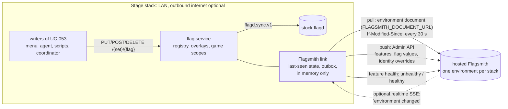

# Flagsmith link: hosted Flagsmith as a writer and audit view of the flag service

> Architecture note. Status: **implemented** (epic #2587, sub-issues #2588 to #2592; UC-054 and UC-055 Tested against a fake Flagsmith, the live SaaS check is a Known gap on both). Written 2026-11-15 against `main` and the Flagsmith API
> source at v2.269 (`Flagsmith/flagsmith`, `api/`). Spec rows: [UC-054](../use_cases/UC-054.md),
> [UC-055](../use_cases/UC-055.md), FR-206 to FR-215, NFR-057, NFR-058, C-036, C-037, the C-008 amendment
> ([requirements](../requirements.md)); [services.md §7.3](../specs/services.md#73-flagsmith-link-implemented-2588-to-2592-uc-054-uc-055),
> [flags.md §13.6](../specs/flags.md#136-flagsmith-link-implemented-2588-to-2592-uc-054-uc-055),
> [telemetry.md §10.4](../specs/telemetry.md#104-flagsmith-link-implemented-2588-to-2592-uc-054-uc-055).
> Builds on the flag service ([flag-service.md](flag-service.md)); nothing there changes for a stack without the link.

## 1. Summary

The maintainer wants runtime flag changes visible in hosted Flagsmith (SaaS), wants to change flags there, and
wants the stage stack to keep working offline:

> "each flag change is also send to flagsmith. furthermore, i would love to reintegrate chnges in flagsmith into
> the flagservice. Ideally the flagservice fetches the files for in memory storage, but also fetches from
> flagsmith (where flagsmith wins) if we are online."

> "flagsmith is a SAAS so in a offline scenario this should still work"

The **Flagsmith link** is a component inside the flag service (`services/flag-service/flagsmith/`). It does two things, both
in the background:

- **Out** ([UC-055](../use_cases/UC-055.md)): every accepted write, overlay end and game lifecycle change is
  sent to the stack's Flagsmith environment.
- **In** ([UC-054](../use_cases/UC-054.md)): the flag service fetches the Flagsmith environment, works out what
  a person changed there, and applies each change as an ordinary registry-validated write with writer label
  `flagsmith`.

flagd stays the only evaluator and the flag service its only sync source (C-031). Flagsmith is never on the path
of a local write or of a game (NFR-057), and the stack starts, plays and accepts writes without it (FR-212).



Every arrow to Flagsmith starts at the stack (C-037): no webhook reaches the Pi, no port is opened.

### Decisions

| # | Decision | Status |
|---|---|---|
| F1 | **Flagsmith is a writer, not an evaluator.** Pulled changes are `flagsmith`-labelled writes through the registry (C-032, C-036); no OpenFeature client talks to Flagsmith (C-031). | decided by the maintainer |
| F2 | **Every registry flag is synced**, every scope is shown (stack, game, player, experiment arm, `real`, fraction, event lists). Read-only baseline flags are not features. | decided by the maintainer ("Everything") |
| F3 | **Flagsmith may set stack, game, player values and game events**; experiment-arm, `real` and fraction values are shown only, so a Flagsmith value never competes with an agent experiment or promotion (UC-054 BR-003). | decided in the review of UC-054 |
| F4 | **Flagsmith wins a conflict**, kill switches included, and is the source of truth once online: stack-scope changes made offline are discarded at the reconnect, game and player values are sent (UC-054 A2, BR-005, BR-007, §6). | decided by the maintainer 2026-11-16 (#2621; replaces "kill switches tighten" of 2026-11-15) |
| F5 | **No disk copy.** The last-seen state and the outbox are in memory only (C-030 unchanged). An offline restart runs baseline + admin settings. | decided by the maintainer ("Keep, no cache") |
| F6 | **Agent limits under full Flagsmith control**, capped by the env ceilings of C-034; on a conflict Flagsmith wins (F4); the agent never writes its own limits. | decided by the maintainer |
| F7 | **Flagsmith wins at a restart** (UC-054 BR-006, FR-215): every value Flagsmith holds comes back, whoever made it (a person, the link's own pushes, Terraform, the Flagsmith MCP server); no authorship is read, nothing is cleared in Flagsmith (§5.1). | decided by the maintainer 2026-11-16 (#2621; replaces the restart rule by authorship of 2026-11-15) |
| F8 | **Pull, not webhooks.** Polling the environment document (conditional `GET`) is the baseline; realtime SSE only shortens the delay. Flagsmith webhooks are rejected (§9.1). | recommendation |
| F9 | **Non-stack scopes are identities.** Game, player, experiment-arm, `real` and fraction values are identity overrides on identities named after the scope (§4.2). | recommendation |
| F10 | **Off by default.** `FLAGSMITH_LINK=off` in every stack; CI and the dry-run stacks never call the SaaS; the stage stack opts in through `.env.local`. | recommendation |

## 2. Flagsmith model and the mapping

| JoustMania | Flagsmith | Notes |
|---|---|---|
| stack (stage, CI, dry run) | one **environment** of one project `joustmania` | each stack has its own environment and keys, so CI never touches the stage values |
| registry flag `<set>/<key>` | one **feature** named `<key>`, tagged `<set>`, description = registry `description` | keys are unique across sets (flag-service.md §5.2); one tag per flag set, created on demand |
| stack overlay (in memory or persisted) | the feature's **environment value**: `enabled=true`, value = §4.1 | |
| no stack overlay | `enabled=false`, value = the baseline default (shown for reference) | `enabled=false` never means "flag off"; it means "baseline applies" |
| game value | override on identity `game:<gameId>` | identity traits `game_kind`, `coordinator_instance` (best effort) |
| player value in a game | override on identity `game:<gameId>:<serial>` | no traits (the identifier names the game and serial) |
| experiment-arm value | override on identity `experiment:<id>:<arm>` | shown only (F3) |
| `real` overlay | override on identity `real` | shown only (F3) |
| fraction overlay | override on identity `fraction`, value `{"variant":…, "fraction_percent":…}` | shown only (F3) |
| event list (one-shot interventions) | override on `game:<gameId>` with the list's latest value | a JSON payload set there by a person is appended as one event (§4.3) |
| writer label | not stored in Flagsmith: the change's audit entry names an API-key change, not which writer of the stack made it (F7); the writer is on the push span | |

Identities are the one Flagsmith object that carries per-target overrides without segment rules. Using one
identity per scope keeps the mapping 1:1 and lets game cleanup be one identity delete. Segments
(`game_id == X`) were considered and rejected: a segment per live game churns project-level objects and every
segment change touches every environment (§9.2).

### 2.1 Values

Flagsmith stores `string`, `integer` and `boolean` (`FeatureValueType`, `api/features/feature_states/models.py`).

| Registry bound | Flagsmith type | Encoding |
|---|---|---|
| declared variants | string | the variant name (`jev`, `standard`) |
| integer range | integer | the number |
| float range | string | decimal text (`1.25`), parsed by the flag service |
| `free string` | string | the string |
| object flags (`windows`, `goal.profile`, event lists, fraction) | string | compact JSON text |

The pull hands the value to the same parser as `PUT /{set}/{flag}`: a string that names a declared variant selects
it, anything else is a `value` checked against the bounds. A value Flagsmith shows with another type than the
table is refused (`flagsmith_type_mismatch`, A4 of UC-054).

## 3. The link's state (in memory)

Per flag and scope (`(set, key, scope)`), the link holds:

| Field | Meaning |
|---|---|
| `remote` | last state **seen** from Flagsmith (enabled + value), or none | 
| `pending` | latest local value not yet confirmed by Flagsmith (the outbox entry), or none |
| `in_sync` | `remote` equals what the stack runs |
| `refused` | reason of the last refusal on either side, cleared on the next accepted change; a refused push also keeps the refused local value, which is not sent again until the local value changes to a different one or the process restarts (UC-055 A4, #2604) |

Plus link-wide: `state` (`off`, `starting`, `online`, `offline`), `last_pull_at`, `last_modified` (for the
conditional pull), the boot epoch of the flag service and the Flagsmith ids it resolved (project, environment,
feature ids, tag ids, identity ids). Nothing of this is written to disk (F5); the entity model gains no persisted
entity.

## 4. Data flows

### 4.1 Out (UC-055)

1. An accepted write, an overlay expiry, a `DELETE`, a game registration or a game end puts the new target state of
   `(set, key, scope)` into `pending`, replacing an older pending entry (merge, BR-001 of UC-055).
2. One sender goroutine drains `pending` in order of first change, at most `FLAGSMITH_PUSH_RATE` requests per
   second (default 5), and stops on `429` for the `Retry-After` the API answers.
   It wakes on every queued value: a local write (step 1) and the end of a pull round that queued one (§4.2,
   §6 push rows; once per round, #2608).
3. Stack value: `PATCH /api/__future__/environments/{env_key}/features/{feature_id}/` with
   `{"environment_default": {"enabled": …, "value": {"type": "string|integer|boolean", "value": "<text>"}}}` (the
   experimental flag API, `api/features/future/serializers.py` `UpdateFlagSerializer`; the inner `value` is always
   text). A cleared overlay sends `enabled: false` with the baseline default as the value. An environment that
   requires change requests answers `409 change_requests_enabled` (A4 of UC-055). Fallback for a Flagsmith without
   `__future__` (a 404 whose body is not JSON `{"detail": …}`, latched per process):
   `GET /api/v1/environments/{env_key}/featurestates/?feature=<id>`, then `PUT …/featurestates/{id}/`.
4. Identity scopes: values are upserted by identifier, without a uuid round trip:
   `PUT /api/v1/environments/{env_key}/edge-identities-featurestates` (no trailing slash) with
   `{"identifier", "feature", "enabled", "feature_state_value"}` (typed JSON value); it creates a missing identity.
   An ended value is a `DELETE` on the same path with `{"identifier", "feature"}` (204, also when absent). A game
   registration lists the game and its players with `POST /api/v1/environments/{env_key}/edge-identities/`
   (`identifier`; 400 "already exists" counts as created); the game identity gets the traits `game_kind` and
   `coordinator_instance` (best effort; skipped when the organisation does not persist traits). A game end deletes
   the game and player identities (`DELETE …/edge-identities/{uuid}/`, the uuid found by the exact search
   `?q="<identifier>"` when unknown). Edge identities need an edge-enabled project (the SaaS has it).
5. On success `remote := pending`, `pending := none` (no echo, §4.4).

### 4.2 In (UC-054)

1. Every `FLAGSMITH_POLL_SECONDS` (default 30), and at once when the optional realtime stream announces a change,
   the link fetches `GET {FLAGSMITH_DOCUMENT_URL}environment-document/` (default
   `https://edge.api.flagsmith.com/api/v1/`; the Admin API stays on `FLAGSMITH_API_URL`) with the server-side key
   (`X-Environment-Key: ser.…`) and `If-Modified-Since: <last_modified>`; a `304` ends the round. The `304` is an optimisation only: Flagsmith may not move the environment `updated_at` for an edge identity override change, so while any game (real or shadow) is live the pull is unconditional (no `If-Modified-Since`), and otherwise every 10th pull is unconditional. On the SaaS, edge
   identity overrides appear only in the edge document.
2. The document holds the environment values of every feature and, **only when the environment has
   `use_identity_overrides_in_local_eval` on** (`api/util/mappers/sdk.py`), the identity overrides. The link
   refuses to go online without it (`state=offline`, reason `identity_overrides_disabled`), because without it
   game and player values could be pushed but never read back.
3. For each synced `(set, key, scope)` the link computes the 3-way state of `remote`, the document value and the
   local value (§6) and turns each remote change into a write through the same in-process call the HTTP handler
   uses (writer `flagsmith`, `persist: true` when the registry row has `persist: yes`).
4. A write refused by the registry or the game scope keeps the local value, records the
   reason and posts **unhealthy** to the feature-health webhook (§8). It is not retried until the document changes
   again.
5. A `503 no_sync_stream` leaves `remote` unchanged, so the next round tries again (A5 of UC-054).
6. **A stale document never reverts a confirmed push.** The link snapshots the last-seen generation of every key
   before the fetch and skips, in this round, every key whose last-seen state changed during the round, and every key
   the **value guard** holds back. No clock comparison is used. When a push is confirmed, the link remembers the
   remote value(s) the push replaced. In a pull round a key is skipped (no write; the next pull is unconditional)
   while the document value differs from the last-seen value and equals one of those replaced values: the document
   still shows the pre-push value and is stale. The guard ends once the document shows the pushed value, or after
   max(10 min, 10 x the poll interval). The next round looks at the key again. A push confirmed during a round that
   read no document (an error, a skipped older document, `304`) also guards the value of the last document read.
   A whole document whose update time (body `updated_at`, else the `X-Flagsmith-Document-Updated-At` header) is
   older than the newest one the process already read is a stale copy and is skipped: nothing is written, the pull
   counts as an error with reason `stale_document`, and the next pull is in full. Only Flagsmith's own times are
   compared, never the local clock (a Pi without RTC may run at 1970 before NTP); an update time that is not a finite
   epoch after 1970 or lies beyond year 9999 counts as none, so a garbled value cannot block every later document.
   The refusal is bounded: one update time ahead of all later ones (Flagsmith's clock skewed forward and corrected, an
   environment database restore, a garbled but in-range time) would otherwise refuse every document, kill-switch
   changes included, until a restart. Once older documents have been refused in a row for max(10 min, 10 x the
   poll interval), measured as local elapsed time (the monotonic clock, never a wall-clock comparison, so a local
   clock at 1970 plays no part), the next older document is accepted and its update time becomes the newest; the
   link logs a warning `flagsmith stale document accepted`. Any document accepted in between ends the run of
   refusals; errors and unchanged (`304`) pulls in between do not end it (they return before the update-time
   check), so after an outage longer than the threshold the first older document is accepted at once and applied
   like any document, kill switches included (#2621). The generation snapshot and the value guard above still apply
   to every key in that round.
7. **Every pulled write is conditional**: it carries the version of the local slot as read, empty slots included, so a
   local write that lands between the read and the apply wins (the pulled write is refused as stale, and the next round
   sees the conflict). Event appends (§4.3) are the one unconditional write.
8. `last_modified` advances only to the document body's update time (or the sub-second header), never to the `Date`
   of the response, and the next pull is unconditional while the body is older than the header or the second has not
   passed. Pulls are at least 1 s apart (wake-ups are coalesced) and `429 Retry-After` on the document is honoured. A
   round applies at most 50 writes; the rest follow in the next round, so a large change never delays a local write
   (NFR-050). Health posts (§8) are asynchronous, never inline in the round.
9. A key whose apply is deferred (flagd not connected, a stale slot) backs off 1, 2, 4 … 60 s; after 5 consecutive
   deferrals the feature is marked unhealthy with that reason.
10. A segment override or a multivariate option on a synced feature is not applied (JoustMania reads only the
    environment value and the identity overrides); the feature is marked unhealthy once, "segment overrides are not
    applied by JoustMania".
11. The change-delay metric (telemetry.md §10.4) uses the environment's update time, which the link's own pushes also
    move; NFR-058 measured this way is a lower bound.

### 4.3 Events from Flagsmith

A person may set an override on `game:<gameId>` for an event flag (`eliminate_player`, `audio_cue`, …) with a JSON
object that is **one event payload** (`{"serial":"MOCK0003"}`). The link sends it as `POST /interventions/{flag}`
(UC-053 A4) with `scope.game_id`; the flag service checks the payload exactly as for the agent (shape, serial of
the game). The resulting event list is then pushed back (§4.1), and since `remote` is set to the pushed list, the
payload is not appended twice. The append is unconditional (the list is append-only), and a document list that is
equal to, or a prefix of, the local list does nothing and is never a refusal (a stale document after the list was
pushed appends nothing).

### 4.4 No echo

A change is applied only when the document value differs from `remote`. Every successful push sets `remote` to
what was pushed, so its own change is never "new". Because variants are opaque and carry the boot epoch
(flag-service.md §10), the link compares **values** (variant name or decoded value), never generated variant ids.

## 5. Start, restart and offline

| Situation | Behaviour |
|---|---|
| Start, link off | nothing changes against today |
| Start, Flagsmith reachable | serve baseline + admin settings at once (FR-130); in the background: resolve ids, create missing features and tags (FR-214), then the start reconcile applies what Flagsmith holds (§5.1: Flagsmith wins), then poll |
| Start, Flagsmith unreachable | `state=offline`; the stack runs baseline + admin settings; retries with backoff 1, 2, 4 … 60 s; stack-scope changes made before the first connect are discarded at it (UC-054 A2, A3) |
| Link drops while running | `state=offline`; writes keep working and fill `pending`, the case plays on them; on reconnect: full pull, reconcile (§6: Flagsmith is the source of truth, stack-scope changes made while not connected are discarded, never sent), then drain what is left of `pending` (game and player values, stack changes made online that the outage cut) |
| Restart while offline | `pending` and Flagsmith-only values are gone until Flagsmith is reached (F5, UC-054 BR-007) |

### 5.0 Start checks

The ids are resolved from `GET /api/v1/environments/{env_key}/`. The link refuses to go online (`state=offline`)
when the environment's project differs from `FLAGSMITH_PROJECT_ID` (`offline_reason` `project_mismatch`) or when
`use_identity_overrides_in_local_eval` is off (`identity_overrides_disabled`). Feature creation compares names
case-insensitively; an existing feature is never re-tagged or re-described. A project without edge identities
(the edge identity endpoint answers `DynamoNotEnabled` or 400) is refused as well (`edge_required`): the link goes
offline with that reason, because game and player overrides are edge identities and core identities are not
supported.

**Feature creation** never sends `initial_value` (the new feature gets Flagsmith's default and the registry value is
pushed afterwards like any value), because an initial value would change what every other environment of the project
serves. A feature whose name differs only in case from the registry key is refused (`feature_name_case`), an archived
one too (`feature_archived`), both with a warning; the link never renames or unarchives a feature. A create that fails
three times (5xx or timeout) is refused (`feature_create_failed`) and the start continues with the other features;
only a `401` on resolving the ids or on the document takes the link down. Side effect: every created feature makes
Flagsmith rebuild the environment document of every environment of the project, so features and tags are created once,
at start.

### 5.1 Restart: Flagsmith wins (F7)

Maintainer decision 2026-11-16 (#2621), replacing the restart rule by authorship of #2591: at a restart, and
from then on, **Flagsmith is the source of truth once the link is online**. The start sequence reads no audit log
and seeds no last state: `remote` is empty, so the start reconcile (§6, rows "remote absent") applies every
Flagsmith value that differs from the local value (the baseline, or the persisted value of an admin setting),
whoever made it:

- a value made with an API key (the link's own pushes of in-memory writes, Terraform, the Flagsmith MCP server)
  comes back like a person's; nothing is cleared in Flagsmith;
- an admin setting (`persist: yes`) takes the Flagsmith value and persists it, as the menu admin's write would; with
  no Flagsmith value its persisted value stays and is sent to Flagsmith;
- a kill switch takes the Flagsmith value like any flag (no "more restrictive" merge, §6);
- an override on a game that is not registered yet is neither applied nor refused: it applies once the game
  registers, whoever made it;
- an event list in a game's override (the list the link pushed before the restart) is not brought back: events are
  one-shot payloads (§4.3); the local list is kept and sent. A single payload a person set is appended;
- identities of games that are not live → deleted, but **start never deletes identities**: the cleanup runs once the
  coordinator has re-registered its games, or 45 s after start, whichever is later, and keeps every identity that a
  registered game matches (the whole identifier is compared with `game:<id>` and `game:<id>:<serial>`), so a game
  that registers late keeps its overrides.

The identity uuids of the start document are remembered in the start's final step, after every other step
succeeded, so a failed start leaves nothing half done. Consequence (§10): an in-memory write the link pushed
before a restart (a stage script, an agent's game-scoped write) is in force again after the restart; a restart is
no stage reset while Flagsmith is reachable.

## 6. Conflicts (FR-210, UC-054 BR-005)

Flagsmith wins every conflict, a kill switch included (maintainer decision 2026-11-16, #2621, replacing the
"more restrictive wins" rule of #2590). A round still applies the kill switches of flags.md §13.6 first.

| `remote` vs document | `remote` vs local | Result |
|---|---|---|
| equal | equal | nothing |
| equal | differs | local change not yet pushed: push it, unless Flagsmith refused that local value (any refusal but `429`): it is not sent again until the local value changes to a different one or the process restarts (UC-055 A4); the same holds for every round. **A stack-scope local change made while the link was not connected** (offline, or before the first connect; marked on its pending entry, which the sender never sends) **is discarded instead**: the document value is applied, recorded as a `flagsmith` conflict, and the pending entry is dropped (only while it is still that change: a write made during the round is kept); with no document value the flag goes back to the baseline, an admin setting too. The mark survives a skip or deferral and ends with the next change made online. A change made online that the outage cut is pushed as usual. **A stack-scope value Flagsmith refused is reverted the same way** (no conflict, the refusal stays reported, a re-save is reverted again). Game and player values are pushed (UC-054 A2, BR-007, UC-055 A4, #2621) |
| differs | equal | change made in Flagsmith: apply it |
| differs | differs, document == local | both moved to the same value: `remote := document` |
| absent (no last state: restart) | differs | apply the document value, a kill switch too; no document value: push the local value (an in-memory stack value discarded at a reconnect goes back to the baseline instead) |
| differs | differs | **conflict**: Flagsmith wins, a kill switch too; the loser is recorded on the span and in `flagservice_flagsmith_conflicts_total{resolution="flagsmith"}` |

## 7. Credentials and configuration

The flag service's own configuration is environment (C-035); the keys are secrets in `.env.local` (C-016).

| Variable | Default | Meaning |
|---|---|---|
| `FLAGSMITH_LINK` | `off` | `off` or `on` (F10) |
| `FLAGSMITH_API_URL` | `https://api.flagsmith.com/api/v1/` | Flagsmith Admin API base (also a self-hosted Flagsmith) |
| `FLAGSMITH_DOCUMENT_URL` | `https://edge.api.flagsmith.com/api/v1/` | base of the environment-document pull (§4.2); on the SaaS the edge document holds the edge identity overrides |
| `FLAGSMITH_SERVER_KEY` | none (secret) | server-side environment key `ser.…` for the environment document |
| `FLAGSMITH_ADMIN_API_KEY` | none (secret) | organisation Admin API key for pushes; with RBAC, give it a role limited to the project |
| `FLAGSMITH_ENVIRONMENT_KEY` | none | the environment's client key, used in Admin API paths |
| `FLAGSMITH_PROJECT_ID` | none | project id for feature and tag creation |
| `FLAGSMITH_POLL_SECONDS` | `30` | pull interval (NFR-058) |
| `FLAGSMITH_REALTIME_URL` | empty | SSE base, e.g. `https://realtime.flagsmith.com/`; empty = polling only (realtime is a paid Flagsmith feature) |
| `FLAGSMITH_PUSH_RATE` | `5` | pushes per second |
| `FLAGSMITH_HEALTH_WEBHOOK_URL` | empty (secret) | feature-health webhook URL of a "Webhook" provider; empty = no health events |
| `FLAGSMITH_TIMEOUT_SECONDS` | `5` | per request (UC-054 A1) |

With `FLAGSMITH_LINK=on` and a key missing, the flag service starts with the link `off` and logs an error; it never
refuses to start because of the link.

## 8. Feature health

A refusal of a pulled change (UC-054 A4) posts to the feature-health webhook of a Flagsmith "Webhook" provider
(`api/features/feature_health/providers/webhook/`):

```json
{"feature": "decision.backend", "environment": "stage", "status": "unhealthy",
 "reason": {"text_blocks": [{"title": "Refused by JoustMania", "text": "422 out_of_bounds: value 'gpt' is not a declared variant"}],
            "url_blocks": []}}
```

The health of a feature is per feature: it is unhealthy while any key of it is refused (several identities of one
feature count together) and healthy again when the last refusal is gone (an accepted change, or the game or identity
left). A post is made only when this changes, asynchronously and coalesced per feature. Flagsmith then shows the refusal on the
feature itself, next to the value the operator just set. Grafana's own Flagsmith provider is not used: the stack
has no Prometheus alerting (#1425).

## 9. Alternatives considered

### 9.1 Flagsmith webhooks instead of pulling

Environment webhooks (`FLAG_UPDATED`) need an inbound HTTPS endpoint on the stage device: a public port or a tunnel
on a Pi behind a venue network or its own hotspot (UC-061, C-044). Rejected (C-037). The pull with
`If-Modified-Since` costs one `304` per interval when no game is live; while any game (real or shadow) is live, and on every 10th pull otherwise, the pull is unconditional (§4.2).

### 9.2 Segments for game scope

One segment per live game (`gameId == X`) with segment overrides. Rejected: segments are project-level, so every
game would create and delete a project object visible in every environment, and segment overrides are ordered
by priority, which the link would have to manage. Identities map 1:1 to scopes and die with one delete.

### 9.3 OpenFeature clients on the Flagsmith provider

Point the Python, Go and Rust clients at Flagsmith (OpenFeature Flagsmith provider, local evaluation). Rejected:
it contradicts C-031 (stock flagd), loses the game scoping and the registry, and needs internet on stage.

### 9.4 Translate the whole Flagsmith environment into flagd JSON

Make Flagsmith the source of truth for every flag, its segments and rules, and render flagd configuration from
it. Rejected: segment rules would need a JSONLogic translation, the baseline files would no longer be the
reviewed source (C-033), and an offline start would have nothing to serve.

### 9.5 A disk cache of the Flagsmith state

Keep the last pulled document and the outbox on the `flag-service-state` volume, so an offline restart keeps
Flagsmith-set values. Rejected by the maintainer (F5): C-030 stays as is.

## 10. Risks

| Risk | Mitigation |
|---|---|
| In-memory writes the case pushed before a restart (stage scripts, an agent's game-scoped writes, a stage reset made online) come back after the restart from Flagsmith: a restart is no stage reset while Flagsmith is reachable (F7, #2621) | accepted by the maintainer 2026-11-16: Flagsmith is the source of truth once online (the stage Pi's agent gates switched on in Flagsmith survive an upgrade or reboot). A reset is a change in Flagsmith (or `talk-stage.sh reset` while online, whose deletes are pushed); a game-scoped value comes back only for a game that registers again |
| Stack-scope changes made while offline (menu admin, stage scripts, an operator write, a kill switch switched off on stage) are discarded at the reconnect (or the first connect after an offline start) in favour of Flagsmith (F4, #2621) | accepted by the maintainer 2026-11-16: offline the case plays on its offline configuration; once online Flagsmith decides. A safety stop made offline must also be made in Flagsmith; an offline change with no Flagsmith value goes back to the baseline, an admin setting too; a change made online and cut by the outage is still sent; game and player values of running games are sent |
| A kill switch loosened in Flagsmith (or by an accepted older document) is applied as is: there is no "more restrictive" merge any more (F4, #2621) | the env ceilings of C-034 still cap the agent-limiting flags; the agent never writes its own limits; kill switches are applied first in a round |
| A conditional pull (`If-Modified-Since`) may miss an edge identity override change, because the environment `updated_at` may not move | while any game is live the pull is unconditional, otherwise every 10th pull is unconditional (§4.2); the fake-Flagsmith test changes an override without a newer `Last-Modified` and expects it to be applied |
| A person changes a flag in Flagsmith between a pull and the push of a pending local change: the push overwrites it | accepted; last writer wins for every flag, kill switches included: a person's change between the last pull and the push is overwritten (the window lasts from the last pull to the push); for a kill switch the next pull re-applies a tighter Flagsmith value only as a deliberate change |
| Edge overrides in the document: the SaaS serves edge identity overrides only in the edge document | `FLAGSMITH_DOCUMENT_URL` defaults to the edge URL; to verify live against the SaaS (Known gap of UC-054 and UC-055, maintainer decision D1) |
| `use_identity_overrides_in_local_eval` off: game and player values cannot be read back | the link stays offline with reason `identity_overrides_disabled`; documented in the setup |
| SaaS request limits (`MASTER_API_KEY_THROTTLE_RATE` is a per-deployment setting; the SaaS value is not published) under many games and events | merge per flag and scope, `FLAGSMITH_PUSH_RATE`, honour `429 Retry-After`; to measure with 8 live games (NFR-057; Known gap of UC-054 and UC-055, maintainer decision D1) |
| Edge identity count grows with games on the plan's identity quota | identities deleted at game end and, for games that are not live, after start (§5.1); to verify against the plan |
| A stale environment document (cached, or older than a push) would revert a confirmed push | keys whose state changed during the round are skipped, and the value guard skips a key whose document value still equals a value its confirmed push replaced (§4.2 step 6); a document whose update time is older than the newest one read is skipped whole (`stale_document`, server time only; §4.2 step 6); pulled writes are conditional on the local slot (§4.2) |
| One document update time ahead of all later ones (Flagsmith clock skew, an environment database restore, a garbled but in-range time) would refuse every later document as `stale_document`, kill-switch changes included | the refusal ends after max(10 min, 10 x poll interval) of refusals in a row, local elapsed time; the older document is then accepted and becomes the newest, with a warning log; in that round kill switches merge without their remote value and take the more restrictive value (§4.2 step 6). Residuals, accepted by the maintainer 2026-11-15 (follow-up #2602): (a) the copy stamped with the too-new time (a cache or region still serving it) is not older, so it is accepted normally and ends the run: served at least once per max(10 min, 10 x poll interval), it keeps the run from ever reaching the threshold and the tightening stays refused as before; served less often, it makes kill switches flap: the accepted older document tightens, then the too-new copy is newer than the accepted time again and merges normally (`R != D`, `R = L` -> apply), a deliberate loosening, and the refusals start over (an operator's kill in Flagsmith takes effect, then is undone for about the threshold, repeatedly). (b) In the accepted round a kill switch whose local value is tighter than the accepted document keeps local and pushes it; when a lagging copy answers that round while Flagsmith already holds a tighter value set during the refusal run, the push overwrites that value in Flagsmith and the operator's value is lost on both sides (as in the "push overwrites a person's change" row, but the window is the whole refusal run). (c) Every non-kill-switch value in the accepted document that differs from the link's remote value while the local value still equals it applies as a change from Flagsmith (a value Flagsmith changed itself as well as a pushed one) until a newer document is read and corrects it; a pushed value is protected only while its value guard lives, and the guard can end before the threshold (the newest document showed the pushed value), as for a document without an update time |
| A local write to a game or player slot that is empty during a document fetch is not detected by the per-slot version check for that round (game values only; stack and kill-switch slots are fully covered) | accepted; last writer wins |
| `__future__` flag API is experimental and may change | fallback to the stable `featurestates` endpoints (§4.1 step 3); a contract test against the pinned Flagsmith version |
| Change requests on the environment make every push fail | A4 of UC-055, reported as out of sync; the stage environment runs without change requests |
| A person in Flagsmith loosens an agent limit (F6) | env ceilings of C-034 still cap; Flagsmith wins a conflict (F4, #2621), so the operator in Flagsmith decides; the change is a `flagservice.write` span with writer `flagsmith` |
| Admin API key on the Pi | a role limited to the project (Flagsmith RBAC), stored in `.env.local` (C-016), never in a flag |

## 11. Implementation outline

| Order | Scope | Spec |
|---|---|---|
| 1 | `services/flag-service/flagsmith/`: client (document pull, Admin API pushes), link state, `GET /state` block, config, spans and metrics; link `off` everywhere | services.md §7.3, telemetry.md §10.4 |
| 2 | Out: stack values, identities for game and player scopes, game end cleanup, outbox with merge and rate limit | UC-055, FR-207, FR-211, NFR-057 |
| 3 | In: pull, 3-way merge, kill switches first (their "more restrictive" order dropped in #2621), events, feature health | UC-054, FR-208 to FR-210, FR-213, flags.md §13.6 |
| 4 | Start: feature creation, restart rule by authorship (replaced by "Flagsmith wins at a restart", #2621) | FR-214, FR-215 |
| 5 | Tests: a fake Flagsmith (HTTP) in `tests/service/`, the echo and conflict table of §6, offline start and reconnect; `talk-preflight.sh` shows the link state | done (#2592): TC-021, TC-022, the fake in `tests/service/harness/fakes/flagsmith.py` |
