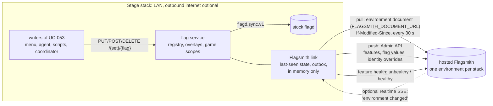

# Flagsmith link: hosted Flagsmith as a writer and audit view of the flag service

> Architecture note. Status: **implemented** (epic #2587, sub-issues #2588 to #2592; controller identities #2624; variant options #2709; reference values #2623; UC-054 and UC-055 Tested against a fake Flagsmith, the live SaaS check is a Known gap on both). Written 2026-11-15 against `main` and the Flagsmith API
> source at v2.269 (`Flagsmith/flagsmith`, `api/`). Spec rows: [UC-054](../use_cases/UC-054.md),
> [UC-055](../use_cases/UC-055.md), FR-206 to FR-215, FR-226, FR-227, NFR-057, NFR-058, C-036, C-037, the C-008 amendment
> ([requirements](../requirements.md)); [services.md §7.3](../specs/services.md#73-flagsmith-link-implemented-2588-to-2592-uc-054-uc-055),
> [flags.md §13.6](../specs/flags.md#136-flagsmith-link-implemented-2588-to-2592-uc-054-uc-055),
> [telemetry.md §10.4](../specs/telemetry.md#104-flagsmith-link-implemented-2588-to-2592-uc-054-uc-055).
> Builds on the flag service ([flag-service.md](flag-service.md)); nothing there changes for a stack without the link.

## 1. Summary

The maintainer wants runtime flag changes visible in hosted Flagsmith (SaaS), wants to change flags there, and
wants the stage stack to keep working offline:

> "each flag change is also send to flagsmith. furthermore, i would love to reintegrate chnges in flagsmith into
> the flagservice. Ideally the flagservice fetches the files for in memory storage, but also fetches from
> flagsmith (where flagsmith wins) if we are online."

> "flagsmith is a SAAS so in a offline scenario this should still work"

The **Flagsmith link** is a component inside the flag service (`services/flag-service/flagsmith/`). It does two things, both
in the background:

- **Out** ([UC-055](../use_cases/UC-055.md)): every accepted write, overlay end and game lifecycle change is
  sent to the stack's Flagsmith environment.
- **In** ([UC-054](../use_cases/UC-054.md)): the flag service fetches the Flagsmith environment, works out what
  a person changed there, and applies each change as an ordinary registry-validated write with writer label
  `flagsmith`.

flagd stays the only evaluator and the flag service its only sync source (C-031). Flagsmith is never on the path
of a local write or of a game (NFR-057), and the stack starts, plays and accepts writes without it (FR-212).



Every arrow to Flagsmith starts at the stack (C-037): no webhook reaches the Pi, no port is opened.

### Decisions

| # | Decision | Status |
|---|---|---|
| F1 | **Flagsmith is a writer, not an evaluator.** Pulled changes are `flagsmith`-labelled writes through the registry (C-032, C-036); no OpenFeature client talks to Flagsmith (C-031). | decided by the maintainer |
| F2 | **Every registry flag is synced**, every scope is shown (stack, game, player, experiment arm, `real`, fraction, event lists). Read-only baseline flags are not features. A baseline flag the operator should change from Flagsmith gets a **Flagsmith-only** registry row (flags.md §13, #2705): a feature like every row, written only by the link's in-process path, refused over HTTP (`403 flagsmith_only`), so the agent never can. | decided by the maintainer ("Everything"); Flagsmith-only rows #2705 |
| F3 | **Flagsmith may set stack, game, player values and game events**; experiment-arm, `real` and fraction values are shown only, so a Flagsmith value never competes with an agent experiment or promotion (UC-054 BR-003). A Flagsmith-only row is stack scope only and Flagsmith is its only runtime writer (UC-054 BR-011). | decided in the review of UC-054 |
| F4 | **Flagsmith wins a conflict**, kill switches included, and is the source of truth once online: stack-scope changes made offline are discarded at the reconnect, game and player values are sent (UC-054 A2, BR-005, BR-007, §6). | decided by the maintainer 2026-11-16 (#2621; replaces "kill switches tighten" of 2026-11-15) |
| F5 | **No disk copy.** The last-seen state and the outbox are in memory only (C-030 unchanged). An offline restart runs baseline + admin settings. | decided by the maintainer ("Keep, no cache") |
| F6 | **Agent limits under full Flagsmith control**, capped by the env ceilings of C-034; on a conflict Flagsmith wins (F4); the agent never writes its own limits. | decided by the maintainer |
| F7 | **Flagsmith wins at a restart** (UC-054 BR-006, FR-215): every value Flagsmith holds comes back, whoever made it (a person, the link's own pushes, Terraform, the Flagsmith MCP server); no authorship is read, nothing is cleared in Flagsmith (§5.1). | decided by the maintainer 2026-11-16 (#2621; replaces the restart rule by authorship of 2026-11-15) |
| F8 | **Pull, not webhooks.** Polling the environment document (conditional `GET`) is the baseline; realtime SSE only shortens the delay. Flagsmith webhooks are rejected (§9.1). | recommendation |
| F9 | **Non-stack scopes are identities.** Game, experiment-arm, `real` and fraction values are identity overrides on identities named after the scope (§4.2); a real game's player values live on the controller's own identity (F11). | recommendation; player part amended by F11 |
| F11 | **One identity per controller.** A Move controller is the Flagsmith identity `controller:<serial>`, kept across games, with the traits `game_id`, `game_kind`, `coordinator_instance` of the game it plays in; a real game's player values are overrides on it, removed when the controller leaves the game. A shadow game's players keep `game:<gameId>:<serial>` (§2.2). | decided by the maintainer, 2026-11-16 (#2624) |
| F10 | **Off by default.** `FLAGSMITH_LINK=off` in every stack; CI and the dry-run stacks never call the SaaS; the stage stack opts in through `.env.local`. | recommendation |
| F13 | **Flagsmith shows the whole configuration.** Every synced feature without a stack overlay carries the registry baseline default as its value under `enabled=false` (the **reference value**), written by the start sequence where it differs (§5.2); toggle off still means "baseline applies", toggle on "this value is the stack overlay". The reference is always the flag-file default, also for a persisted admin setting, which is a stack overlay and shown with the toggle on (§5.2). | decided by the maintainer 2026-11-16 (#2623); admin-setting rule, re-read before each write, failure handling and staged values decided by the maintainer 2026-11-23 (§5.2) |
| F12 | **Declared variants are options, a pick is one variant.** A synced feature whose flag has declared variants shows them as Flagsmith multivariate options, so the operator picks one instead of typing its name; the stack applies exactly one declared variant stack-wide: one option at 100 % is the pick, any other percentage split is refused (§2.3). Flagsmith never buckets identities for JoustMania. Each option's title (`key`) is the variant name and its value the variant's own value, so the operator sees what a variant does (#2713). | decided by the maintainer (#2709, #2713) |

## 2. Flagsmith model and the mapping

| JoustMania | Flagsmith | Notes |
|---|---|---|
| stack (stage, CI, dry run) | one **environment** of one project `joustmania` | each stack has its own environment and keys, so CI never touches the stage values |
| registry flag `<set>/<key>` | one **feature** named `<key>`, tagged `<set>`, description = registry `description` | keys are unique across sets (flag-service.md §5.2); one tag per flag set, created on demand |
| declared variants of a registry flag (two or more) | the feature's **multivariate options**, one per variant: title (`key`) = the variant name, value = the variant's value as text (§2.3, #2709, #2713) | options are project-level (every environment of the project sees them), created with 0 % in every environment; the weights are per environment |
| stack overlay (in memory or persisted) | the feature's **environment value**: `enabled=true`, value = §4.1 | |
| no stack overlay | `enabled=false`, value = the baseline default (the **reference value**, F13) | `enabled=false` never means "flag off"; it means "baseline applies". Written when an overlay is cleared (§4.1 step 3) and, for every synced feature whose value differs, by the start sequence (§5.2, #2623) |
| game value | override on identity `game:<gameId>` | identity traits `game_kind`, `coordinator_instance` (best effort) |
| player value in a real game (any kind but `shadow`) | override on identity `controller:<serial>`, the controller's own identity (F11, §2.2) | traits `game_id`, `game_kind`, `coordinator_instance` of the controller's current game (cleared when it leaves); the identity is never deleted |
| player value in a shadow game | override on identity `game:<gameId>:<serial>` | no traits; deleted at game end, so a shadow player never touches a real controller |
| experiment-arm value | override on identity `experiment:<id>:<arm>` | shown only (F3) |
| `real` overlay | override on identity `real` | shown only (F3) |
| fraction overlay | override on identity `fraction`, value `{"variant":…, "fraction_percent":…}` | shown only (F3) |
| event list (one-shot interventions) | override on `game:<gameId>` with the list's latest value | a JSON payload set there by a person is appended as one event (§4.3) |
| writer label | not stored in Flagsmith: the change's audit entry names an API-key change, not which writer of the stack made it (F7); the writer is on the push span | |

Identities are the one Flagsmith object that carries per-target overrides without segment rules. Using one
identity per scope keeps the mapping 1:1 and lets game cleanup be one identity delete. Segments
(`game_id == X`) were considered and rejected: a segment per live game churns project-level objects and every
segment change touches every environment (§9.2). A person may still build a segment such as "controllers in game
X" from the controller traits; the link never reads segment overrides (§4.2 step 10).

### 2.1 Values

Flagsmith stores `string`, `integer` and `boolean` (`FeatureValueType`, `api/features/feature_states/models.py`).

| Registry bound | Flagsmith type | Encoding |
|---|---|---|
| declared variants | string | the variant name (`jev`, `standard`) |
| integer range | integer | the number |
| float range | string | decimal text (`1.25`), parsed by the flag service |
| `free string` | string | the string |
| object flags (`windows`, `goal.profile`, event lists, fraction) | string | compact JSON text |

The pull hands the value to the same parser as `PUT /{set}/{flag}`: a string that names a declared variant selects
it, anything else is a `value` checked against the bounds. **A document value is decoded by the registry flag's
type, never by its JSON type** (#2682): the SaaS's edge document shows an integer identity override as a JSON string
(a pushed `10` reads back `"10"`, verified 2026-11-18), and the typing of an integer environment value could not be
observed, so both forms are accepted everywhere. The accepted forms, after surrounding whitespace is trimmed:

| Registry bound | Accepted from the document | Not accepted (`flagsmith_type_mismatch`) |
|---|---|---|
| integer range | a JSON number, or a string holding one that is a whole number: `5`, `"5"`, `"5.0"` (= 5), `"2e1"` (= 20) | `"5.5"`, `5.5`, `".5"`, `"+1"`, `"NaN"`, `"Infinity"`, `""` |
| float range | a JSON number, or a string holding one: `1.25`, `"1.25"`, `"1.50"` (= 1.5), `"2"` | `".5"`, `"1,5"`, `"NaN"`, `"+1"`, `""` |
| declared variants whose values are booleans | `true` / `false`, or the strings `"true"` / `"false"`: the variant with that value (the default variant when it is one) | any other boolean or string that names no variant |
| other variants, `free string`, object flags | as in the table above (unchanged) | as before |

The decoded value is what every comparison of the link uses (no echo §4.4, remote against document and local, the
value guard, the removed-controller guard, the event-list prefix, the refusal memory), so the link's own pushed `10`
read back as `"10"` is unchanged: never a change, a conflict or a refusal. Writes stay typed (an integer is sent as a
number). A value that does not parse as the registry type is refused (`flagsmith_type_mismatch`, A4 of UC-054).

### 2.2 Controller identities (F11, #2624)

**Why:** a demo shows "this controller has a shield" on a stable identity, not on a per-game identity that
disappears with the game.

**Owner.** The overrides on `controller:<serial>` always belong to one game, the controller's **owner**: the live
real game whose players include the serial; when two live real games hold it (a new game registered before the old
one's end reached the flag service), the one registered later (then the larger game id). Shadow games never own a
controller.

**Keys stay per game.** Inside the link a player value is still the key `(set, flag, game:<gameId>:<serial>)`; only
the identity it is sent to and read from is the controller's. So the last state seen, the pending value, the
refused-value memory of UC-055 A4 (#2604), the value guards and the restart report stay per game and serial: a
value refused or guarded in one game is never held back in the next.

**Settle.** Before any value of a new owner is sent or read, the link settles the controller: it finds the identity
(the uuid it knows, else the exact search `?q="controller:<serial>"`, else it creates it), lists its overrides
(`GET …/edge-identities/{uuid}/edge-featurestates/`), deletes every override of a registry feature on it by the
`featurestate_uuid` the listing names (`DELETE …/edge-identities/{uuid}/edge-featurestates/{featurestate_uuid}/`;
a `404` there is an override gone already, #2682), then sets the traits `game_kind`, `coordinator_instance` and, last, `game_id` (best
effort, as on game identities; `game_id` last, so a settle cut short by a 429 or the link going down is never taken
for a restart while the game was live). A value of the owner waits as pending until the settle ended. A refused
removal leaves the controller unread for that game (its values are still sent), with a warning; so does a create
that Flagsmith answers "already exists" while the search does not show the identity (never retried in a loop, which
would hold every value push back). It counts as a listing, so each of that game's values for the controller
searches again with the #2639 backoff (0.5, 1, 2 s) and lands once the search shows the identity; without the uuid
no override route works, so a search that never shows it refuses the value `not_found` (#2682). Exception, the **first settle of a controller in a process**: the link first reads the identity's
traits (`GET …/edge-identities/{uuid}/list-traits/`); when `game_id` names the owner, the flag service restarted while
that game was live and nothing is removed. Traits that cannot be read (traits off in the organisation, a refusal)
count as another game: the overrides are removed.

**Release.** When the controller leaves its owner (game end, the expiry sweep of UC-053 A11, the serial leaves the
game) and no other live real game holds it, the link releases it: the same removal, then the traits that are set are cleared
(`trait_value: null`; the traits are read first, so a controller released already costs two reads and no write). The identity stays. When another live real game holds it, that game becomes the owner and the
controller is settled for it instead. The former owner's keys of that serial are dropped, so a value the former game
writes afterwards is never sent to the controller.

**Pull.** An override on `controller:<serial>` is read as the owner's player value, and only while the controller is
settled for that owner with nothing refused and no settle or release queued; otherwise it is ignored (no write, no
refusal). An override a person sets on a controller that plays in no game is therefore never applied: it is removed
when the controller joins its next game, or by the start cleanup. A `game:<gameId>:<serial>` identity is read only
for a live shadow game, so a player value never comes from two identities.

**Concurrency.** Every controller request runs on the out side's one sender goroutine, and the controller work runs
before any value push, so:

| Case | Behaviour |
|---|---|
| two live games | each real game's players are on their own controllers; a shadow game with the same serials uses `game:<id>:<serial>` and never touches them |
| controller moves between games | the new owner's settle removes the former game's overrides before the new owner's first value is sent; the former game's keys of that serial are dropped, so its later writes are not sent; the pull ignores the controller until the settle ended |
| game ends while a push is in flight | the release is queued behind the push on the same goroutine, lists the overrides after the push landed and removes it |
| a pull round overlaps a settle or release | the round snapshots each controller's generation before the fetch; a controller that moved during the round is skipped (the next pull is in full). A document that lags behind a removal and still shows a removed value is skipped for that key until it shows another value, at most max(10 min, 10 polls), like the value guard of §4.2 step 6 |
| restart while a game is live | the coordinator registers the game again; the first settle finds `game_id` = the game and keeps the overrides, which then apply to that game like any Flagsmith value (Flagsmith wins at a restart, §5.1, #2621), never to a later one |
| start / stale cleanup | with the game identity cleanup (§5.1, after the re-registration or 45 s, whichever is later): every `controller:*` identity without an owner is released (overrides removed, traits cleared, identity kept); the owner is checked again on the sender right before. Cost: one listing, then per idle controller two reads (traits, overrides) plus one write per override or trait still set, at `FLAGSMITH_PUSH_RATE`, ahead of value pushes (20 idle released controllers: about 8 s at 5/s) |
| the 45 s grace | a game that registers after the cleanup ran gets its controller settled like any new owner: overrides left from before the restart are removed (the same outcome as a game identity deleted after the grace) |
| refused-value memory (#2604) | keyed by `game:<gameId>:<serial>`, so a value Flagsmith refused in one game is sent again in the next |
| an identity a person deleted | a 404 on its uuid forgets the uuid and the settle starts over (search, create) |

### 2.3 Variant options (F12, #2709)

**Why:** on stage the operator expected a list of choices for `decision.backend` and found one text value; the
variant names (`jev`, `standard`, `chaos_focused`, …) lived only in the flag files. Since #2713 an option also shows
what its variant does: `objectives` → `chaos_focused` carries `{"endurance":0.1,"balanced":0.1,"accelerate":0.1,"chaos":0.7}`,
`decision.operator_brief` → `unkillable` the whole brief.

**An option** (#2713) is `{"key": <variant name>, "type": "unicode", "string_value": <text>}`. The text is the
variant's value in the form of §2.1 without the name shortcut: a string is itself (`""` for `off`), an object or
array compact JSON, a number or boolean its JSON text (`60`, `true`). Flagsmith keeps the `key` per feature
(unique, a slug of letters, digits, `_` and `-`, at most 255 characters, `control` reserved; every declared variant
name fits, `api/features/multivariate/models.py`) and the value up to `FEATURE_VALUE_LIMIT` characters (default
20 000; the longest declared variant value is 369 characters today). A text longer than 20 000 characters is replaced
by the variant name, so such an option still works, by its key. The Flagsmith UI shows the key as the option's title
and the value as text; JSON is not pretty-printed.

**Which option is which variant.** Everywhere (the start's sync, the weights of a push, the pick of a pull) an option
is the variant of the first rule that matches: (1) its `key` names an offered variant; (2) its id is one the link
recorded for a variant (pull only: the start's listing and creations, kept by a later listing); (3) with no `key`, or
a `key` that names no offered variant (a title a person renamed), its value is a variant name (an option of #2711);
(4) likewise, its value equals the text of exactly one offered variant. Rules 3 and 4 apply only to the options rule 1
left over: every key is matched first, so a renamed option never takes a variant another option holds by its key (that
renamed option is deleted, not updated into a key that is taken). An option none of these match is no variant. On a
Flagsmith without option keys (below) rule 3 is tried before rule 2, the read order of #2711, so an option whose value
a person set to another variant's name is that variant.

A value a person edits in Flagsmith while the option keeps its `key` is shown, never applied: the key picks the
declared variant and the stack runs that variant's own value; the next start writes the variant's value back.

**A Flagsmith without option keys** (before Flagsmith #7698; #2713, maintainer decision D1). The start tells from the
feature list it already reads, once per start and before any option write, whether the options carry the `key` field
at all: when any option lacks the field, the link writes the #2711 shape for the rest of that start (no `key`, value =
the variant name; an option is updated only when its value is not the name, never for the key alone) and reads with
the #2711 order above. A `key` of `null` is no sign of this: an option of #2711 on a current Flagsmith has
`"key": null` and is updated. A project with no option at all decides from the answer of the first create (no `key`
field, or `null` after one was sent); the options created before that answer keep their text until the next start.

**Which features.** A registry row whose flag has two or more **offered variants**: the row's `bounds.variants` when it
lists them (only names the baseline declares), else every variant the baseline declares, in the baseline's order.
Event lists (kind `event`) get none. So `decision.backend`, `objectives`, `interventions_allowed` and the on/off flags
get options; a free-string, range or shape flag gets its declared variants too (`decision.operator_brief` off /
unkillable / protect_weakest, `decision.magnitude_bounds` default / unkillable), and its typed value keeps working as
before. A feature that is not a registry row is never touched.

**Options at start.** The start sequence (§5.0) reads each feature's options from the feature list it already
fetches (`multivariate_options`, no extra read) and keeps them in step with the offered variants:

| Case | Request |
|---|---|
| an offered variant has no option | `POST /api/v1/projects/{project}/features/{feature}/mv-options/` with `{"feature", "key": <name>, "type": "unicode", "string_value": <text>, "default_percentage_allocation": 0}`: 0 % in every environment, so no environment of the project changes what it serves |
| an option is an offered variant but its `key`, type or value differs (an option of #2711 with the name as value and no key, a variant whose value changed in its flag file) | `PUT …/mv-options/{id}/` with the same body (Flagsmith's update validates `feature` and `default_percentage_allocation`, so the body is complete): the option keeps its id, so its weights in every environment, a running 100 % pick included, stay (#2713). Each update is audited and makes Flagsmith rebuild the document of every environment of the project (about 422 updates at the migration); it also sets the option's `default_percentage_allocation` to 0, which only matters for an environment created later. An update answered `404` (the option was deleted after the listing) drops the option and creates the variant in the same pass |
| an option is no offered variant, or a second option of one (a variant the baseline dropped, one a person added, a duplicate) | `DELETE …/mv-options/{id}/` |

Options are matched by `key` first, so a person's option that holds a variant's key keeps it and a keyless
duplicate of the same variant is deleted; deletes are sent before updates and updates before creates (an order of the
requests only: every option is matched before the first request). **Migration of the #2711 options:** none beyond this; the first start after the upgrade updates
each option in place (rule 3 matches it), about 422 PUTs with the CI baseline (85 s at 5/s, in the background like the
creates), and a pick at 100 % keeps applying throughout: before the update the option's value is the name, after it
the key is.

The options of a synced feature belong to the link: they are made equal to the offered variants at every start (a new
release that adds or drops a variant changes them at its first start); between starts they are not changed. A failed
create, update or delete is logged (WARN `flagsmith option not synced`, naming the option's key or id, never its value),
counted as a push (op `option`) and leaves the feature's value sync as it is; the next start tries again. An answer
`403` or `405` (the key may not change options: update needs the same permission as create and delete) stops every
option write of the pass with one WARN `flagsmith options not synced`; the options stay as they are and keep working
by the rules above. Three transient errors in a row (a 5xx, a timeout, no answer; each request already tried 3 times)
end the pass with one WARN; the pass is then retried like the stale identity cleanup (§5.1): every 60 s, at most 10
times, cancelled with the link, each retry listing the options of the features not yet done again
(`GET …/mv-options/`). A cancelled start leaves the options it did not reach; the update keeps the ids, so the next
start updates the rest. The sync runs **in the background once the start
succeeded** (like the stale identity cleanup, §5.1): the link goes online, reconciles and pulls without waiting for it;
until a feature's options are created its weight writes name the options the feature list showed (Flagsmith's
refusal of a stale list is answered by one listing, below). Cost: one request per missing or stale option, paced at
`FLAGSMITH_PUSH_RATE` with the 429 retry (`Retry-After`) of the start. While it runs, the start's pacing and the
sender's each allow `FLAGSMITH_PUSH_RATE`, as during the identity cleanup. The first start after the upgrade creates
every option (121 of the 134 registry rows have two or more offered variants, 422 options with the CI baseline: about
85 s at 5/s); later starts create none.

**Picking (pull).** The environment value of a feature (and an identity override, if it carries weights) is read as:

| Weights in the document (`multivariate_feature_state_values[].percentage_allocation`) | Value read |
|---|---|
| none, or all 0 % | the feature's value, as before (§2.1); typing the variant name keeps working |
| exactly one option at 100 %, the others 0 % | the variant that option is (rules above, the document's `multivariate_feature_option.key` first); an option that is no variant: its value, checked like any value |
| anything else (50/50, one option at 30 %, …) | refused: `422 flagsmith_percentage_split` (UC-054 A4), the feature is marked unhealthy "percentage splits are not applied by JoustMania", nothing is written |

`enabled=false` stays "baseline applies" whatever the weights. The edge environment document carries the weights per
feature state (`api/util/mappers/engine.py` `map_mv_fs_value_to_engine`: `percentage_allocation`, the option's
`id`, `value` and, since Flagsmith #7698 of 2026-06, `key`). A document without `key` (rules 2 to 4) reads the same.
Identity overrides carry a snapshot of the option (`id`, `value`, `key`) that an update does not rewrite; rule 1, 2 or
3 still maps such a snapshot to the same variant. v2 feature versioning changes nothing here: an option update is
project-level and keeps the id, a create adds its weight to the live version, and the `__future__` write
(`_write_variants`) creates any weight row that is missing.

**Pushing.** A stack value sent through `__future__` (§4.1 step 3) carries the weights of every option of the feature:
100 % on the option that is the variant sent (by the rules above; ids as before, #2713 changes no weight) when the overlay is on, 0 % on every other
option; a cleared overlay or a value no option names sends all 0 %. So Flagsmith shows the running choice, and the
pull reads the link's own push back as the same value (§4.4). Flagsmith refuses weights that do not name every option
of the feature exactly once (400 `Must include all feature's variants.`, `Variant not found`, `Feature is not
multivariate.`: a person added or deleted an option since the start): the link lists the options once
(`GET …/mv-options/`) and sends again; a second refusal refuses the value (UC-055 A4). The listing keeps the variant
the link recorded for an option id when the rules give none (keyless options with equal values, such as
`tempo.ramp_down_seconds` `original` and `default`, both 1.5), and a changed id → variant pair makes the next pull
unconditional, so a pick the document already shows is read again. A listing whose request predates the sync's last
create can miss that option until one more refusal and listing. The v1 fallback (§4.1 step 3) and identity overrides
send no weights.

## 3. The link's state (in memory)

Per flag and scope (`(set, key, scope)`), the link holds:

| Field | Meaning |
|---|---|
| `remote` | last state **seen** from Flagsmith (enabled + value), or none | 
| `pending` | latest local value not yet confirmed by Flagsmith (the outbox entry), or none |
| `in_sync` | `remote` equals what the stack runs |
| `refused` | reason of the last refusal on either side, cleared on the next accepted change; a refused push also keeps the refused local value, which is not sent again until the local value changes to a different one or the process restarts (UC-055 A4, #2604) |

Plus link-wide: `state` (`off`, `starting`, `online`, `offline`), `last_pull_at`, `last_modified` (for the
conditional pull), the boot epoch of the flag service and the Flagsmith ids it resolved (project, environment,
feature ids, tag ids, identity ids). Nothing of this is written to disk (F5); the entity model gains no persisted
entity.

## 4. Data flows

### 4.1 Out (UC-055)

1. An accepted write, an overlay expiry, a `DELETE`, a game registration or a game end puts the new target state of
   `(set, key, scope)` into `pending`, replacing an older pending entry (merge, BR-001 of UC-055).
2. One sender goroutine drains `pending` in order of first change, at most `FLAGSMITH_PUSH_RATE` requests per
   second (default 5), and stops on `429` for the `Retry-After` the API answers.
   It wakes on every queued value: a local write (step 1) and the end of a pull round that queued one (§4.2,
   §6 push rows; once per round, #2608).
3. Stack value: `PATCH /api/__future__/environments/{env_key}/features/{feature_id}/` with
   `{"environment_default": {"enabled": …, "value": {"type": "string|integer|boolean", "value": "<text>"}}}` (the
   experimental flag API, `api/features/future/serializers.py` `UpdateFlagSerializer`; the inner `value` is always
   text). A feature with variant options adds `"variants": [{"id": <option id>, "weight": 0 or 100}, …]` to
   `environment_default` (§2.3; the same view publishes a new version when the environment uses v2 feature
   versioning, `api/features/future/services.py` `update_flag`). A cleared overlay sends `enabled: false` with the baseline default as the value. An environment that
   requires change requests answers `409 change_requests_enabled` (A4 of UC-055). Fallback for a Flagsmith without
   `__future__` (a 404 whose body is not JSON `{"detail": …}`, latched per process):
   `GET /api/v1/environments/{env_key}/featurestates/?feature=<id>`, then `PUT …/featurestates/{id}/`.
4. Identity scopes: a value is the override on its identity, through the per-identity routes (#2682; the SaaS does
   not route the upsert by identifier `…/edge-identities-featurestates`: Django's HTML 404, verified 2026-11-18):
   - **the identity's uuid**: the one the link knows (its own listing, a settle, the start), else the exact search
     `GET …/edge-identities/?q="<identifier>"`, else (a value to write) it creates the identity with
     `POST …/edge-identities/` (a new identity has no override). A create, and one answered "already exists" while
     the exact search does not show the identity yet (the search may lag a create), count as a listing: that answer
     is a `404` (status and reason agree), so the #2639 backoff below searches again; a search that never shows it
     refuses the value `not_found` after the retries (no uuid, no route);
   - **the override's `featurestate_uuid`**: cached per identity and feature (from the create answer, an identity it
     created, a controller settle's listing), else one listing `GET …/edge-identities/{uuid}/edge-featurestates/`
     (a plain list; it fills the cache for every feature of the identity);
   - **write**: no override yet: `POST …/edge-identities/{uuid}/edge-featurestates/` with
     `{"feature", "enabled": true, "feature_state_value"}` (typed JSON value; 201 names the `featurestate_uuid`); an
     override: `PUT …/edge-featurestates/{featurestate_uuid}/` with the same body (200). A value whose override is
     cached costs one request;
   - **ended value**: `DELETE …/edge-featurestates/{featurestate_uuid}/` (204); a removal lists the overrides first
     unless it knows the override (a cached "none" is not trusted: a person may have set one); no override: done,
     no request;
   - **Flagsmith changed meanwhile** (a person in the dashboard): a `POST` answered 400 `["Feature state already
     exists."]` or an override answered `404` lists the overrides again and writes once more (`PUT` the listed
     override, or `POST`); the same override answering `404` again is a refusal. A `404` on the identity's list or
     `POST` (the identity is gone) forgets the uuid and starts over once (search, create), unless the link listed or
     settled the identity less than 30 s before: then that `404` is retried up to 3 times (0.5, 1, 2 s, #2639; risk
     row in §10), the waiting value at the back of the queue (a timer wakes the sender), so it never holds other
     keys back. A removal on an identity that is gone is done.

   Every request of a value is paced (`FLAGSMITH_PUSH_RATE`) and a `429` waits its `Retry-After`, then sends the
   value again from the cached state; the whole value is one `flagservice.flagsmith.push` span (op `override` or
   `delete_override`) and one `pushes_total` point. A game
   registration lists the game, and a shadow game's players, with `POST /api/v1/environments/{env_key}/edge-identities/`
   (`identifier`; 400 "already exists" counts as created); the game identity gets the traits `game_kind` and
   `coordinator_instance` (best effort; skipped when the organisation does not persist traits). A real game's players
   are their controllers: each is settled for its owner before its first value (§2.2). A game end deletes the game
   identity and a shadow game's player identities (`DELETE …/edge-identities/{uuid}/`, the uuid found by the exact
   search `?q="<identifier>"` when unknown) and releases each controller of a real game (§2.2: overrides removed,
   traits cleared, identity kept). Controller work and identity listings run before value pushes on the one sender.
   Edge identities need an edge-enabled project (the SaaS has it).
5. On success `remote := pending`, `pending := none` (no echo, §4.4).

### 4.2 In (UC-054)

1. Every `FLAGSMITH_POLL_SECONDS` (default 30), and at once when the optional realtime stream announces a change,
   the link fetches `GET {FLAGSMITH_DOCUMENT_URL}environment-document/` (default
   `https://edge.api.flagsmith.com/api/v1/`; the Admin API stays on `FLAGSMITH_API_URL`) with the server-side key
   (`X-Environment-Key: ser.…`) and `If-Modified-Since: <last_modified>`; a `304` ends the round. The `304` is an optimisation only: Flagsmith may not move the environment `updated_at` for an edge identity override change, so while any game (real or shadow) is live the pull is unconditional (no `If-Modified-Since`), and otherwise every 10th pull is unconditional. On the SaaS, edge
   identity overrides appear only in the edge document, at once, and its `updated_at` does not move for them; the
   SaaS's edge document ignores `If-Modified-Since` (always 200, no `Last-Modified`, verified 2026-11-18), so there
   the 304 path never happens. The realtime stream announces environment (stack) changes only, never an identity
   override change: game and player overrides a person sets arrive with the next poll (at most
   `FLAGSMITH_POLL_SECONDS`).
2. The document holds the environment values of every feature and, **only when the environment has
   `use_identity_overrides_in_local_eval` on** (`api/util/mappers/sdk.py`), the identity overrides. The link
   refuses to go online without it (`state=offline`, reason `identity_overrides_disabled`), because without it
   game and player values could be pushed but never read back.
3. For each synced `(set, key, scope)` the link computes the 3-way state of `remote`, the document value and the
   local value (§6) and turns each remote change into a write through the same in-process call the HTTP handler
   uses (writer `flagsmith`, `persist: true` when the registry row has `persist: yes`). An override on
   `controller:<serial>` is read as the player value of the controller's owner, only while the controller is settled
   for it; `game:<gameId>:<serial>` is read only for a live shadow game (§2.2).
4. A write refused by the registry or the game scope keeps the local value, records the
   reason and posts **unhealthy** to the feature-health webhook (§8). It is not retried until the document changes
   again.
5. A `503 no_sync_stream` leaves `remote` unchanged, so the next round tries again (A5 of UC-054).
6. **A stale document never reverts a confirmed push.** The link snapshots the last-seen generation of every key
   before the fetch and skips, in this round, every key whose last-seen state changed during the round, and every key
   the **value guard** holds back. No clock comparison is used. When a push is confirmed, the link remembers the
   remote value(s) the push replaced. In a pull round a key is skipped (no write; the next pull is unconditional)
   while the document value differs from the last-seen value and equals one of those replaced values: the document
   still shows the pre-push value and is stale. The guard ends once the document shows the pushed value, or after
   max(10 min, 10 x the poll interval). The next round looks at the key again. A push confirmed during a round that
   read no document (an error, a skipped older document, `304`) also guards the value of the last document read.
   A whole document whose update time (body `updated_at`, else the `X-Flagsmith-Document-Updated-At` header) is
   older than the newest one the process already read is a stale copy and is skipped: nothing is written, the pull
   counts as an error with reason `stale_document`, and the next pull is in full. Only Flagsmith's own times are
   compared, never the local clock (a Pi without RTC may run at 1970 before NTP); an update time that is not a finite
   epoch after 1970 or lies beyond year 9999 counts as none, so a garbled value cannot block every later document.
   The refusal is bounded: one update time ahead of all later ones (Flagsmith's clock skewed forward and corrected, an
   environment database restore, a garbled but in-range time) would otherwise refuse every document, kill-switch
   changes included, until a restart. Once a **run** of older-document refusals has lasted max(10 min, 10 x the
   poll interval), measured as local elapsed time (the monotonic clock, never a wall-clock comparison, so a local
   clock at 1970 plays no part), the next older document is accepted and its update time becomes the newest; the
   link logs a warning `flagsmith stale document accepted` (with `updated_at`, `newest`, `refused_for` and the
   number of abandoned times kept). The first refusal starts the run, and every pull of a run is in full (no
   `If-Modified-Since`). The run ends with a document **strictly newer** than the newest one, with a document
   without an update time, or when the document stamped exactly the newest time is read on **2 full pulls in a
   row**: then the newest time is what Flagsmith serves, and a lagging copy that answers now and then is refused
   again from the start. A copy stamped exactly the newest time read once between refusals (a cache or region still
   serving a too-new copy now and then) is applied as usual but does not end the run, so it can no longer keep the
   run from reaching the threshold (#2602). Errors and unchanged (`304`) pulls in between do not end the run either
   (they return before the update-time check), so after an outage longer than the threshold the first older
   document is accepted at once and applied like any document, kill switches included (#2621). The generation
   snapshot and the value guard above still apply to every key in that round. When the older document is accepted,
   the link gives up the newest time and every other newest time it read that is after the accepted one (the link
   keeps the last 8 distinct newest times it read; a skewed clock may have stamped several changes). These are
   **abandoned times** (the last 8 are kept). From then on a
   document stamped exactly an abandoned time is that copy again and is refused as `stale_document` like an older
   one (nothing written, the next pull in full), without starting or ending a run and never accepted by the
   timeout; any other time is judged as above. Update times are compared to the microsecond (the header time is
   a float epoch). So the too-new copy cannot undo the accepted values, and kill
   switches no longer flap between the two copies (#2602; one exception, a too-new time that was only ever
   refused, is §10 residual (a)).
7. **Every pulled write is conditional**: it carries the version of the local slot as read, empty slots included, so a
   local write that lands between the read and the apply wins (the pulled write is refused as stale, and the next round
   sees the conflict). Event appends (§4.3) are the one unconditional write.
8. `last_modified` advances only to the document body's update time (or the sub-second header), never to the `Date`
   of the response, and the next pull is unconditional while the body is older than the header or the second has not
   passed. Pulls are at least 1 s apart (wake-ups are coalesced) and `429 Retry-After` on the document is honoured. A
   round applies at most 50 writes; the rest follow in the next round, so a large change never delays a local write
   (NFR-050). Health posts (§8) are asynchronous, never inline in the round.
9. A key whose apply is deferred (flagd not connected, a stale slot) backs off 1, 2, 4 … 60 s; after 5 consecutive
   deferrals the feature is marked unhealthy with that reason.
10. A segment override on a synced feature is not applied (JoustMania reads only the environment value and the
    identity overrides); the feature is marked unhealthy once, "segment overrides are not applied by JoustMania".
    Multivariate options (#2709, §2.3): one option at 100 % is the picked value; any other percentage split is not
    applied and is refused (`flagsmith_percentage_split`, unhealthy "percentage splits are not applied by
    JoustMania"), so Flagsmith never splits the stack.
11. The change-delay metric (telemetry.md §10.4) uses the environment's update time, which the link's own pushes also
    move; NFR-058 measured this way is a lower bound.

### 4.3 Events from Flagsmith

A person may set an override on `game:<gameId>` for an event flag (`eliminate_player`, `audio_cue`, …) with a JSON
object that is **one event payload** (`{"serial":"MOCK0003"}`). The link sends it as `POST /interventions/{flag}`
(UC-053 A4) with `scope.game_id`; the flag service checks the payload exactly as for the agent (shape, serial of
the game). The resulting event list is then pushed back (§4.1), and since `remote` is set to the pushed list, the
payload is not appended twice. The append is unconditional (the list is append-only), and a document list that is
equal to, or a prefix of, the local list does nothing and is never a refusal (a stale document after the list was
pushed appends nothing).

### 4.4 No echo

A change is applied only when the document value differs from `remote`. Every successful push sets `remote` to
what was pushed, so its own change is never "new". Because variants are opaque and carry the boot epoch
(flag-service.md §10), the link compares **values** (variant name or decoded value), never generated variant ids.
The document value is decoded by the registry type first (§2.1): the pushed integer `10` that the edge document
shows as `"10"` equals `remote`, so it is never "new" (#2682).

## 5. Start, restart and offline

| Situation | Behaviour |
|---|---|
| Start, link off | nothing changes against today |
| Start, Flagsmith reachable | serve baseline + admin settings at once (FR-130); in the background: resolve ids, create missing features and tags (FR-214), write the reference values that differ (§5.2, FR-227), then the start reconcile applies what Flagsmith holds (§5.1: Flagsmith wins), then poll |
| Start, Flagsmith unreachable | `state=offline`; the stack runs baseline + admin settings; retries with backoff 1, 2, 4 … 60 s; stack-scope changes made before the first connect are discarded at it (UC-054 A2, A3) |
| Link drops while running | `state=offline`; writes keep working and fill `pending`, the case plays on them; on reconnect: full pull, reconcile (§6: Flagsmith is the source of truth, stack-scope changes made while not connected are discarded, never sent), then drain what is left of `pending` (game and player values, stack changes made online that the outage cut) |
| Restart while offline | `pending` and Flagsmith-only values are gone until Flagsmith is reached (F5, UC-054 BR-007) |

### 5.0 Start checks

The ids are resolved from `GET /api/v1/environments/{env_key}/`. The link refuses to go online (`state=offline`)
when the environment's project differs from `FLAGSMITH_PROJECT_ID` (`offline_reason` `project_mismatch`) or when
`use_identity_overrides_in_local_eval` is off (`identity_overrides_disabled`). Feature creation compares names
case-insensitively; an existing feature is never re-tagged or re-described. A project without edge identities
(the edge identity endpoint answers `DynamoNotEnabled` or 400) is refused as well (`edge_required`): the link goes
offline with that reason, because game and player overrides are edge identities and core identities are not
supported.

**Feature creation** never sends `initial_value` (the new feature gets Flagsmith's default, `enabled=false` with no
value; the start then writes its reference value, §5.2, and a stack overlay is pushed afterwards like any value), because an initial value would change what every other environment of the project
serves. A feature whose name differs only in case from the registry key is refused (`feature_name_case`), an archived
one too (`feature_archived`), both with a warning; the link never renames or unarchives a feature. A create that fails
three times (5xx or timeout) is refused (`feature_create_failed`) and the start continues with the other features;
only a `401` on resolving the ids or on the document takes the link down. Side effect: every created feature makes
Flagsmith rebuild the environment document of every environment of the project, so features and tags are created once,
at start. Once the start succeeded, each usable feature's variant options are kept in step with its
offered variants in the background, from the options the feature list named (§2.3).

### 5.1 Restart: Flagsmith wins (F7)

Maintainer decision 2026-11-16 (#2621), replacing the restart rule by authorship of #2591: at a restart, and
from then on, **Flagsmith is the source of truth once the link is online**. The start sequence reads no audit log
and seeds no last state: `remote` is empty, so the start reconcile (§6, rows "remote absent") applies every
Flagsmith value that differs from the local value (the baseline, or the persisted value of an admin setting),
whoever made it:

- a value made with an API key (the link's own pushes of in-memory writes, Terraform, the Flagsmith MCP server)
  comes back like a person's; nothing is cleared in Flagsmith;
- an admin setting (`persist: yes`) takes the Flagsmith value and persists it, as the menu admin's write would; with
  no Flagsmith value its persisted value stays and is sent to Flagsmith;
- a kill switch takes the Flagsmith value like any flag (no "more restrictive" merge, §6);
- an override on a game that is not registered yet is neither applied nor refused: it applies once the game
  registers, whoever made it. An override on `controller:<serial>` applies to the game it was set in only: when
  that game registers again and owns the controller, whose `game_id` trait names it (§2.2), else the controller's
  settle removes it;
- an event list in a game's override (the list the link pushed before the restart) is not brought back: events are
  one-shot payloads (§4.3); the local list is kept and sent. A single payload a person set is appended;
- identities of games that are not live → deleted, but **start never deletes identities**: the cleanup runs once the
  coordinator has re-registered its games, or 45 s after start, whichever is later, and keeps every identity that a
  registered game matches (the whole identifier is compared with `game:<id>` and `game:<id>:<serial>`), so a game
  that registers late keeps its overrides. The same cleanup lists the `controller:*` identities and releases each one
  without a live owner (§2.2: overrides removed, traits cleared, the identity never deleted).

The identity uuids of the start document are remembered in the start's final step, after every other step
succeeded, so a failed start leaves nothing half done. Consequence (§10): an in-memory write the link pushed
before a restart (a stage script, an agent's game-scoped write) is in force again after the restart; a restart is
no stage reset while Flagsmith is reachable.

### 5.2 Reference values (F13, #2623)

**Why:** in the Flagsmith UI on stage every feature without a stack overlay looked blank (toggle off, no value): the
link wrote the baseline default only when an overlay was cleared. The maintainer wants Flagsmith to show the whole
configuration of the case (2026-11-16).

**When.** A step of the start sequence (§5.0), after features and tags, before the final step. It runs before the
start reconcile and before the sender sends anything, so no other write of the link races it; the link is `starting`
meanwhile.

**Which features.** The step pulls the environment document once more (in full, after the features were created) and
looks at the environment value of every usable synced feature (a registry row with a feature id that the start did
not refuse), in registry order. The document only decides which features may need a write:

| Environment value in the document | Request |
|---|---|
| `enabled=true` (a stack value Flagsmith holds) | none: the start reconcile applies it (§5.1) |
| `enabled=false`, value = the reference value, every option weight 0 % | none (idempotent) |
| `enabled=false`, any other value (none, an old baseline default, a value a person typed with the toggle off), or an option weight above 0 % | re-read, then write (below) |
| feature absent from the document | re-read, then write, when the start created it (the document may not show a new feature yet; Flagsmith created it disabled with no value), else none |

**Re-read right before each write** (maintainer decision 2026-11-23). The edge document can lag, and the step takes
seconds, so right before writing a feature the step reads that feature's environment state again from the Admin API:
`GET /api/v1/environments/{env_key}/featurestates/?feature={feature_id}` (the route the v1 fallback uses, §4.1 step 3;
paged or plain answer). Only the environment default counts (`identity` and `feature_segment` null). Flagsmith lists
one per feature: its listing keeps the latest live version per feature, segment and identity
(`get_environment_flags_queryset` in `api/features/versioning/versioning_service.py`, v2 versioning included); should
several come back, the newest live one is used (`live_from` not after now, then the latest `live_from`, then the
highest id). Only items whose `feature` is the feature's id count, so a listing that ignored the filter never decides
on another feature's state. When that state is now `enabled=true`, or already shows the reference value with 0 %
weights, the feature is not written. When no environment default of the feature is listed (Flagsmith keeps one for
every feature of the environment, so the answer is unexpected), the re-read has failed: the feature is not written and
one WARN `flagsmith reference not written` with reason `state_not_listed` names it; this is no transient failure, so
the step goes on. The write itself is sent once, never retried as is: after a `429` (wait its `Retry-After`, at most 3
times), a 5xx or timeout (1 s backoff, 3 writes in all) or an options relist (below), the feature is re-read and decided
again before the next write. So a toggle turned on in Flagsmith (a kill switch included) is never turned off by the
step unless it is turned on in the one request between a re-read and its write. The re-read is no push: no push span, no `pushes_total` point (op `reference` counts the writes only); a failed re-read is
handled as listed under "Pacing and failures" below. Then:
`PATCH /api/__future__/environments/{env_key}/features/{feature_id}/` with `enabled: false`, the reference value and
0 % on every option the feature list named: the body of a cleared overlay (§4.1 step 3).

The **reference value** is the baseline default of the flag (its `defaultVariant`), encoded as in §2.1, the same value
a cleared overlay sends. It is compared as text (a string's content, a number's digits, `true` / `false`), so an integer
reference that the document shows as `"10"` (§2.1, #2682) is equal and not written again. Segment overrides are not
looked at (§4.2 step 10). A baseline that changes in a new release changes the reference: it is written at the first
start of that release; later starts write nothing and cost one document pull, unless a person typed a value under an
off toggle meanwhile (that feature is written again at the next start). For a feature with variant options (§2.3) the
reference is the default variant's name, the same text as its option's title, so a change of the option titles
(#2713, PR #2725) keeps the two equal.

References are refreshed at start only (maintainer decision 2026-11-23): a feature turned off at run time (a cleared
overlay sends the reference, §4.1 step 3) shows it at once, but a value a person types under an off toggle while the
stack runs stays until the next start. Accepted: a write triggered by a pull could loop with the pull.

**Admin settings (`persist: yes`): the reference is the baseline default, never the persisted local value**
(maintainer decision 2026-11-23). A
persisted admin setting is a stack overlay (§2), shown with the toggle on: the start reconcile sends it when Flagsmith
holds no value (§5.1, §6 row "absent"), so after the start Flagsmith shows it on with its value. Reasons: toggle off
means "baseline applies", and turning the feature off in Flagsmith clears the setting and brings back exactly the
flag-file default, so the value under the off toggle must be that default; and the rule reads no local state, so the
reference never depends on what the stack holds at that moment (an in-memory change made before the first connect is
discarded at it, §6). Cost: a persisted admin setting whose feature is off in Flagsmith and whose reference differs is
written twice at that start (the reference, then its overlay).

**Not a change.** The pull reads `enabled=false` as no value whatever the value is (§4.2, §2.3), so a reference write
never changes what the link reads from the document: it is never a change from Flagsmith, a conflict, an out-of-sync
key or a refusal, and no pull applies anything because of it. It does not touch `remote`, `pending`, `in_sync`,
`refused` or the feature health, and it never changes a feature whose toggle is on at its re-read. A reference
written as `enabled=false` also never touches another environment (no `initial_value`, §5.0) and no identity override.

**Staged values are overwritten** (maintainer decision 2026-11-23). A value under an off toggle is not in force; the
step resets it to the flag-file default at each start, for every flag. For a kill switch (flags.md §13.6) each
overwritten value is logged at INFO (`flagsmith reference overwrote a kill switch value`, flag and old value), so a
value an operator staged there can be found again.

**Pacing and failures** (maintainer decision 2026-11-23). Every request of the step (the document read, each re-read
and each write) goes through the start's pacing (`FLAGSMITH_PUSH_RATE`, `429` waits its `Retry-After`, a 5xx or
timeout is tried 3 times); for a write, each such retry starts with a new re-read (above). The writes of one feature
are one push span and one `pushes_total` point with op `reference`. They carry the result of the last write sent, or
`ok` when a re-read after a failed write shows the feature already at the reference (Flagsmith applied a write that
timed out).
- The document read, or a re-read, fails transiently (no answer, timeout, 5xx, a `429` left after the retries): the
  start fails and is retried with backoff (every step is idempotent). A `4xx` on the document read is logged once
  (WARN `flagsmith reference not written`) and the process writes no reference.
- The first refusal that holds for the whole environment (`401`, `403`, `409` or another change-request answer, a
  plain non-JSON `404`) stops the step with one log line: INFO `flagsmith: no __future__ API, reference values are not
  written` for a plain `404` of the write (§4.1 step 3: such a host gets no reference values), else WARN `flagsmith
  reference values not written`. The next start tries again.
- Weights refused because a person changed the feature's options since the feature list (`400` naming the variants):
  the options are listed once, the feature is re-read and the write sent again, as the sender does (§2.3); a second
  refusal is logged for that feature.
- Any other refusal is logged for its feature (WARN `flagsmith reference not written`) and the step goes on.

Cost: the first start after the upgrade re-reads and writes every synced feature whose toggle is off (about 130
features with the CI baseline: about 260 requests, about 52 s at 5/s, before the link goes online; on a project the
start creates, about 80 s with the creations); later starts write only references a release changed.

## 6. Conflicts (FR-210, UC-054 BR-005)

Flagsmith wins every conflict, a kill switch included (maintainer decision 2026-11-16, #2621, replacing the
"more restrictive wins" rule of #2590). A round still applies the kill switches of flags.md §13.6 first.

| `remote` vs document | `remote` vs local | Result |
|---|---|---|
| equal | equal | nothing |
| equal | differs | local change not yet pushed: push it, unless Flagsmith refused that local value (any refusal but `429`): it is not sent again until the local value changes to a different one or the process restarts (UC-055 A4); the same holds for every round. **A stack-scope local change made while the link was not connected** (offline, or before the first connect; marked on its pending entry, which the sender never sends) **is discarded instead**: the document value is applied, recorded as a `flagsmith` conflict, and the pending entry is dropped (only while it is still that change: a write made during the round is kept); with no document value the flag goes back to the baseline, an admin setting too. The mark survives a skip or deferral and ends with the next change made online. A change made online that the outage cut is pushed as usual. **A stack-scope value Flagsmith refused is reverted the same way** (no conflict, the refusal stays reported, a re-save is reverted again). Game and player values are pushed (UC-054 A2, BR-007, UC-055 A4, #2621) |
| differs | equal | change made in Flagsmith: apply it |
| differs | differs, document == local | both moved to the same value: `remote := document` |
| absent (no last state: restart) | differs | apply the document value, a kill switch too; no document value: push the local value (an in-memory stack value discarded at a reconnect goes back to the baseline instead) |
| differs | differs | **conflict**: Flagsmith wins, a kill switch too; the loser is recorded on the span and in `flagservice_flagsmith_conflicts_total{resolution="flagsmith"}` |

## 7. Credentials and configuration

The flag service's own configuration is environment (C-035); the keys are secrets in `.env.local` (C-016).

| Variable | Default | Meaning |
|---|---|---|
| `FLAGSMITH_LINK` | `off` | `off` or `on` (F10) |
| `FLAGSMITH_API_URL` | `https://api.flagsmith.com/api/v1/` | Flagsmith Admin API base (also a self-hosted Flagsmith) |
| `FLAGSMITH_DOCUMENT_URL` | `https://edge.api.flagsmith.com/api/v1/` | base of the environment-document pull (§4.2); on the SaaS the edge document holds the edge identity overrides |
| `FLAGSMITH_SERVER_KEY` | none (secret) | server-side environment key `ser.…` for the environment document |
| `FLAGSMITH_ADMIN_API_KEY` | none (secret) | organisation Admin API key for pushes; with RBAC, give it a role limited to the project |
| `FLAGSMITH_ENVIRONMENT_KEY` | none | the environment's client key, used in Admin API paths |
| `FLAGSMITH_PROJECT_ID` | none | project id for feature and tag creation |
| `FLAGSMITH_POLL_SECONDS` | `30` | pull interval (NFR-058) |
| `FLAGSMITH_REALTIME_URL` | empty | SSE base, e.g. `https://realtime.flagsmith.com/`; empty = polling only (realtime is a paid Flagsmith feature) |
| `FLAGSMITH_PUSH_RATE` | `5` | pushes per second |
| `FLAGSMITH_HEALTH_WEBHOOK_URL` | empty (secret) | feature-health webhook URL of a "Webhook" provider; empty = no health events |
| `FLAGSMITH_TIMEOUT_SECONDS` | `5` | per request (UC-054 A1) |

With `FLAGSMITH_LINK=on` and a key missing, the flag service starts with the link `off` and logs an error; it never
refuses to start because of the link.

## 8. Feature health

A refusal of a pulled change (UC-054 A4) posts to the feature-health webhook of a Flagsmith "Webhook" provider
(`api/features/feature_health/providers/webhook/`):

```json
{"feature": "decision.backend", "environment": "stage", "status": "unhealthy",
 "reason": {"text_blocks": [{"title": "Refused by JoustMania", "text": "422 out_of_bounds: value 'gpt' is not a declared variant"}],
            "url_blocks": []}}
```

The health of a feature is per feature: it is unhealthy while any key of it is refused (several identities of one
feature count together) and healthy again when the last refusal is gone (an accepted change, or the game or identity
left). A post is made only when this changes, asynchronously and coalesced per feature. Flagsmith then shows the refusal on the
feature itself, next to the value the operator just set. Grafana's own Flagsmith provider is not used: the stack
has no Prometheus alerting (#1425).

## 9. Alternatives considered

### 9.1 Flagsmith webhooks instead of pulling

Environment webhooks (`FLAG_UPDATED`) need an inbound HTTPS endpoint on the stage device: a public port or a tunnel
on a Pi behind a venue network or its own hotspot (UC-061, C-044). Rejected (C-037). The pull with
`If-Modified-Since` costs one `304` per interval when no game is live; while any game (real or shadow) is live, and on every 10th pull otherwise, the pull is unconditional (§4.2).

### 9.2 Segments for game scope

One segment per live game (`gameId == X`) with segment overrides. Rejected: segments are project-level, so every
game would create and delete a project object visible in every environment, and segment overrides are ordered
by priority, which the link would have to manage. Identities map 1:1 to scopes and die with one delete.

### 9.3 OpenFeature clients on the Flagsmith provider

Point the Python, Go and Rust clients at Flagsmith (OpenFeature Flagsmith provider, local evaluation). Rejected:
it contradicts C-031 (stock flagd), loses the game scoping and the registry, and needs internet on stage.

### 9.4 Translate the whole Flagsmith environment into flagd JSON

Make Flagsmith the source of truth for every flag, its segments and rules, and render flagd configuration from
it. Rejected: segment rules would need a JSONLogic translation, the baseline files would no longer be the
reviewed source (C-033), and an offline start would have nothing to serve.

### 9.5 A disk cache of the Flagsmith state

Keep the last pulled document and the outbox on the `flag-service-state` volume, so an offline restart keeps
Flagsmith-set values. Rejected by the maintainer (F5): C-030 stays as is.

## 10. Risks

| Risk | Mitigation |
|---|---|
| In-memory writes the case pushed before a restart (stage scripts, an agent's game-scoped writes, a stage reset made online) come back after the restart from Flagsmith: a restart is no stage reset while Flagsmith is reachable (F7, #2621) | accepted by the maintainer 2026-11-16: Flagsmith is the source of truth once online (the stage Pi's agent gates switched on in Flagsmith survive an upgrade or reboot). A reset is a change in Flagsmith (or `talk-stage.sh reset` while online, whose deletes are pushed); a game-scoped value comes back only for a game that registers again |
| Stack-scope changes made while offline (menu admin, stage scripts, an operator write, a kill switch switched off on stage) are discarded at the reconnect (or the first connect after an offline start) in favour of Flagsmith (F4, #2621) | accepted by the maintainer 2026-11-16: offline the case plays on its offline configuration; once online Flagsmith decides. A safety stop made offline must also be made in Flagsmith; an offline change with no Flagsmith value goes back to the baseline, an admin setting too; a change made online and cut by the outage is still sent; game and player values of running games are sent |
| A kill switch loosened in Flagsmith (or by an accepted older document) is applied as is: there is no "more restrictive" merge any more (F4, #2621) | the env ceilings of C-034 still cap the agent-limiting flags; the agent never writes its own limits; kill switches are applied first in a round |
| A conditional pull (`If-Modified-Since`) may miss an edge identity override change, because the environment `updated_at` may not move | while any game is live the pull is unconditional, otherwise every 10th pull is unconditional (§4.2); the fake-Flagsmith test changes an override without a newer `Last-Modified` and expects it to be applied |
| A person changes a flag in Flagsmith between a pull and the push of a pending local change: the push overwrites it | accepted; last writer wins for every flag, kill switches included: a person's change between the last pull and the push is overwritten (the window lasts from the last pull to the push); for a kill switch the next pull re-applies a tighter Flagsmith value only as a deliberate change |
| Edge overrides in the document: the SaaS serves edge identity overrides only in the edge document | `FLAGSMITH_DOCUMENT_URL` defaults to the edge URL; to verify live against the SaaS (Known gap of UC-054 and UC-055, maintainer decision D1) |
| `use_identity_overrides_in_local_eval` off: game and player values cannot be read back | the link stays offline with reason `identity_overrides_disabled`; documented in the setup |
| SaaS request limits (`MASTER_API_KEY_THROTTLE_RATE` is a per-deployment setting; the SaaS value is not published) under many games and events | merge per flag and scope, `FLAGSMITH_PUSH_RATE`, honour `429 Retry-After`; to measure with 8 live games (NFR-057; Known gap of UC-054 and UC-055, maintainer decision D1) |
| Edge identity count grows with games on the plan's identity quota | game and shadow player identities deleted at game end and, for games that are not live, after start (§5.1); controller identities stay but are bounded by the number of controllers (§2.2); to verify against the plan |
| A controller's overrides belong to a game that ended while the flag service was down, and the controller joins a new game | the settle of a new owner removes them unless the `game_id` trait names that owner (§2.2); with traits off in the organisation every first settle removes, so a restart while a game is live loses that game's controller overrides |
| A document that lags behind a controller's removal hands the former game's override to the new owner | a removed value is skipped for that controller key until the document shows another value, at most max(10 min, 10 polls) (§2.2); a person who sets exactly the removed value again for the new game waits that long |
| A stale environment document (cached, or older than a push) would revert a confirmed push | keys whose state changed during the round are skipped, and the value guard skips a key whose document value still equals a value its confirmed push replaced (§4.2 step 6); a document whose update time is older than the newest one read is skipped whole (`stale_document`, server time only; §4.2 step 6); pulled writes are conditional on the local slot (§4.2) |
| One document update time ahead of all later ones (Flagsmith clock skew, an environment database restore, a garbled but in-range time) would refuse every later document as `stale_document`, kill-switch changes included | the refusal ends after max(10 min, 10 x poll interval) of refusals in a row, local elapsed time; the older document is then accepted and becomes the newest, with a warning log, and is applied like any document, kill switches included (F4, #2621; §4.2 step 6). The too-new copy (a cache or region still serving it) does not end the run when it is read only now and then (the run ends with a strictly newer document, a document without an update time, or the newest time read on 2 full pulls in a row), and after the accepted document it cannot undo it: a document stamped exactly an abandoned time is refused as `stale_document` (#2602). The accepted round merges with the remote value like any round, so where the local value equals the remote value a lagging copy that still shows it changes nothing and pushes nothing (the "heal round re-push" of the #2596 review is gone since #2621); a local change still pending is pushed as in any round. Residuals: (a) only times that were read as the newest are abandoned (the last 8 distinct ones read, and the last 8 abandoned times, are kept): a too-new time that was only ever refused (a skewed clock stamped T1 < T2, and the T1 copy arrived after T2) comes back once after the heal and undoes a kill for one run, then it is the newest and the next heal abandons it; refused times are not abandoned because during a run they are mostly Flagsmith's genuine changes (maintainer decision on #2732); a skewed clock that stamped more than 8 too-new times can likewise bring a copy back, once per refusal run; (b) the too-new copy served on 2 full pulls in a row ends the run like a genuine newest document, so a cache serving it most of the time still delays the heal; (c) a genuine newest time is abandoned only if a run reaches the threshold without the newest document read twice in a row, for example when a lagging cache answers every other pull; a genuine change stamped exactly an abandoned time is then refused until a later change; (d) the newest and abandoned times live in memory only: after a restart the first document read becomes the newest, so a cache that serves the too-new copy first starts the cycle again (at most one kill-switch flap per restart); (e) a cache serving a copy without an update time now and then ends every run, as before #2602; (f) every non-kill-switch value in the accepted document that differs from the link's remote value while the local value still equals it applies as a change from Flagsmith (a value Flagsmith changed itself as well as a pushed one) until a newer document is read and corrects it; a pushed value is protected only while its value guard lives, and the guard can end before the threshold (the newest document showed the pushed value), as for a document without an update time |
| A local write to a game or player slot that is empty during a document fetch is not detected by the per-slot version check for that round (game values only; stack and kill-switch slots are fully covered) | accepted; last writer wins |
| `__future__` flag API is experimental and may change | fallback to the stable `featurestates` endpoints (§4.1 step 3); a contract test against the pinned Flagsmith version |
| Flagsmith's edge storage (eventually consistent) may not show an identity it created moments before, so an override push right after the listing or settle could be answered `404` and refuse a correct value; seen on stage after a restart (#2639). Most likely cause, found in #2682: the link wrote overrides through `…/edge-identities-featurestates`, a route the SaaS does not have (every override push was a `404`; upstream mounts that view under a doubled `environments/environments/` prefix). Since #2682 overrides use the per-identity routes; the edge lag itself is not confirmed, so the bounded retry stays, now for a `404` on the identity's override list or `POST` only | a `404` within 30 s of the link's own listing or settle is retried per key, at most 3 times (0.5, 1, 2 s, the push pacing applies; the waiting value goes to the back of the queue, no head-of-line wait), then refused. The start cleanup's delete of a game identity whose game registers while the delete is on the wire (the liveness check runs right before the request) no longer forgets the game's keys: the sender, after any push in flight, forgets the deleted uuid, lists the identity again with its traits and sends its confirmed values again; `GET /state` `keys` names every refused key with `http_status` (absent: no request was sent) and each refusal logs one WARN with flag, scope and reason, so the next occurrence tells the two causes apart (services.md §7.3) |
| Variant options are project-level (§2.3): every stack's environment of the project sees the same options and option values, so two stacks running releases with different variants of a flag, or different values of one variant, change them back and forth at each of their starts (#2713: the value shown is the one of the stack that started last). A release before #2713 started against the same project deletes every titled option whose value is not the variant name, its weights in every environment with it (a pick made in the Flagsmith UI is lost), and creates it again without a title; the next #2713 start updates it again | options are created at 0 % in every environment, so no environment changes what it serves; the key decides the pick, so each stack runs its own declared variant whatever value another stack wrote last, and an update keeps the option id and its weights; a pick the stack pushed survives a pre-#2713 start through the feature value; a stack whose weights name an option another stack deleted sends again after one listing (§2.3). Upgrade every stack linked to the project together. Accepted (#2709; #2713 maintainer decision D3) |
| The v1 fallback (a Flagsmith without `__future__`) sends no weights: an option a person set to 100 % stays and the next pull reads it, not the value the link pushed | the SaaS has `__future__`; to set a value on such a host, set the option weights back to 0 % (#2709) |
| Variant options, their weights in the edge document and the `variants` of the `__future__` write are checked against the Flagsmith source (`api/features/multivariate/`, `api/features/future/`, `api/util/mappers/engine.py`, main of 2026-11) and the fake, not against the live SaaS (#2709). Also unchecked on the SaaS (#2713, maintainer decision D4): that the feature list's `multivariate_options[]` carries the `key` field (`null` for an option of #2711) rather than omitting it; that the edge document carries the option `key`, and that identity overrides made before the upgrade keep the old option value after an update; that an update (`PUT`) with the stage Admin key answers 200 with `key`, keeps the id and a 100 % weight, and that the second start sends no update; that an update of a deleted option is a JSON `404`; whether webhooks or audit integrations of the stage project fire once per option update (about 422 at the first start); that the SaaS `FEATURE_VALUE_LIMIT` keeps the 369-character brief unchanged, and how the UI shows the title and a JSON value | Known gap of UC-054 and UC-055 (maintainer decision D1 of #2709, D4 of #2713); a Flagsmith without option keys falls back to the #2711 shape (§2.3); a refused write is reported per key (UC-055 A4), a misread document refuses (unhealthy), neither changes the stack silently |
| While online, Flagsmith refuses every stack write (change requests on the environment, `409`; a `401`/`403` on writes: a key revoked after the connect, a role without write access): each such stack write is reverted at once to Flagsmith's value (UC-055 A4, #2621), a kill switch turned off on stage (agent stop) included; the stop is in force only until Flagsmith's answer and the pull it wakes (a few seconds), then the agent runs again. A key wrong at the start keeps the link offline: nothing is reverted, the local stop holds. A missing feature reverts a stack value to the baseline: a stop (`off`, a clear) holds there, `on` is refused and reverted to `off`. When Flagsmith's own value is refused here, the revert is refused too and the local value stays, out of sync | accepted by the maintainer (#2631: documented, no code change): the refusal is reported (`refused` in `GET /state`, the push span and metric); the preflight names the stop only once Flagsmith refused a stack write with `409`, `401` or `403`, so a T-1h rehearsal stop with the link online checks it. With change requests or no write access, a stop must also be made in Flagsmith, or the link switched off (`FLAGSMITH_LINK=off` in `.env.local`, recreate the flag service, `flags.sh restart`, `talk-stage.sh reset`, `agent-killswitch.sh on`). The stage environment runs without change requests and with a write-capable Admin API key. A real preflight probe for change requests and write access is a follow-up. Game and player values are not reverted: they stay in force, out of sync |
| A person or an API key turns a feature's toggle on (a kill switch included) right before that feature's reference write (§5.2): the write turns it off again | the step re-reads each feature from the Admin API right before writing it and skips a feature that is on (maintainer decision 2026-11-23), and re-reads it again before every retry of the write (after a `429`, a 5xx or timeout, or an options relist), so the window is the one request between a re-read and its write, not the whole step or a retry wait, and an edge document that lags no longer widens it. Within that window: accepted, as "last writer wins" above; the value turned off is not applied (the start reconcile reads the document after the write) and the person sets it again. The window opens at any start where some feature needs a write: a value typed under an off toggle triggers one at the next start, not only a baseline change |
| The first start after the upgrade re-reads and writes about 130 reference values before the link goes online (§5.2), so a stack-scope change made locally in those seconds (a kill switch tightened on stage included) counts as made before the first connect and is discarded (§6; services.md §7.3 Offline, UC-054 A2) | accepted by the maintainer 2026-11-23 (#2623): once per release that changes many baselines; the step runs inside the start, before the reconcile, so that no reference write can race a push of a stack value |
| On an environment with v2 feature versioning every reference write is a new version of the feature: the first start after the upgrade adds about 130 versions to the features' history | accepted (#2623): once per changed reference; later starts write none |
| Terraform, the Flagsmith MCP server or another API key that manages feature values (`enabled=false` with its own value) sees the references as drift, and the step overwrites its value under an off toggle at each start | accepted (#2623): a value under an off toggle is not in force (§5.2, staged values); manage such features with the toggle on, or exclude the values from the drift check |
| Two stacks with different baselines (two releases) on one Flagsmith environment rewrite each other's references at each of their starts | one stack per environment (maintainer decision 2026-11-23); the references never change what either stack applies (`enabled=false` is no value) |
| A person in Flagsmith loosens an agent limit (F6) | env ceilings of C-034 still cap; Flagsmith wins a conflict (F4, #2621), so the operator in Flagsmith decides; the change is a `flagservice.write` span with writer `flagsmith` |
| Admin API key on the Pi | a role limited to the project (Flagsmith RBAC), stored in `.env.local` (C-016), never in a flag |

## 11. Implementation outline

| Order | Scope | Spec |
|---|---|---|
| 1 | `services/flag-service/flagsmith/`: client (document pull, Admin API pushes), link state, `GET /state` block, config, spans and metrics; link `off` everywhere | services.md §7.3, telemetry.md §10.4 |
| 2 | Out: stack values, identities for game and player scopes, game end cleanup, outbox with merge and rate limit | UC-055, FR-207, FR-211, NFR-057 |
| 3 | In: pull, 3-way merge, kill switches first (their "more restrictive" order dropped in #2621), events, feature health | UC-054, FR-208 to FR-210, FR-213, flags.md §13.6 |
| 4 | Start: feature creation, restart rule by authorship (replaced by "Flagsmith wins at a restart", #2621) | FR-214, FR-215 |
| 5 | Tests: a fake Flagsmith (HTTP) in `tests/service/`, the echo and conflict table of §6, offline start and reconnect; `talk-preflight.sh` shows the link state | done (#2592): TC-021, TC-022, the fake in `tests/service/harness/fakes/flagsmith.py` |
