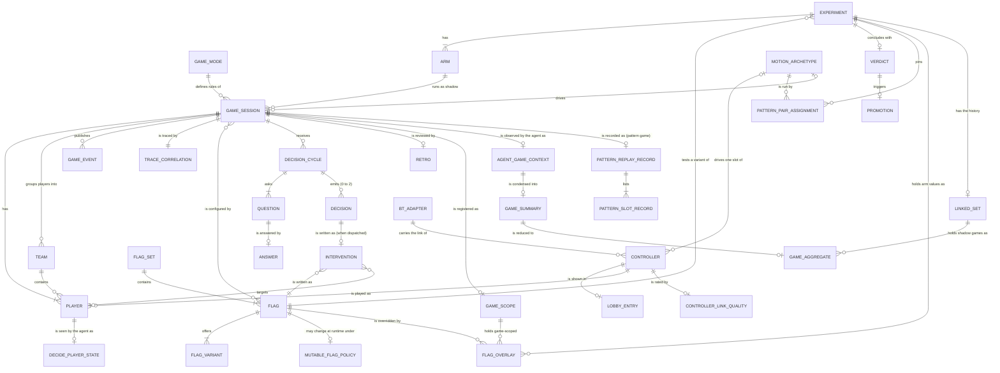

# Entity Model

> AIUP stage 3 of 5: [vision](vision.md) → [requirements](requirements.md) → **entity model** →
> [use cases](use_cases.puml) → [technical specs](specs/). Index: [README.md](README.md).
>
> JoustMania has no database: these entities live in protobuf messages, in-memory service state, flag
> files, flag-service overlays and the agent's experiment journal. This file keeps the ER diagram, one line per
> entity (its meaning and where it is defined) and the invariants that span services. Fields, types and bounds are
> read from the named proto, struct or flag file; the rules about an entity live in the use case named on its line.
> Deliberate deviation from the AIUP entity-model template (no attribute tables, #2796): see
> [architecture/stack.md](architecture/stack.md#mapping-of-the-aiup-3x-core-commands-to-our-skills).

## Entity Relationship Diagram

## Cross-service invariants

Rules that no single use case owns because more than one service relies on them. Everything else about an entity
is a business rule of its use case.

1. **Game kind.** One vocabulary, `real` / `shadow` (#2646), on coordinator spans and metrics, in the flag evaluation
   context, in the flag service's GAME_SCOPE and in the agent. An empty or unknown kind is never `real` (fail closed,
   FR-041); the agent still normalises a legacy `primary` to `real` at ingest ([UC-041](use_cases/UC-041.md) step 5).
2. **Game session state.** A GAME_SESSION is created `STARTING`, becomes `RUNNING` on `game_started` and `ENDED` on
   any game end, force end or error; a failed or cancelled start goes from `STARTING` straight to `ENDED` without a
   `game_ended` event ([UC-010](use_cases/UC-010.md) A7). The proto values `IDLE` (the coordinator's answer when no
   session exists) and `ENDING` are never set on a session, but consumers tolerate `ENDING`: the dashboard keeps such a
   real game on stage ([UC-035](use_cases/UC-035.md)) and the pairing daemon counts it as busy. The per-mode lifecycle
   (`games/base.py` `GameState`, with `ending`) is what the `game.state` span attribute reports.
3. **Primary and shadow games.** Only `GAME_ORIGIN_MENU` claims the primary slot; at most one primary session, at most
   `max_concurrent_games` sessions and `max_shadow_games` shadows; `experiment_id`, `arm` and `rng_seed` are honoured
   only for shadow sessions ([UC-043](use_cases/UC-043.md), [flags.md](specs/flags.md)).
4. **Interventions.** The agent and the game coordinator both check the type against the live `interventions_allowed`
   list; nothing is written unless `enabled` is `act`. Every write is scoped to the game whose decision loop
   decided it and resolves only there (FR-069, FR-136, [UC-053](use_cases/UC-053.md)); its shape is the `kind` of the
   flag's MUTABLE_FLAG_POLICY ([UC-040](use_cases/UC-040.md), [flags.md §13](specs/flags.md#13-mutable-flag-registry)).
5. **Runtime flag values.** A runtime value is a FLAG_OVERLAY in flag-service memory (C-030); no runtime writer changes a
   baseline flag file (C-033). A game-scoped write needs the game's GAME_SCOPE, which the coordinator registers at
   admission (`game_not_live` otherwise); the overlay is dropped with its scope, at its time-to-live or by a restart
   (a `persist` stack value is restored). An experiment's arm value is an `experiment+arm` overlay, resolved only in
   that arm's shadow games ([UC-053](use_cases/UC-053.md), [flags.md](specs/flags.md)).
6. **Trace correlation.** The ids of a game's root, `game.phase.gameplay` and `game.cycle` spans reach the agent, which
   parents its in-game spans on them ([UC-041](use_cases/UC-041.md) BR-004; [telemetry.md](specs/telemetry.md)).
7. **Per-controller data stays in its game.** A serial, a name or another per-controller value of one game is used
   only for that game (its decisions, retro and telemetry) and never kept across games: GAME_AGGREGATE and LINKED_SET
   hold game-level numbers and pattern slots only (C-009, [UC-042](use_cases/UC-042.md) BR-004,
   [UC-046](use_cases/UC-046.md) BR-006).

## Entities

One line each: what it is, where it is defined, and the use case that owns its rules. "In-memory" means lost on a
restart of the owning service.

### CONTROLLER

A physical or mock PS Move controller tracked by the controller manager. Source: `proto/controller_manager.proto` `ControllerState`, `proto/controller_manager_mock.proto` `MockControllerInfo`, `services/controller_manager/name_manager.py`. Rules: [UC-002](use_cases/UC-002.md), [UC-003](use_cases/UC-003.md).

### LOBBY_ENTRY

A controller's state in the menu lobby (CONNECTED, READY, IDLE; a disconnected controller is removed; the ADMIN state is gone with the controller admin mode, #2819). Source: `services/menu/handlers/base.py`, `services/menu/state_manager.py`. Rules: [UC-010](use_cases/UC-010.md) (BR-015, BR-016).

### GAME_MODE

A playable game type. Source: `lib/types.py` `Games`, `services/game_coordinator/game_factory.py` `_GAME_CLASSES`. Rules: [UC-010](use_cases/UC-010.md) BR-001, [UC-011](use_cases/UC-011.md).

### GAME_SESSION

One running or finished game in the game coordinator. Source: `services/game_coordinator/game_session.py`, `proto/game_coordinator.proto` `StartGameConfig`, `GameInfo`, `GameState`. Rules: [UC-010](use_cases/UC-010.md), [UC-020](use_cases/UC-020.md); invariants 1 to 3.

### PLAYER

A controller's participation in one game, with its agent factors, grace windows and shield state. Source: `proto/game_coordinator.proto` `Player`, `PlayerInfo`; `services/game_coordinator/games/base.py`. Rules: [UC-030](use_cases/UC-030.md), [UC-040](use_cases/UC-040.md).

### DECIDE_PLAYER_STATE

A player as the decision backends see it. Source: `services/agent/decide/decide.go` `PlayerState`, `services/agent/decide/danger.go`. Rules: [decide-contract.md](specs/decide-contract.md), [UC-040](use_cases/UC-040.md).

### TEAM

A colour team in team modes; hidden roles are per player, not per team. Source: `services/game_coordinator/games/teams_base.py`, `games/traitor.py` `TraitorPlayer`. Rules: [UC-021](use_cases/UC-021.md), [UC-022](use_cases/UC-022.md).

### GAME_EVENT

An event on a game's event stream. Source: `proto/game_coordinator.proto` `GameEvent`. Rules: [UC-020](use_cases/UC-020.md), [services.md](specs/services.md).

### FLAG_SET

One flag set: its read-only baseline file, served to flagd by the flag service with its runtime overlays. Source: `services/flagd/<set>.json` (`metadata.flagSetId`). Rules: [flags.md](specs/flags.md), [OWNERSHIP_MODEL.md](OWNERSHIP_MODEL.md).

### FLAG

One OpenFeature flag. Source: the flag sets in `services/flagd/`. Rules: [flags.md](specs/flags.md).

### FLAG_VARIANT

A named value of a flag. Source: the flag's `variants` in its flag set. Rules: [flags.md](specs/flags.md).

### MUTABLE_FLAG_POLICY

One row of the flag service's mutable-flag registry: a flag that may change at runtime, its kind, scope and bounds. Source: `services/flag-service/registry.yaml`. Rules: [UC-053](use_cases/UC-053.md), [flags.md §13](specs/flags.md#13-mutable-flag-registry).

### GAME_SCOPE

The flag service's in-memory record of one live game, registered by the coordinator at admission. Source: `services/flag-service/state/games.go`. Rules: [UC-053](use_cases/UC-053.md), NFR-051; invariant 5.

### FLAG_OVERLAY

One runtime value the flag service holds on top of the baseline (in memory, C-030). Source: `services/flag-service/state/`. Rules: [UC-053](use_cases/UC-053.md); invariant 5.

### DECISION_CYCLE

One agent decision cycle for a game, recorded on one `invoke_agent joustmania-agent` span (its natural id); emits 0 to 2 DECISIONs. Source: `services/agent/decision/decision.go`, `decide_hook.go`. Rules: [UC-040](use_cases/UC-040.md), [decide-contract.md](specs/decide-contract.md).

### DECISION

One decision of a cycle, recorded on its own `agent.decision` span. Source: `services/agent/decision/decision.go` `runDecision`, `decision/effect.go`. Rules: [UC-040](use_cases/UC-040.md).

### QUESTION

A question in a decide request. Source: `services/agent/decide/decide.go`, `decide/ffa.go`. Rules: [decide-contract.md](specs/decide-contract.md).

### ANSWER

A backend's answer to one question. Source: `services/agent/decide/decide.go`, `decide/validate.go`. Rules: [decide-contract.md](specs/decide-contract.md).

### INTERVENTION

A bounded in-game change the agent writes for one game through the flag service and the coordinator applies. Source: `services/agent/actions/writer.go`, `services/game_coordinator/interventions.py`. Rules: [UC-040](use_cases/UC-040.md), [flags.md](specs/flags.md); invariant 4.

### EXPERIMENT

A hypothesis about one `game` flag value, tested in shadow games; the dossier (`/experiments`) is a read-only view of it. Source: `services/agent/experiment/registry.go`, journal `services/agent/experiment/journal/`. Rules: [UC-043](use_cases/UC-043.md) (status lifecycle BR-011), [UC-046](use_cases/UC-046.md).

### ARM

One treatment of an experiment (`experimental`, `control`) with its running fitness. Source: `services/agent/experiment/registry.go`. Rules: [UC-043](use_cases/UC-043.md).

### VERDICT

The conclusion of an experiment. Source: `services/agent/experiment/verdict.go`, `journal.Verdict`. Rules: [UC-043](use_cases/UC-043.md) step 5, FR-063. The journal records a verdict's outcome, delta, significance flag and reason; it does not store the effect size.

### PROMOTION

What happens to a promote verdict. Source: `services/agent/promote/promote.go`, `journal.Promotion`. Rules: [UC-043](use_cases/UC-043.md).

### RETRO

A post-game retrospective, at most one per game. Source: `services/agent/decision/retro_capture.go`, `services/agent/llm/retro.go`. Rules: [UC-042](use_cases/UC-042.md).

### MOTION_ARCHETYPE

A named parameter object that defines the motion of every player of a pattern game; one object variant of `experiment.mock_archetype`. Source: `services/flagd/agent.json`, `services/agent/patterngame/`. Rules: [UC-046](use_cases/UC-046.md) BR-002, BR-003, BR-018.

### PATTERN_PAIR_ASSIGNMENT

The archetype one pair of an experiment runs, pinned in the journal (`pattern_pinned`), with its rerun counters. Source: `services/agent/experiment/registry_pattern.go`. Rules: [UC-046](use_cases/UC-046.md) BR-006, BR-015.

### TRACE_CORRELATION

The ids that tie a game's telemetry together. Source: the trace context of the agent-only `game.start` / `game.phase.start` log records, the agent's only source since #2783 retired the `game_trace_correlation` gauge (FR-253). Rules: [UC-041](use_cases/UC-041.md) BR-004; invariant 6.

### AGENT_GAME_CONTEXT

The agent's in-memory view of one game, built from forwarded OTLP signals, one per `game_id` plus one shared fallback context. Source: `services/agent/gamecontext/` (`model.go` `GameContext`, `multiplexer.go`). Rules: [UC-041](use_cases/UC-041.md).

### GAME_SUMMARY

The in-memory narrative of one finished game, built once at game end. Source: `services/agent/gamesummary/summary.go`. Rules: [UC-042](use_cases/UC-042.md); invariant 7.

### GAME_AGGREGATE

One finished game as the cross-game window keeps it: game-level numbers only. Source: `services/agent/gamewindow/window.go` `GameAggregate`. Rules: [UC-042](use_cases/UC-042.md) BR-004, BR-005; invariant 7.

### LINKED_SET

The in-memory shadow history of one experiment. Source: `services/agent/gamewindow/` `LinkedSet`. Rules: [UC-042](use_cases/UC-042.md) BR-005, BR-006.

### PATTERN_REPLAY_RECORD

The replay record of one finished pattern game, journalled as `pattern_game_ended`. Source: `services/agent/patterngame/tracker.go` `Record`. Rules: [UC-046](use_cases/UC-046.md) BR-008, BR-013, BR-014.

### PATTERN_SLOT_RECORD

One controller's replay record in a pattern game, keyed by slot. Source: `services/agent/patterngame/` `SlotRecord`. Rules: [UC-046](use_cases/UC-046.md) BR-008, BR-014.

### CONTROLLER_LINK_QUALITY

A controller's connection quality from the gaps between fresh frames over a rolling 10 s window (in-memory). Source: `services/controller_manager/connection_quality.py`. Rules: [UC-035](use_cases/UC-035.md) BR-005, FR-122.

### BT_ADAPTER

One local Bluetooth adapter as the pairing daemon reads it each poll. Source: `services/pairing_daemon/psmove_pairing/adapter_identity.py` (`pairing_bluetooth_adapter_info`). Rules: FR-122, [telemetry.md](specs/telemetry.md).
