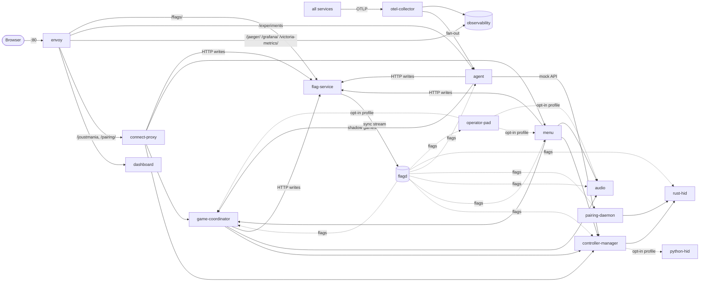

# Services

> Technical spec. Part of the [spec tree](../README.md).
> RPC tables are **generated from `proto/*.proto`**; regenerate them when a `.proto` changes (and remember the
> forwarding method in `services/connect-proxy/main.go` for browser-reachable RPCs).
> **References.** Write a code reference as a full repo path: `path/file.go:Symbol` (survives edits) or `path/file.go:123` (allowed, but it drifts and a growing count warns in CI). `make spec-refs-check` fails on a missing file, an out-of-range line, a missing symbol or a path that is not a full repo path (#1280). <!-- spec-refs: ignore -->

## 1. Topology



Dependencies (start-up, from `depends_on` and code): audio, python-hid, rust-hid and flagd have no application
dependencies; the controller manager waits for flagd and rust-hid to be healthy and for python-hid only when the `python-hid` profile is active (compose
`depends_on`, `required: false`, #1371) and talks to both HID adapters over gRPC; the game coordinator calls the controller manager and
audio, and the menu calls the controller manager, the game coordinator and audio (code only: in compose the
coordinator and the menu wait only for flagd); flagd waits for the flag service to be healthy and restarts with it; no game service depends on an observability service (Jaeger, VictoriaMetrics, Grafana, the collector), and the collector itself has no `depends_on` on its backends: it starts at once and its exporters queue and retry (UC-060 BR-004, FR-181); every service in `docker-compose.yml` and `docker-compose.lite.yml` has a restart policy and a json-file log limit (10 MB x 3); the agent depends only on flagd, and it and rust-hid wait in the background for flagd's first sync rather than at start ([flags.md §1.1](flags.md#11-clients), #1713)
(and calls the game coordinator and the mock control API to run shadow games, the named exception in C-005).

## 2. Service catalog

| Service (compose name) | Language | Port(s) | Host-published | Responsibility | Source |
|---|---|---|---|---|---|
| controller-manager | Python | 50052 gRPC; 50062 mock control API (mock adapter only) | 50052, `127.0.0.1:50062` (loopback only) via `docker-compose.override.yml` | Discover controllers, route each to one HID adapter, stream buttons and motion, apply LEDs / rumble / effects, names | `services/controller_manager/` |
| python-hid | Python | 50059 gRPC | no | HID access via hidapi: ControllerIOService only. Opt-in: starts only under the `python-hid` compose profile (UC-002 BR-003, #1371); the `StreamIO` input side holds at most one waiting sample per controller per stream (`InputSlot`): newest wins with the button bits of the replaced samples and of every report in a drain kept, the controllers are served round robin, and a new stream skips the reports queued before it registered, as in rust-hid (UC-002 step 2, UC-010 BR-012, #2503; it was a 1024-sample drop-oldest queue, up to about 1 s stale under a lagging reader) | `services/python_hid/` |
| rust-hid | Rust | 50058 gRPC | `127.0.0.1:50058` (for the host-networked pairing daemon, #1319; full and lite stack) | HID access: PairingService + ControllerIOService. The default Bluetooth backend; in the full and the lite stack (UC-002 BR-003); LED / rumble go out through one writer thread per controller, coalesced and capped by `rust_hid.output_rate_hz`, and pairing hidapi calls run off the gRPC workers; a queued Discover or Open whose caller already gave up (reply channel closed) is skipped, not run (UC-002 BR-005, NFR-055, #2140); the `StreamIO` input side holds at most one waiting sample per controller, newest wins with the button bits kept, and a new stream starts after a flush of the queued reports (UC-002 A7, UC-010 BR-012, #2372); behind that slot the only buffer is the controller manager's fixed 512-byte HTTP/2 receive window, so a lagging reader gets samples under 100 ms old (median, NFR-056); compose limit `cpus: 1.0`; a watchdog thread exits the process (code 70) when the server fails 5 health probes in a row or the device loop stalls for 15 s, so the restart policy restarts it (UC-002 A7, NFR-054), after flushing logs and traces (at most 1 s); on SIGTERM / SIGINT it sends LED off and rumble 0 to every open controller (waiting at most 2 s), flushes OTLP and exits 0; a serial entering through Open, Close, Discover `exclude_serials` or a StreamIO command is normalized first, so one controller has one key; while a `StreamIO` call is open, Discover `force` has no effect (the device loop's poll already finds dead controllers; the pass logs it at debug) and `verify_only` is honoured (it opens nothing), as the `psmove_hid.proto` comments say (#2374); if the trace exporter cannot be built it still logs to stdout (#2373) | `services/rust-hid/` |
| pairing-daemon | Python | 8002 `/healthz`, `POST /controllers/{address}/unpair` (host network, bound to `CONTROL_BIND`) | host network | USB pairing loop, Bluetooth monitor (RSSI metrics), unpair a controller (UC-005) | `services/pairing_daemon/` |
| game-coordinator | Python | 50053 gRPC (metrics are pushed over OTLP) | 50053 via override | Game sessions (primary + shadow), game modes, death detection, events, interventions consumer | `services/game_coordinator/` |
| menu | Python | 50054 gRPC | 50054 via override | Lobby, ready state, mode selection; the operator pad commands (§3.1, #2050; the controller admin mode is gone since #2819) write the `game` / `user` settings and `agent.interventions_allowed` to the flag service as persisted admin values, and `agent.enabled` (in memory), `agent.decision.backend` and `user.audio_volume.master` | `services/menu/` |
| audio | Python | 50056 gRPC | 50056 via override | Music with tempo (separate process, soxr), 8 effect channels (miniaudio), ALSA | `services/audio/` |
| agent | Go | 4317 OTLP gRPC (receiver); 13134 HTTP `/healthz`, `/experiments`, `/experiments/state` | no | Observe via OTLP, decide, write interventions / experiment arms / promotions through the flag service, run experiments and promotion | `services/agent/` |
| operator-pad | Python | none (a gRPC client of the menu, the game coordinator and the audio service) | no | **In Progress (#2050):** code in `services/operator_pad/` (PR6), image `operator-pad` and compose profile (PR7); the Pi hardware check is PR8. Optional, `operator-pad` compose profile only (full stack; the lite stack has no pad), not privileged: a read-only bind mount of `/dev/input` (it protects the directory only, no mknod or unlink; the device nodes stay readable and writable through it, which the grab and the keyboard LEDs need), for the display of UC-016 the host's `/dev` bound read-only and not recursively at `/run/host-dev` (§3.1), the cgroup rule `c 13:* rw` (evdev nodes, also ones plugged in later) and, only through `docker-compose.operator-pad-hidraw.yml` with a known major, `c ${HIDRAW_MAJOR}:* rw` (hidraw, §3.1), `group_add` with the host's input GID (`INPUT_GID`, default 996, the stage Pi; host identity under C-035), no `/run/udev`; waits only for flagd. Reads a USB macro pad through evdev (exclusive grab, hotplug), turns key gestures into menu commands and force-end (UC-015); writes no flag itself. Its removal leaves every other service unchanged (FR-195) | `services/operator_pad/` |
| connect-proxy | Go | 8080 HTTP | no | Connect (browser) ↔ gRPC bridge | `services/connect-proxy/` |
| dashboard | TypeScript | 8080 HTTP (static-web-server) | no | SPA: controllers, Agent, Experiments, Metrics, Traces tabs; follows the newest live shadow game when no real game is live (`ListGames`, `GetGameState`, `StreamGameEvents(game_id)`; UC-070 BR-005); mode selector from the menu's `ListGameModes` (UC-011 BR-002); reads VictoriaMetrics through envoy for the Agent tab's intervention counts, the stage settings strip's gauges (UC-035 BR-010) and, every 10 s, `controller_adapter_info` for the adapter on each controller card (UC-035 BR-009); reads the Agent tab's decide feed, goal and prediction strips and flag panel and the Experiments tab from the agent's read-only `GET /experiments/state` through envoy (#2809; §5); every row links its trace in Jaeger; opened as `/?view=stage` it shows only the full-screen stage view for the talk (UC-035 A8, BR-017: per-player acceleration, thresholds, outs and the agent's applied decisions with their rationale, from VictoriaMetrics and Jaeger, polled every second; `&replay=<url>` plays a recorded stage snapshot, `&record` saves one); opened as `/?latest=summary`, `/?latest=retro` or `/?latest=decide` it does not start but replaces itself with the Jaeger UI view of the newest `agent.game.summary`, `agent.llm.retro` or `invoke_agent joustmania-agent` span (`/jaeger/trace/<trace>?uiFind=<span>`, one v3 search of the newest 5 traces; the Jaeger search page for that operation when none is found or Jaeger is unreachable), the talk slides' deep link (#2717); calls `GetMenuStatus` for the stage settings strip (UC-035 BR-010), `StreamGameplayData`, `IdentifyController`, `ForceEndGame` and `ProcessInput` through connect-proxy | `services/dashboard/` |
| envoy | config | 80 HTTP; 9901 admin | **80** | Single entry point / reverse proxy | `services/envoy/envoy.yaml` |
| flagd | binary v0.18.1 | 8013 RPC eval (tests and tools only, #1713), 8014 mgmt, 8015 sync (every service client), 8016 OFREP | `127.0.0.1:8015` (8013 via override) | Evaluate flags; its only source is the flag service's gRPC sync stream (no flag file mounted) | `docker-compose.yml` (`flagd`) |
| flag-service | Go | 50064 gRPC sync (flagd only), 8070 HTTP API | 8070 via override; `/flags/` through envoy | Runtime flag state in memory over the read-only baseline files; the only writer path for runtime flags (§7) | `services/flag-service/` |
| otel-collector | custom contrib build | 4317 / 4318 OTLP | `127.0.0.1:4317` | Receive OTLP + host metrics; export to Jaeger, VictoriaMetrics, agent (OTLP logs end in the debug exporter, no log store, #2059; only moment log events also go to the agent, FR-218) (the :8889 Prometheus exporter was removed in #1449). Opt-in (`docker-compose.gateway.yml`, #2571): also OTLP/HTTP to the gateway, outbound to port 443 only, no new published port (UC-035 A7) | `services/otel-collector/config.yaml`, `services/otel-collector/config.gateway.yaml` |
| jaeger | 2.22.0 | 16686 UI, 4317 / 4318 OTLP | no | Trace store (badger, bounded TTL; 1 GiB container limit, Go soft limit `GOMEMLIMIT=850MiB`, #2223); repo readers use the query API v3 `/jaeger/api/v3` ([telemetry.md](telemetry.md) §6.1, #2283), Grafana's Jaeger datasource serves trace links only, no dashboard panel searches Jaeger (#2311) | `services/jaeger/config.yaml`, `docker-compose.yml` |
| victoria-metrics | v1.155.0 | 8428 | no | The only metric store (remote write, 7 d); serves the Prometheus query API to Grafana, the dashboard and the tools. The Prometheus container was removed in #1449 | `docker-compose.yml:516-544` |
| grafana | 13.3.0 | 3000 | no | Dashboards | `services/grafana/` |

**Listen-port overrides (#1524).** The Python gRPC services read their listen port from the environment, so the
service tier (`tests/service/`, T2) can run several of them from source on ephemeral ports. Compose sets none of
these, so every stack keeps the ports in the table above. An unset or empty variable means the default; a value
that is not a TCP port (1-65535) fails the start, naming the variable (`lib/grpc_utils.py` `port_from_env`).
The Python gRPC servers bind without `SO_REUSEPORT` (`get_server_options`, `grpc.so_reuseport=0`): a second
server on a taken port fails its start instead of sharing the port. Compose runs one server per port, so
deployed stacks are unchanged.

| Variable | Service | Default |
|---|---|---|
| `GRPC_PORT` | controller-manager | 50052 |
| `GRPC_PORT` | game-coordinator | 50053 |
| `GRPC_PORT` | menu | 50054 |
| `MOCK_CONTROL_PORT` | controller-manager (mock adapter only) | 50062 |

### Compose variants and host ports

Every `docker-compose*.yml` at the repository root, what it adds and which command loads it. The compose network is
`joustmania-network` (compose name `joustmania`); every container has a fixed `container_name` (`joustmania-<service>`), so a
service cannot be scaled with `--scale`.

| File | Kind | Adds or changes | Loaded by |
|---|---|---|---|
| `docker-compose.yml` | Base (full stack) | Every service of section 2; real hardware through rust-hid; the `python-hid` service only under the `python-hid` profile and the `operator-pad` service only under the `operator-pad` profile; loopback host ports below | Always (`-f`); the Pi runs it alone through `scripts/setup/joustmania-compose.sh` |
| `docker-compose.override.yml` | Dev and test ports | Publishes flagd 8013, flag-service `127.0.0.1:8070`, controller-manager 50052 and `127.0.0.1:50062` (mock control API, loopback only, #1628), game-coordinator 50053, menu 50054, audio 50056. Auto-loaded by a bare `docker compose`; the Pi path names `-f docker-compose.yml` so it never loads it (#1319) | Bare `docker compose`, `make dev`, `make dry-run`, the integration suite |
| `docker-compose.dev.yml` | Hot reload | Volume-mounts Python service source and `lib/`, `pull_policy: build` for flag-service, `pull_policy` for the collector (`COLLECTOR_PULL_POLICY`, default `always`); rust-hid source mounted read-only for reference (no hot reload) | `make dev`; the integration suite with `USE_DEV_MOUNTS=true` (`make test-dev`) |
| `docker-compose.ci.yml` | No hardware | Audio without devices (`play_audio=off`), CI flag baseline `services/flagd/ci/` (`backend=mock`). Moves pairing-daemon, rust-hid and python-hid to the `hardware` profile, the agent to `agent`, and connect-proxy, dashboard and envoy to `dashboard`, so none of them starts without that profile. Needs Compose 2.24+ (`!reset`) | `make up-mock` (with the base alone, no override), `make dry-run`, the integration suite |
| `docker-compose.dry-run.yml` | Demo and experiments | On top of ci: the experiment cohort loop's agent, its own flag-service state file (the seed and both gates come from `scripts/agent-dryrun-enable.sh on`, #1907), the agent in the `agent` profile | `make dry-run` (also `IMAGE_TAG=latest`, profiles `agent` and `dashboard`) |
| `docker-compose.gateway.yml` | Gateway export (opt-in, #2571) | The collector only: command with a second `--config` (`services/otel-collector/config.gateway.yaml`), that file mounted read-only, and the required variables `ORANGECASE_GATEWAY_HOST` and `ORANGECASE_GATEWAY_TOKEN` (compose refuses the file without them; secrets stay in the environment, C-016). No port, no other service (UC-035 A7, BR-015) | By hand, on top of `docker-compose.yml`: `docker compose -f docker-compose.yml -f docker-compose.gateway.yml up -d otel-collector`. On the Pi `scripts/setup/joustmania-compose.sh` adds it to every compose call, the autostart included, when both variables are set (UC-035 BR-015, #2622). Never by a `make` target |
| `docker-compose.lite.yml` | Standalone Pi stack | Its own project file, not an overlay: no observability (no Jaeger, VictoriaMetrics, Grafana, collector) and no agent, about 2.7 GB less memory limit (Jaeger 1024m, collector 768m, VictoriaMetrics 256m, Grafana 512m, agent 128m); still flag-service, flagd, controller-manager, rust-hid, pairing-daemon (host network, as in the full stack), game-coordinator, menu, audio, connect-proxy, dashboard, envoy (UC-002 BR-003, #1318, #1402) | `docker compose -f docker-compose.lite.yml up -d` |

Profiles merge across files: an overlay's `profiles` list is added to the base one, never replaced (python-hid keeps `python-hid` and
gains `hardware` under the CI overlay). With no profile active, the base file starts everything except python-hid and operator-pad.

**Host ports are loopback-only unless they must be reachable (#1319).** In the production path (`docker-compose.yml` alone, or lite) the only
port reachable from the venue network is envoy's **80**. Three ports are published on `127.0.0.1` only, because the host-networked
pairing daemon (raw HCI, no Docker DNS) reaches them there and nobody on the venue network may read the flag config or inject telemetry:

| Host binding | Service | Why loopback |
|---|---|---|
| `127.0.0.1:8015` | flagd sync | Flag configuration must not be readable from the venue network |
| `127.0.0.1:4317` | otel-collector OTLP gRPC | The agent observes games through this telemetry; no spans or metrics may be injected from outside (full stack only) |
| `127.0.0.1:50058` | rust-hid | Pairing daemon reaches it as `RUST_HID_HOST=127.0.0.1`, so a second binding in an overlay would expose it |

Outside the Pi path, `docker-compose.override.yml` adds the dev and test bindings listed above (the gRPC ports and flagd 8013 on all interfaces,
flag-service 8070 on loopback). Every other service is reachable only on
`joustmania-network`, or through envoy's routes. Do not add a host port to the base file without a loopback bind and a reason in this table.

**Traceability:** C-014, C-015, FR-085, NFR-020 / UC-035 / `docker-compose*.yml`, `services/envoy/envoy.yaml`, `services/*/server.py` / `tests/integration/conftest.py`, `tests/service/harness/stack.py`.

## 3. gRPC services

The RPC tables (service, kind, request and response, the `proto/*.proto` line, and the RPC count) are generated by
`make specs` (`scripts/gen_specs.py`) into **[generated/grpc-rpcs.md](generated/grpc-rpcs.md)**; do not hand-edit
them. A new or changed RPC needs its description in [notes/grpc-rpcs.yaml](notes/grpc-rpcs.yaml), keyed by
`<package>.<Service>/<Rpc>` (the generator fails without one).

### `controller_manager_mock.MockControllerService`: pattern-game changes

Pattern games (#1258, [UC-046](../use_cases/UC-046.md), PR #1308). The proto change needs
`make protos` and `make protos-agent` (committed Go stubs in `services/agent/gen`); the mock proto's `go_package`
is the connect-proxy gen, so the `Build connect-proxy` CI job must compile it, but no forwarding method is needed
because connect-proxy forwards no `MockControllerService` RPC. The controller manager never reads flagd for
archetypes: the agent resolves and pins the parameters and passes them in `AddControllers`.

| Change | Kind | Fields | Behaviour | Status |
|---|---|---|---|---|
| `AddControllersRequest.archetype`, `.archetype_params` | new fields 4 (string), 5 (string, JSON object) | archetype name; its parameter object as JSON; empty = no pattern (random resting motion, only for mock controllers outside experiments) | Validates the parameters (UC-046 BR-003), requires `count` = `players`, installs slot i on the i-th returned serial, pins the gameplay stream of these controllers to `stream_rate_hz`, and refuses `SimulateMovement` / `SimulateDeath` for them | Implemented (#1258, FR-100, FR-102, FR-103, FR-104) |
| `AddControllersResponse` | new fields 4 to 6 | `archetype`, `stream_rate_hz`, `players` | Echo of the installed archetype; `success=false` with the failed rules when the parameters are invalid | Implemented (#1258) |
| `RemoveControllerResponse` | new fields 3 to 8 | `pattern_slot`, `frames_delivered` (uint64), `signal_hash` (fixed64), `frame_overruns` (uint32), `signal_checkpoints` (repeated string), `archetype` | For a pattern controller: the replay record of UC-046 step 8 (definitions in [telemetry.md §9](telemetry.md#9-pattern-games-1258)); `archetype` is empty for other controllers | Implemented (#1258, FR-108, FR-109) |

### `controller_manager_mock.MockControllerService`: `SetAutoGameEnd` removed

`SetAutoGameEnd` and its `AutoGameEndRequest` / `AutoGameEndResponse` messages were deleted in #1623 (UC-003 A1 retired, D-C8): the scripted kill hit every mock controller except the last-added one, including reserved shadow-game controllers. Games on mock controllers end through `SimulateDeath` (UC-003 step 4) or organic deaths (UC-046 BR-004). Regenerated with `make protos` and `make protos-agent`; connect-proxy forwards no `MockControllerService` RPC, and the dashboard has no mock client. The remaining RPCs are listed in [generated/grpc-rpcs.md](generated/grpc-rpcs.md) and described in [UC-003](../use_cases/UC-003.md).

### `controller_manager_mock.MockControllerService`: `SetColor` and singular `AddController` removed

`SetColor` (with `ColorRequest` / `ColorResponse`) and the singular `AddController` (with `AddControllerRequest` / `AddControllerResponse`) were deleted in #1322 (UC-003 A5 retired): nothing called either. A test sets an LED colour through the adapter, and `AddControllers` (`count=1`, with `reserved` / `tag`) replaces the singular call. The `reserved` / `tag` semantics now live on `AddControllersRequest`. Regenerated with `make protos` and `make protos-agent`; connect-proxy forwards no `MockControllerService` RPC and the dashboard has no mock client.

The agent's OTLP receiver implements the standard `opentelemetry.proto.collector.{trace,metrics,logs}.v1` Export
services (`services/agent/receiver.go`); they are not JoustMania protos.

### Browser-reachable RPCs (connect-proxy)

Four of the six `ControllerManagerService` RPCs (`RenameController`, `GetConnectedControllers`, `IdentifyController` and the proxy-only `WatchGameplayData`), all four `GameCoordinatorService` RPCs and all six `MenuService`
RPCs (`GetMenuStatus`, §3.1, included) are forwarded under `/joustmania` (`services/connect-proxy/main.go`, the `ControllerManagerProxy`, `GameCoordinatorProxy` and `MenuProxy` methods). Audio, HID, pairing and mock
RPCs are not.

Wire format from the dashboard (`services/dashboard/src/client.ts`, `connect.ts`): unary calls are a plain
`application/json` POST. Server streams (`StreamGameEvents`) are `application/connect+json` with the request in
one 5-byte Connect envelope; the response is a sequence of envelopes ending in an end-stream frame whose
`error` the dashboard raises (a plain `application/json` POST to a stream gets 415, #1542). Browser-facing RPCs are unary or server-streaming only (#1543): the proxy owns any bidi gRPC stream to the backend internally.
`StreamGameplayData` and `StreamButtonEvents` are not forwarded and answer `unimplemented` (envoy talks HTTP/1.1 to
connect-proxy, where connect-go refuses bidi calls anyway). The dashboard's controller grid reads the server stream `WatchGameplayData` (#1595): it posts one `GameplayStreamConfig` (`{updateFrequencyHz: 30}`);
connect-proxy builds its own config from it, keeping only the rate (missing or 0 and below = 30 Hz, capped at 30 Hz) and never the browser's
colours, so the upstream is always the unfiltered observer stream with connection quality (UC-035 BR-005,
BR-006). It opens a `StreamGameplayData` stream to the controller manager with that config as its first control
message, relays every
`GameplayDataUpdate`, and cancels the upstream stream when the browser disconnects. An upstream error or end ends the
browser stream (error in the end-stream frame); the dashboard retries after 2 s. The controller manager does not
implement `WatchGameplayData` itself (UNIMPLEMENTED).

**Start config from the browser (#2214, UC-010 BR-011):** a `StreamGameEvents` request with a `start_config` is forwarded with `rng_seed`, `experiment_id`, `arm` and `pattern_trigger_policy` cleared (the shadow-only fields, `proto/game_coordinator.proto`); everything else is unchanged. `StartGameConfig` only travels in `StreamEventsRequest.start_config`; there is no unary `StartGame` RPC. The agent starts its shadow games over gRPC directly and is not affected.

**Error mapping (#1560):** a backend gRPC error reaches the browser as the Connect error with the same code (the two code sets are identical: `Unavailable` stays `unavailable`, `NotFound` stays `not_found`, `FailedPrecondition` stays `failed_precondition`, and so on), carrying the backend status message without the `rpc error: code = ...` prefix. This holds for every unary forwarder and for the `StreamGameEvents`, `StreamMenuEvents` and `WatchGameplayData` streams (the code travels in the end-stream frame). An error without a gRPC status (for example a failed local call) stays `internal`; a browser disconnect stays `canceled`. The dashboard branches on no Connect code, it only shows `code: message` (`connect.ts`), so it needs no change. Implemented by `toConnectError` in `services/connect-proxy/main.go`.

**Traceability:** C-014 / UC-002, UC-003, UC-004, UC-010, UC-027, UC-031 / `proto/*.proto`, `services/connect-proxy/main.go`, `services/dashboard/src/connect.ts`, `services/dashboard/src/client.ts` / `tests/integration/`, `services/connect-proxy/forwarding_test.go`, `services/connect-proxy/watch_gameplay_test.go`, `services/dashboard/src/__tests__/connect.test.ts`.

### 3.1 Operator pad commands and `GetMenuStatus` (#2050, #2741)

Spec for [UC-015](../use_cases/UC-015.md). The `ProcessInput` commands (#2050 PR3; `preview_setting` #2106) and `GetMenuStatus` with `lifecycle_generation` and the `force_start` `stale` check (#2050 PR4) are implemented; the pad service that calls them is in `services/operator_pad/` (#2050 PR6) and deploys under the `operator-pad` compose profile (#2050 PR7). `GetMenuStatus` is in the generated tables ([generated/grpc-rpcs.md](generated/grpc-rpcs.md), notes in [notes/grpc-rpcs.yaml](notes/grpc-rpcs.yaml)).

**The pad's display ([UC-016](../use_cases/UC-016.md), #2741; Implemented, the check on the Pi 5 pending).** No new RPC; one new response field (`ProcessInputResponse.value`, below) and one new `step_setting` `data` key (`cue`, below): the display reuses `GetMenuStatus`, polled every `operator_pad.display_poll_ms` (default 500 ms) while the display link is up (UC-016 BR-003), and the key presses and releases read it as before. The menu's background read of the operator values behind `operator_settings` runs at most once per 2 s whatever the poll rate, also while a value is unknown (three flag-service reads per refresh), so the poll adds `GetMenuStatus` calls only. The pad service (`services/operator_pad/display.py`, `hidraw.py`, `screens.py`) opens the pad's raw HID node read-write: the pad has three hidraw nodes, and the service takes the one of the device `operator_pad.device` matches (`HID_ID` in `/sys/class/hidraw/hidrawN/device/uevent`, PS Move ids never) whose report descriptor declares usage page `0xFF60`, found again at every rescan (every 2 s, so a new `hidrawN` after a firmware reset is picked up), never a fixed `/dev/hidrawN`. It answers the hello with protocol version 1 or later (a later version keeps the v1 ops; the service draws the v1 screens and keeps the version it read); version 0, no reply within 250 ms, an error reply or the VIA "unhandled" answer leave the link down (UC-016 A1). All hidraw I/O runs on one worker thread of its own, never on the event loop, so a write stuck in the kernel never delays a key; the link counts as up while a show was acknowledged within the last 1.5 s (a show alone goes out every second), which is what silences the volume step sound and the pad's own voice lines (UC-016 BR-004, BR-005). Every opener of the node gets every report, so replies that are not the service's are skipped; with the Vial app open on the same host the link may drop and come back. One screen per service: with two pads attached the first raw node gets it. Compose: the host's `/dev` is bound read-only and not recursively at `/run/host-dev` (the devtmpfs only, without `/dev/shm`, `/dev/pts` or `/dev/mqueue`; the `bind.recursive` key needs Compose v2.24+, docs/DEVELOPMENT.md), and a second cgroup rule `c ${HIDRAW_MAJOR}:* rw` allows the hidraw major, which is dynamic. That rule is not in `docker-compose.yml` but in the overlay `docker-compose.operator-pad-hidraw.yml` (no fallback: compose refuses to render it without `HIDRAW_MAJOR`, since a wrong major grants other devices), which `scripts/setup/joustmania-compose.sh` adds, exporting `HIDRAW_MAJOR`, only when it knows the major: the host's `/proc/devices`, else a configured value that is a plain number other than 13 (flags.md §15.2). Without the overlay (a bare `docker compose`, a host without a hidraw driver) the pad runs with the display link down (UC-016 A1). The major is fixed when the container is created. The udev rule `scripts/setup/99-joustmania-operator-pad.rules` (installed by `scripts/setup/setup_runtime.sh`; a Pi set up before #2741 runs that step once) gives the `input` group, which the container joins (`INPUT_GID`), the pad's hidraw nodes only (`cb00:1337`); every other hidraw node stays root-only. Still unprivileged. The firmware lives in `orange-case/operator-pad`: the Vial keymap `firmware/`, built for the rev 5 pad (RP2040) with the repository's own keyboard definition `keyboard/` (`orange_case/operator_pad`, a `.uf2`), and for revisions 1 to 4 (ATmega32U4) as `0xcb/1337`.

**`MenuService.ProcessInput` `web_command` additions** (`data` keys; no new RPC, so they are forwarded by the existing `MenuProxy`). Their core is `services/menu/settings_ops.py`; they use no controller serial: no LED pulse on a caller's controller, no roster entry for the caller.

| `web_command` | `data` | Effect | Errors |
|---|---|---|---|
| `force_start` | `expected_generation` (optional int; empty or missing = no check) | force-start as UC-014 steps 3 to 5 with the live roster. The generation is compared before anything changes and again after the roster lookup (a game that started and ended during the lookup is `stale`) | `game_active`, `stale` |
| `step_setting` | `option` (`current_game`, `sensitivity`, `num_teams`, `game_instructions`, `force_all_start`, `audio_volume.master`, `agent_level`, `shield.activation`), `direction` (`up` / `down`), `steps` (int, default 1), `cue` (optional, UC-016 BR-004: `none` skips only the volume step sound of an `audio_volume.master` step, a mute or unmute included; `cue` with any other option, or with a value other than `none`, answers `bad_option`; a menu older than the key ignores it and the sound plays) | step the option by `steps` along its ladder, one write, wrapping or clamped as the option table below says (a wrapping option's no-op answers `success=true`, error `ok`, `value` the unchanged value; the pad sends no step for it when it read the start, UC-016 BR-007; with no operator value the `shield.activation` knob starts at `automatic`, UC-015 BR-018); `sensitivity`, `num_teams` and `shield.activation` step the operator value along automatic followed by their values (`lib/setting_ladders.py` `KNOB_LADDERS`; shield: automatic, instant, trigger, hold): a value is written to `game` persisted, `automatic` clears the persisted value (`DELETE ?persist=true`), so the flag file default or an agent promotion applies again; the commit is shown on every lobby controller (shield: a mode pulse, `automatic` of any setting: a double white flash and the one "Automatic" voice line; UC-015 BR-018, #2215, #2222). `force_all_start`, `game_instructions` and `audio_volume.master` have no `automatic` rung | `game_active` (lobby-only options), `at_limit` (clamped options only), `bad_option`, `flag_service_unavailable`; `ok` with `success=true` = the no-op of a wrapping option |
| `agent_switch` | `direction` (`stop` / `resume`) | the kill (`interventions_allowed`, `enabled`) and resume (`interventions_allowed` when `none`, `interventions_enabled`, `enabled`, in that order) of UC-015 BR-002, BR-003: reply `ok`, `partial:<key>` or `failed` in `error` | `partial:<key>`, `failed`, `bad_option` |
| `set_backend` | `backend` (`rules`, `claude`, `jev`) | write `decision.backend` persisted | `bad_option`, `flag_service_unavailable` |
| `preview_setting` | `option` (`current_game`, `shield.activation`, or `sensitivity` / `num_teams` with `mode` `automatic` only), `mode` (a `Games` name on the mode ladder, or a shield knob rung `automatic` / `instant` / `trigger` / `hold`) | the K1, K6 and (`automatic` rung only, double white flash, #2245) K2 / K5 live preview (UC-015 BR-017, #2106, #2215): pulse the mode's colour on every lobby controller (`show_mode_on_lobby`, BR-015; `show_shield_mode_on_lobby`, BR-018); writes nothing, selects nothing, plays no voice and no failure cue | `game_active`, `bad_option` |

Error codes (a refusal is `success=false` and the code in `error`; no state changes unless the code says `partial:<key>`): `game_active` (the menu's game lifecycle is live, the same check as the start guard of UC-010 A8; the web `start_game` and the `ProcessInput` trigger refused by that guard answer it too, #2176), `at_limit` (the option is at the end of its range; clamped options only), `flag_service_unavailable` (the writer failed closed, UC-053 A7, A8; never retried), `partial:<key>` (a kill wrote one key and failed the other; `<key>` is the failed one), `failed` (a kill's two writes both failed; every other failed write is `flag_service_unavailable`, except a `current_game` step whose persisted write fails: it succeeds, since the selection holds in menu memory and only its survival across a restart is lost, UC-015 A3), `stale` (`expected_generation` differs from the current `lifecycle_generation`, or is not an integer), `bad_option` (unknown option, direction or backend, or a `cue` the option does not take). Writers: `enabled` through a writer that sends no `persist` field, `interventions_allowed`, `decision.backend` and the admin settings with `persist` (UC-015 BR-001).

**Settings option table (#2801).** The one table of the settings a host steps, for every input surface: the pad's `step_setting` (and `set_backend`), lobby SELECT, the `ProcessInput` `button_press` `select` and the web `select_game`. Each surface maps onto the option's row: the same ladder, the same end rule and the same feedback; only the event's `source` names the surface (and the web `select_game` also publishes `game_selection_changed`). The end rule is picked once, by the explicit set `WRAPPING`: `current_game`, `decision.backend`, `shield.activation` and `objectives` wrap, past the last value to the first and back, and a net step count that is a multiple of the ladder's length is a no-op (nothing written, no feedback, error `ok`); every other option, `inference.backend` and `decision.operator_brief` included, is clamped, and a step from the end it moves towards answers `at_limit`. From a value off the ladder the first step lands on the ladder's first value, in either direction. The code is `lib/setting_ladders.py` (the ladders, `WRAPPING`, `KNOB_LADDERS`) and `services/menu/settings_ops.py` (`STEP_OPTIONS`, `announce`); `services/menu/tests/test_option_table.py` checks this table against it. The feedback is the menu's: the voice in the selected voice and the LED cue on every lobby controller (CONNECTED or READY, not IDLE), the same whichever surface made the change. An `automatic` rung clears the operator's persisted value; its feedback is the "Automatic" voice line and a double white flash, whatever the setting (UC-015 BR-018).

| Option | Ladder, in step order | Ends | Lobby only | Feedback on a change | Surfaces |
|---|---|---|---|---|---|
| `current_game` | `JoustFFA`, `JoustTeams`, `JoustRandomTeams`, `Traitor`, `Werewolf`, `Zombies`, `Swapper`, `FightClub`, `Tournament`, `NonStop` | wraps | yes | the mode's voice line and a 600 ms pulse of its colour, ending on its lobby colour (UC-011 step 3, UC-015 BR-015); event `selection_changed` | pad K1 + knob (`step_setting`, `source: operator_pad`); lobby SELECT (one step up, `source: controller` and the serial); `button_press` `select` (one step up, `source: button_input`); web `select_game` (by name, `source: web`, also `game_selection_changed`); web `start_game` with a mode selects it without feedback (UC-011 BR-002) |
| `sensitivity` | `automatic`, `ultra_slow`, `slow`, `medium`, `fast`, `ultra_fast` | clamped | yes | the level's voice line | pad |
| `num_teams` | `automatic`, `two`, `three`, `four`, `five`, `six` | clamped | yes | the number's voice line | pad |
| `shield.activation` | `automatic`, `instant`, `trigger`, `hold` | wraps | yes | the mode's voice line and a pulse of its colour (UC-015 BR-018) | pad |
| `force_all_start` | `off`, `on` | clamped | yes | the on / off voice line | pad |
| `game_instructions` | `off`, `on` | clamped | yes | "Instructions on" / "off" | pad |
| `audio_volume.master` | `mute`, `quiet`, `normal`, `loud`, `max` | clamped | no | a short sound at the new level (none with `cue=none`, UC-016 BR-004) | pad knob |
| `agent_level` | `none`, `ambient`, `standard`, `full` | clamped | no | the level's voice line | pad |
| `decision.backend` | `rules`, `claude`, `jev` | wraps | no | none from the menu (the pad says or shows it) | pad (`set_backend`) |
| `objectives` | `endurance_focused`, `balanced_focused`, `accelerate_focused`, `chaos_focused`, `mixed` | wraps | yes | none from the menu (the pad's screen, UC-016 BR-012) | pad |
| `policy.max_interventions_per_minute` | `1`, `2`, `4`, `8`, `20` | clamped | no | none from the menu (UC-016 BR-012) | pad |
| `policy.group_grant.enabled` | `off`, `on` | clamped | no | none from the menu (UC-016 BR-012) | pad |
| `inference.backend` | `stub`, `claude` | clamped | no | none from the menu (UC-016 BR-012) | pad |
| `inference.effort` | `low`, `medium`, `high`, `xhigh`, `max` | clamped | no | none from the menu (UC-016 BR-012) | pad |
| `decision.operator_brief` | `off`, `unkillable`, `protect_weakest` | clamped | no | none from the menu (UC-016 BR-012) | pad |

**Page-key commands (the page keys, [UC-016](../use_cases/UC-016.md) BR-011 to BR-015, #2747; maintainer decisions of 2026-11-24; built in the menu and the pad service).** Two more `web_command`s with `data` keys, forwarded by the existing `MenuProxy` (no new RPC, no proto change besides the status fields below), and two guard keys on existing commands. All share `services/menu/settings_ops.py` with the commands above, write through the same writers (UC-015 BR-001) and answer with the same error codes and `value`; `stale` also means "a guard key does not match" (the code is not new). A menu that does not know a command answers it with `success=true` and no `value` (the `web_command` fallback), so the pad sends `reset_setting` and `interventions_switch` only to a menu that lists them in `pad_commands` (below); a menu older than a guard key ignores it.

- **`agent_switch` `direction=resume` with `only_if_stopped=1`** (UC-016 BR-011, A10; UC-015 BR-003): under the menu's agent lock the menu reads `enabled` and the level from the flag service and, when `enabled` is on and the level is not `none` (not fully stopped, the stop's no-op test of UC-015 A9), answers `stale` and writes nothing. An unreadable state is `flag_service_unavailable`, nothing written. Otherwise the resume restores the agent exactly as it was at the stop: the stop (`direction=stop`, and a ladder step to `none`) remembers in memory the level it saved and the write gate `interventions_enabled` it found (`off` when unreadable); the resume writes that level to `interventions_allowed` also when the live level is not `none` (it never keeps a level raised meanwhile), then the gate to the remembered value, then `enabled` = on; with nothing remembered (a menu restart) the level is `ambient` as today and the gate is not written, so an agent whose gate is `off` comes back watching. A remembered stop is forgotten as soon as the menu reads the agent running (`enabled` on and a level set: at a stop, a ladder step, an interventions switch, a level reset, a resume, or the background read of `setting_defaults`), and the resume caps what it restores by what is live: the lower of the saved and the live level (a live level off the ladder caps nothing), and the gate only `on` while it is `on` now; so a memory the agent has left since can only lower it (review of #2753). The pad sends the resume only with this key; a resume without it is never refused as `stale` but restores the same way. Any other value of the key is `bad_option`.
- **`step_setting` `option=agent_level` with `from=<level>`** (UC-016 BR-014): the level the pad's edit started from (the live level of a running or watching agent, the saved level of a stopped one, UC-015 BR-003). Under the agent lock the menu compares it with the level it would step from and answers `stale`, nothing written, when they differ. `from` with any other option is `bad_option`.

The two new commands:

| `web_command` | `data` | Effect | Errors |
|---|---|---|---|
| `reset_setting` | `option` (`sensitivity`, `num_teams`, `shield.activation`, `game_instructions`, `force_all_start`, `agent_level`, `decision.backend`), `expect` (the value the pad showed as NEW; required for `agent_level`, else optional: missing = no check), `from` (`agent_level` only: the level the reset replaces as the pad showed it, the live level of a running or watching agent, the saved level of a stopped one; any other option with `from` is `bad_option`; since #2755: also the six options of iteration 4 and `decision.backend`, below) | one clear of the operator's persisted admin value (`DELETE /{set}/{key}?persist=true`, flags.md §13), never a write of a variant: `sensitivity`, `num_teams`, `shield.activation` exactly as their `automatic` rung of `step_setting` (voice "Automatic", the double white flash; UC-015 BR-018); the others so that the value below the operator's applies again, then the setting's usual voice line for the value now in force. **Target**: one menu function, the same that fills `setting_defaults`, computes what the reset puts in force: an in-memory stack overlay while it lasts, else the real overlay, else the baseline; for `agent_level` by the agent's state: stopped (`enabled` off or the level `none`, the stop's no-op test of UC-015 A9) nothing is cleared and the saved level becomes the baseline default when it is a saved level (`ambient`, `standard`, `full`), else `ambient` (UC-015 BR-003), so a reset never resumes; running or watching (only the gate closed, as for the ladder, UC-015 BR-002) as for the other options. **Check**: the menu recomputes the target at the commit (`agent_level` under the agent lock) and, when `expect` is given and differs, answers `stale` and clears nothing; for `agent_level` it also answers `stale` when `from` is given and is not the level the reset replaces now (a level that dropped under the hold would turn a lowering the pad judged into an unconfirmed raise, UC-016 BR-014). For `game_instructions`, `force_all_start`, `agent_level` and `decision.backend` an operator value masked by a stack overlay is never cleared (a no-op `ok`: the value in force does not change); `sensitivity`, `num_teams` and `shield.activation` reset exactly as their `automatic` rung, also under a stack overlay. A target off the ladder of UC-015 BR-004 for `agent_level` (`probe`, `shadow_experimental`) is `bad_option`, nothing cleared. No operator value set: a no-op, `success=true`, error `ok`, nothing written, no voice. `value`: on every success the target (`automatic` for the three automatic settings), never empty. `current_game` and `audio_volume.master` are not resettable (UC-016 BR-013) | `game_active` (the lobby-only options: all but `agent_level` and `decision.backend`), `stale`, `bad_option` (also `agent_level` without `expect`), `flag_service_unavailable` (a clear that fails or an operator value or agent state that cannot be read; fail closed, never retried) |
| `interventions_switch` | `state` (`on` / `off`) | write `agent/interventions_enabled` in memory (the resume's writer with no `persist` field, UC-015 BR-001, BR-003; the registry row has no persist, flags.md §13.2): `off` stops the agent's actions at its write gate (FR-051) while it keeps observing and deciding; `on` opens the gate only, never `enabled` or the level (UC-016 BR-012). Under the agent lock the menu first reads `enabled` and the level: a fully stopped agent (`enabled` off or the level `none`) is refused with `stale` and nothing is written, since its resume restores the gate of the stop. Not the kill switch (`agent_switch`). The pad sends `on` only after the confirmation of UC-016 BR-014; the menu does not check it. The menu says "Interventions on" / "Interventions off" (UC-031 BR-007), like any committed setting; a refusal says nothing. `value`: the written state | `stale`, `bad_option`, `flag_service_unavailable` |

**`ProcessInputResponse.value`** (UC-016 BR-001, field 3; a new proto field after `success` and `error`, additive): on a successful pad command, the value the menu committed as the menu's ladder name: for `step_setting` the new variant (a `Games` name, a variant name or `automatic`), for `set_backend` the backend; empty for `force_start`, `agent_switch`, `preview_setting`, every refusal and every other input. The `MenuProxy` forwards it unchanged. A menu that does not send it (an older release) leaves it empty; the pad's result screen then shows the label and the UC-015 BR-009 word or `OK`, never a prediction.

**`MenuService.GetMenuStatus`** (unary, `GetMenuStatusRequest {}`, `proto/menu.proto`): a small read-only snapshot for the pad and later the dashboard, read from the menu's in-process state and in-process flag clients, never from the HTTP flag writer. A flag the in-process client cannot resolve reads as its default: an empty variant name, and `agent_enabled` false with `agent_enabled_state` `unknown` (#2101); an unresolvable write gate reads as `agent_interventions_enabled_state` `unknown` (#2093). It is browser-reachable (the `MenuProxy` forwarder in `services/connect-proxy/main.go`); the dashboard calls it for the stage settings strip (UC-035 BR-010, `stageSettings.ts`).

| Field | Meaning |
|---|---|
| `menu_state` | `MenuState` (STOPPED, RUNNING, GAME_STARTING) |
| `lifecycle_live` | the game lifecycle task is live (a game is starting or running) |
| `lifecycle_generation` | integer that goes up on every game start and every lobby restore (UC-015 A5): +1 when the game lifecycle task starts (a game start, or the lobby restore of `reset_menu`) and +1 when it ends (the lobby is back). Derived at read time from the start count and the task's done state, so it changes in the same event-loop step as `lifecycle_live` and a snapshot never pairs a lifecycle with an older generation. Odd while live, even while idle; it starts at 0 with the menu process, so a menu restart resets it |
| `selection` | the selected mode (`Games` name) |
| `ready_count`, `connected_count` | ready and connected controllers |
| (7) | reserved: `admin_serial`, removed with the controller admin mode (#2819) |
| `agent_enabled`, `agent_level`, `agent_saved_level`, `agent_backend` | the kill switch, the allow-list level (`interventions_allowed` variant name), the level a resume restores (empty when none saved), the decision backend (variant name) |
| `agent_enabled_state` | the resolution of the kill switch (#2101): `on` or `off` when the in-process client resolved `agent/enabled`, `unknown` when it could not (an error code, reason `ERROR`, no variant, or the no-op provider's passed-in default before a provider is set); `agent_enabled` is then false. A consumer treats any other value, including the empty one of an older menu, as `unknown` (UC-015 BR-013) |
| `agent_interventions_enabled_state` | the resolution of the agent's write gate `agent/interventions_enabled` (FR-051, #2093), by the same rule as `agent_enabled_state`: `on`, `off` or `unknown`. The pad counts the agent as stopped when it is `off` (UC-015 BR-002) and as unknown for any other value, including the empty one of an older menu (BR-013) |
| `sensitivity`, `num_teams`, `instructions`, `force_all_start` | the current lobby settings as values (sensitivity 0 to 4, team count, `game_instructions`, `force_all_start`; read-only; the taps of UC-015 BR-011 announce them) |
| `audio_volume_master` | the variant name of `user/audio_volume.master` (UC-015 BR-006: the pad restores it on unmute) |
| `shield_activation` | the effective variant name of `game/shield.activation` (`instant`, `trigger`, `hold`; empty when unresolvable; UC-015 BR-018, #2215) |
| `operator_settings` | `map<string,string>` (proto field 21; replaces `shield_activation_operator`, field 20 reserved): per setting with an `automatic` rung (`sensitivity`, `num_teams`, `shield.activation`) the operator's persisted value as a variant name, or `automatic` when none is set (the default applies; the knob then starts at the effective value's rung, from `sensitivity` and `num_teams` of the same status; `shield.activation` starts at `automatic`, UC-016 BR-007). A missing key = unknown (not read yet or unreadable): the pad's live preview is silent for it (UC-015 BR-017, BR-018, #2222). Served from the menu's last background read of the flag service (one at menu start, then at most 2 s old, set by each commit; a read in flight during a commit is dropped), never read in the call |

The pad's display ([UC-016](../use_cases/UC-016.md)) reads these fields for its status screen and, with protocol 2 or higher, its pages (UC-016 BR-006, #2742; the knob scrolls them, the K8 tap stays reserved). The proto fields are additive.

**Agent row status fields (UC-016 BR-006, #2742; built by #2755).** The pages show six agent values. Each is a string field, read like `agent_backend` from the menu's in-process client of the `agent` set (27 from the background read of the flag service, which serves the presets' texts); empty = unknown (not resolvable, or a menu older than the field), which the pad shows as `?`. A two-state value is a string `*_state` field: `on` or `off`, any other value (empty included) unknown. A field added later that is not a string is declared `optional` and read by its presence (absent = unknown). A proto3 zero default (`0`, `false`, empty) is never shown as a value (UC-016 BR-001: never a guess):

| Field | Meaning |
|---|---|
| `agent_objectives` (22; redefined by #2755 before it was built, was `agent_goal_profile`, maintainer decision D17) | the variant name of `agent/objectives` (`endurance_focused`, `balanced_focused`, `accelerate_focused`, `chaos_focused`, `mixed`), the stack value resolved with an empty context; empty = unknown, also for a value that is none of the five declared variants. The goal profile (`goal.profile`, Flagsmith-only, FR-226) is not reported: by default it follows `objectives` (`from_objectives`, decide-contract §14.4) |
| `agent_max_interventions_per_minute` (23) | the resolved value of `policy.max_interventions_per_minute`, as a decimal |
| `agent_group_grant_state` (24) | `on` / `off` for `policy.group_grant.enabled` |
| `inference_backend` (25) | the variant name of `inference.backend` |
| `inference_effort` (26) | the variant name of `inference.effort` |
| `agent_operator_brief_variant` (27; redefined by #2755 before it was built, was `agent_operator_brief_state`) | which brief is in force, never its text: `off` when `decision.operator_brief` is empty, the name of the declared preset whose value the text equals (`unkillable`, `protect_weakest`), else `custom` (a free text from a script or Flagsmith); empty = unknown. The pad shows `OFF`, `UNKILLABLE`, `PROTECT WEAK` or `CUSTOM` (UC-016 BR-006) and edits only from a preset (D4) |

**Status fields `setting_defaults` and `pad_commands` (UC-016 BR-011, BR-013, #2747; built with the commands above).**

- `setting_defaults`, `map<string,string>` (proto field 28): per resettable option without an `automatic` rung (`game_instructions`, `force_all_start`, `agent_level`, `decision.backend`) the variant name of what a `reset_setting` would put in force (or, for a stopped agent's `agent_level`, save), computed by the same menu function the command uses (its **Target** above, maintainer decision D2), from the same background read of the flag service as `operator_settings` (the agent's state included), never from the in-process value. A missing key = unknown: a read that fails drops the key, never an empty value, and so does a change that may move the target until the next background read (an agent command drops `agent_level`; a persisted write of `decision.backend`, `game_instructions` or `force_all_start` drops that key, since it clears a stack overlay); the pad's reset and tap screens show `?`, and a level reset with an unknown or off-ladder value is refused (UC-016 BR-014). Never read in the call. The pad sends the value it showed as `expect`, so a value that changed after the background read is caught at the commit (`stale`).
- `pad_commands`, `repeated string` (proto field 29): the pad commands and guard keys this menu understands, by name (`reset_setting`, `reset_setting.from`, `interventions_switch`, `agent_switch.only_if_stopped`, `step_setting.from`). Empty (a menu older than the field) = none of them: the pad then refuses the reset keys and `AGENT` row 1 with a cue (UC-016 BR-011, "Menu too old"), since an older menu would answer an unknown `web_command` with a `success` and no value.

**Reserved field numbers** (`GetMenuStatusResponse`, reserved here so that the PRs of #2742 and #2747 cannot collide; 21 `operator_settings` was the last field before them; 28 and 29 are built): 22 `agent_objectives` (reserved as `agent_goal_profile`, redefined by #2755 before any release carried it, D17), 23 `agent_max_interventions_per_minute`, 24 `agent_group_grant_state`, 25 `inference_backend`, 26 `inference_effort`, 27 `agent_operator_brief_variant` (the planned status fields of #2742 above, built by #2755; 27 was reserved as `agent_operator_brief_state` and is redefined before any release carried it, so no reader ever saw the old meaning), 28 `setting_defaults`, 29 `pad_commands` (#2747). A PR that adds one of them uses its number; a number is never reused for another field.

**Iteration 4: every pad row settable (#2755; UC-016 BR-012 to BR-014, FR-263, FR-264; maintainer decisions D2 to D16 of 2026-11-24 and D17 of 2026-11-25; built in the menu, the pad and the flag service in their own PRs).** No new RPC and no new `web_command`; the existing commands take six more options, one more reset kind and per-option capability strings. Built in one menu PR (the status fields 22 to 27 and the commands) next to the flag service's compare-and-delete `if_writer` in scope `stack` (flags.md §13).

- **`step_setting` options** `objectives`, `policy.max_interventions_per_minute`, `policy.group_grant.enabled`, `inference.backend`, `inference.effort`, `decision.operator_brief`. Each steps an explicit ladder in `lib/setting_ladders.py` (`FLAG_LADDERS`, shared by the menu and the pad; never the flag file's declared order): `objectives` `endurance_focused`, `balanced_focused`, `accelerate_focused`, `chaos_focused`, `mixed` (the flag's declared order; wraps: `WRAPPING` += `objectives`; a whole-turn no-op as for the mode, UC-016 BR-007); `policy.max_interventions_per_minute` by value, `conservative` 1, `default` 2, `aggressive` 4, `lively` 8, `frenzy` 20; `policy.group_grant.enabled` `off`, `on`; `inference.backend` `stub`, `claude`; `inference.effort` `low`, `medium`, `high`, `xhigh`, `max`; `decision.operator_brief` `off`, `unkillable`, `protect_weakest`; all clamped except `objectives`. The step starts from the value in force (the flag service's `GET` view of the flag). A value in force that is not on the ladder (a rate of 50 from a fixture; a free brief text) is `bad_option`, nothing written: these ladders never restart outside (no `restart_outside`, never moved to the first rung), so a step never overwrites a free brief (D4) and never jumps from an off-ladder rate (D11). Writers: `inference.backend` persisted, through the writer of `set_backend` (`agent_settings_writer`); the other five in memory, through the writer of the resume and the interventions switch (renamed from `agent_enabled_writer` to `agent_memory_writer`, no `persist` field, writer label `menu`). `objectives` is lobby-only (`game_active` while the lifecycle is live, D5, D17); the others are live. **`from`**: accepted for all six, the value the pad's edit started from in the option's canonical format (below); the menu answers `stale`, nothing written, when the value in force differs, compared by value (a variant name is mapped to its declared value first). The check is read then write under the menu's settings lock, not a flag-service precondition (maintainer decision D15): a write by another writer between the menu's read and its write is replaced; the window is one round trip, accepted. It is required (missing = `bad_option`) for the options where a step can raise what the agent may do or spend: `policy.max_interventions_per_minute`, `policy.group_grant.enabled`, `inference.backend`, `inference.effort` (UC-016 BR-014); optional for `objectives` and `decision.operator_brief`. `value`: the new value in the canonical format. **Canonical format**, one per option, the same for the status field, `from`, `expect`, `setting_defaults` and `value`: `policy.max_interventions_per_minute` the integer decimal of its value (`8`, never `8.0` or `lively`); `decision.operator_brief` the preset name whose value equals the text byte for byte (`off` for the empty text), else `custom`; the others the variant name. No voice line (D7). A change of `objectives` starts a new experiment round (`pattern.flag_digest`, flags.md §13.2), as one from Flagsmith or a script does; no extra guard (D17). `goal.profile` is no option: it stays Flagsmith-only (FR-226, D17).
- **`reset_setting` options** the same six. `inference.backend` takes the default kind of `decision.backend` (one clear of the persisted value, `DELETE ?persist=true`; never under a stack overlay): `RESET_DEFAULT_OPTIONS` += `inference.backend`. The other five take a new kind, **clear-own-overlay** (maintainer decision D14, replacing D6): one `DELETE /agent/{key}?writer=menu&if_writer=menu` without `persist` (a new writer method `clear_overlay`; `clear_persisted` sends no writer), which clears the stack overlay only when its stored writer is `menu` (the compare-and-delete `if_writer` of flags.md §13, extended to scope `stack`; `412 writer_mismatch` = nothing cleared). A stage script's overlay (`talk-stage.sh`'s `aggressive` rate, which `talk-preflight.sh` checks), an experiment script's (`agent-group-ab.sh`) or Flagsmith's stays, and the reset is a no-op `ok` with the value in force. **Target**: when the stack overlay is the menu's, the real overlay while one exists, else the baseline (none of these rows takes a `real` overlay, so in practice the baseline: `balanced_focused`, 2, `off`, `medium`, `off`); when it is another writer's, the value in force (the no-op); without a stack overlay the usual no-op. The menu reads the overlay's writer from the flag's `GET` view. **Check**: `expect` is required for the six options (missing = `bad_option`); the menu recomputes the target at the commit and answers `stale` when `expect` differs; `from` (accepted for the six, required for the four raise options) must be the value in force. `RESETTABLE` += the six. The lobby-only resets become an explicit list, `RESET_LOBBY_ONLY_OPTIONS` = `sensitivity`, `num_teams`, `shield.activation`, `game_instructions`, `force_all_start`, `objectives` (no longer `RESETTABLE` minus the live options), so `agent_level`, `decision.backend`, `inference.backend`, `policy.max_interventions_per_minute`, `policy.group_grant.enabled`, `inference.effort` and `decision.operator_brief` reset while a game is live. `value`: the target, never empty.
- **`setting_defaults`** += the six keys (`objectives`, `policy.max_interventions_per_minute`, `policy.group_grant.enabled`, `inference.backend`, `inference.effort`, `decision.operator_brief`), each the target of its reset in the canonical format (for a row whose stack overlay is another writer's: the value in force), from the same background read and the same function as the command; a missing key = unknown. (A single `GET /agent` set view per refresh may replace the per-flag reads; the background read stays at most once per 2 s.)
- **`pad_commands`** += `step_setting:<option>` and `reset_setting:<option>` for each of the six (for example `step_setting:objectives`, `reset_setting:inference.effort`). The pad sends a row's edit or reset only when its string is listed; otherwise the key sends nothing and plays the refusal cue, the row still showing its value (UC-016 BR-011, "Menu too old"): a menu that knows some of the options never gets a command for one it would answer `bad_option`. Also `set_backend.from` (below). The strings of #2747 (`reset_setting`, `step_setting.from`, ...) keep their meaning.
- **`set_backend` with `from=<backend>`** (UC-016 BR-014, maintainer decision D12, the cost rule): the decision backend the pad's edit started from. Paid backends call a paid remote API (`claude`, `jev`; jev is the hosted API of `decision.jev.base_url` with `JEV_API_KEY`), `rules` is free. A switch from `rules` to a paid backend is a raise: the pad sends it only after the knob-press confirmation. The pad computes the target and the raise from the press read and, whenever the menu lists `set_backend.from`, sends every `set_backend` with `from=<backend at the press>`; the menu compares `from` with the backend in force (the flag service's view of `decision.backend`, `effective_default`, read under its lock; never the in-process flagd value, whose sync lag could let a change under the hold through) and answers `stale`, nothing written, when they differ (read then write under its lock, D15), so a backend changed during the hold never turns a switch the pad judged no raise into an unconfirmed free-to-paid one. `from` stays optional: the dashboard, voice and older pads send none and switch as today, unconfirmed (maintainer decision D16: D12 is the pad's; a follow-up in #2755). **`reset_setting` `option=decision.backend` with `from=<backend at the press>`** (built, #2755, the same rule for the reset): the menu compares it with the backend in force under its lock and answers `stale`, nothing cleared, when they differ; listed in `pad_commands` as `reset_setting.from:decision.backend` (the scheme `<command>.<key>:<option>` for a guard key of one option); the pad always sends it when listed and refuses a backend reset to a paid flag-file default without it. Any value of `from` outside the four backends is `bad_option`. The confirmation itself is the pad's (no confirmation field, UC-016 BR-014); `from` only guards the value it was given for. Listed in `pad_commands` as `set_backend.from`; without it the pad refuses every backend edit to a paid backend with the refusal cue (an older menu would ignore the key, so the guard could not hold) and sends only an edit to `rules`.
- **Not here:** no voice commands or lines (D7); `policy.group_grant.max_per_game` and `real_games` stay off the pad (D9); `SYSTEM` stays read-only (D10).

The internet check of UC-016 BR-010 needs no RPC: the pad service makes an outbound TCP connect from its own container on the stack's user-defined bridge network `joustmania` (`joustmania-network`, not internal, so outbound connects work), unprivileged.

**Traceability:** FR-190 to FR-195, FR-198, FR-199 / UC-015, UC-016 (FR-257 to FR-262, #2747; FR-263, FR-264, #2755) / `services/menu/servicer.py`, `services/menu/settings_ops.py`, `lib/flag_service_writer.py`, `proto/menu.proto`, `services/connect-proxy/main.go` / `services/menu/tests/test_pad_commands.py`, `services/menu/tests/test_menu_status.py`, `services/menu/tests/test_pad_reset_setting.py`, `services/menu/tests/test_pad_interventions_switch.py`, `services/menu/tests/test_pad_agent_rows.py`, `services/menu/tests/test_preview_equals_commit.py`, `lib/tests/test_setting_ladders.py`, `lib/tests/test_flag_service_writer.py`, `services/connect-proxy/forwarding_test.go` (`TestProxyGetMenuStatus`).

## 4. Key messages

| Message | Fields that matter | Source |
|---|---|---|
| `StartGameConfig` | `game_name`, `players[]`, `sensitivity` (0-4), `origin` (UNSPECIFIED / MENU / AGENT; only MENU may be primary), `experiment_id`, `arm`, `rng_seed` (shadow only), `pattern_trigger_policy` (shadow only; the mock pattern players press the trigger by their archetype's trigger policy, UC-046 BR-018, #2096), `oneof game_config` (FFA, Teams, RandomTeams, Nonstop, Tournament, FightClub, Werewolf, Zombie, Swapper, Traitor) | `proto/game_coordinator.proto:StartGameConfig` |
| `GameEvent` | `event_type`, `data` (string map), `timestamp` ms, `game_id` | `proto/game_coordinator.proto` |
| `GameInfo` / `PlayerInfo` | mode, state, players (team, colour, alive, `sensitivity_factor`; score always 0), `game_id`, `start_time_ms` | `proto/game_coordinator.proto` |
| `ControllerState` | serial, battery, buttons, accel, gyro, colour (the LED colour last written to the controller, effect frames included; #1301), rssi (always 0 from CM), name | `proto/controller_manager.proto` |
| `GameplayData` | per controller and frame: accel, gyro, `controller_state` fields, and since #1837 `trigger_pressed` (13): the digital trigger, latched by the controller manager as "pressed since the last delivered frame" and cleared per delivered frame (like the death latch), so a press is not lost at 15 or 30 Hz. The game reads it for the shield charge activation (UC-030 A6, BR-005); no other button is sent (menu buttons use `StreamButtonEvents`) | `proto/controller_manager.proto` |
| `GameEffectCommand` | `serial` (empty = all), `effect` (`GameEffect`), optional `color`, `duration_ms`, `speed`. `GameEffect`: `NONE`, `PLAYER_WARNING`, `PLAYER_DEATH`, `PLAYER_RESPAWN`, `WINNER_RAINBOW`, `COUNTDOWN`, `LOW_BATTERY`, `FORCE_START_CHARGE`, `SHOW_BATTERY`, `RUMBLE`, `PULSE`, `FLASH`, `SHIELD` (14, agent shield as a persistent LED layer: fade, last-second blink, restore; short LED effects overlay it, a new base colour shows after it; death, the winner rainbow and `duration_ms=0` end it), `TOUGHNESS_BOOST` (15, the weaker breathing variant) (UC-040 BR-008 to BR-010), `SHIELD_CHARGE` (17, #1837: a held shield charge as the lowest shield layer, the base colour breathing; `duration_ms` capped at 120 s and re-sent by the coordinator while held; 0 ends only this layer; UC-040 BR-021), `SHIELD_SWELL` (18, #1837: the activation rumble, no LED), `SHIELD_HOLD` (19, #2096: a running hold activation, white by the energy left, `duration_ms` = the ms until the energy runs out; 0 ends only this layer; UC-040 BR-026), `SHIELD_ENERGY` (20, #2096: the idle shield energy of a hold game, the base colour by energy state; any `duration_ms` above 0 shows it, 0 ends only this layer; UC-040 BR-026) and `IDENTIFY` (16, white 2 Hz flash plus a 500 ms rumble, then the base colour or the colour shown before; RPC-only: started by `IdentifyController`, a `GameEffectCommand` with it is rejected; a game stream configuration cancels it on its players, UC-004 BR-001 to BR-004). Optional `shield_hold` (`ShieldHoldState`, #2096) on `SHIELD_HOLD` and `SHIELD_ENERGY`: `energy_ms` (at the send), `cap_ms`, `full_ms` (`min(cap, budget remaining)`: recharge stops and "full" starts there), `min_burst_ms`, `rate_ms_per_s` (idle recharge), `cue` (`NONE`, `FULL`, `TOP_UP`, `EMPTY`), `cues` (`ShieldCueParams`: the cue values the game latched, `hold_rumble_max_intensity` and `hold_led_floor_pct` included (#2463); absent fields fall back to the controller manager's flag read) and `activation_ms` (#2463, on `SHIELD_HOLD`: the usable energy at the start of the activation plus any grant during it, the reference of the rumble ramp and the LED dimming; 0 on `SHIELD_ENERGY` and from an older coordinator) | `proto/controller_manager.proto:202-300`; `services/controller_manager/feedback_manager.py` |
| `MenuEvent` | `event_type` (`menu_started`, `menu_stopped`, `selection_changed`, `game_selection_changed`, `game_requested`, `game_start_cancelled` (a start below the selected mode's minimum: `game_name`, `player_count`, `minimum_players`; a `reset_menu` cancel: empty; a start stream that fails before its first event, UC-010 A3: `game_name`, `reason` = `coordinator_unreachable` (gRPC `UNAVAILABLE` / `DEADLINE_EXCEEDED`, a connection error or a timeout) or `start_failed` (any other failure)), `game_start_rejected` (web `start_game` named an unknown or unimplemented mode: `game_name`, `source`, `error`; or any start while a game is starting or running, UC-010 A8: `game_name`, `source`, `reason` = `game_active`), `game_ended` (the terminal game event's data; after a stream reconnect that finds the followed game gone, UC-010 A9: `game_id`, `reason` = `ended_while_disconnected`; after a confirmed start whose stream reconnects all failed, published after the lobby restore, UC-010 A13: `game_id`, `reason` = `coordinator_lost`)), `data` (every value a string; the publisher sends numbers as their decimal text, for example `player_count` = `"0"`, #2105), `timestamp` | `proto/menu.proto:49-53`; `services/menu/` |

Game event types actually published are listed in [UC-020](../use_cases/UC-020.md) to
[UC-027](../use_cases/UC-027.md) and in [telemetry.md](telemetry.md#5-game-events); summary:
`game_start`, `game_start_error`, `game_error`, `game_force_ended`, `game_starting`, `players_initialized`,
`countdown_start`, `countdown_end`, `game_started`, `player_revived`, `game_ended`, `game_winner`, `game_tie`,
`player_analytics`, `team_winner`, `team_formation_start` / `_end`, `traitor_signal_start` / `_end`,
`traitor_winner`, `werewolf_intro_start` / `_end`, `werewolf_reveal`, `werewolf_winner`, `zombie_intro_start` /
`_end`, `time_announcement`, `human_converted`, `zombie_winner`, `player_swapped`, `swapper_winner`,
`round_start`, `round_end`, `round_timeout`, `tournament_intro`, `match_start`, `match_end`,
`tournament_champion`, `tournament_no_winner`, `player_death` (NonStop and JoustFFA), `player_respawned`,
`agent_intervention`, `player_shielded`, `player_shield_charged`, `player_shield_charge_ended` (#1837). Defined in `lib/types.py` but never published: `player_revive`, `player_out`, `score_update`, `team_eliminated`.

**Traceability:** FR-020 to FR-029 / UC-010, UC-020 to UC-027, UC-043 / `proto/game_coordinator.proto`, `services/game_coordinator/` / `tests/integration/test_tc002_ffa_game.py`, `tests/service/test_tc017_parallel_mode_lifecycle.py`.

## 5. HTTP endpoints

| Endpoint | Served by | Reachable via envoy | Purpose | Source |
|---|---|---|---|---|
| `/` | dashboard | yes | SPA | `services/envoy/envoy.yaml:121-123` |
| `/` | connect-proxy, only when `/app/static` exists in its container (not mounted in the stock compose files) | no (envoy sends `/` to the dashboard) | Static dashboard files (`http.FileServer`) | `services/connect-proxy/main.go` (`main`, "Serve static files for dashboard") |
| `/joustmania/*` | connect-proxy | yes (3600 s timeout) | Connect RPCs | `services/envoy/envoy.yaml:37-39` |
| `/experiments`, `/experiments/{id}` | agent :13134 | yes | Experiment dossier (JSON / HTML) | `services/agent/dossier.go` (`handleList`, mux registration) |
| `GET /experiments/state` | agent :13134 | yes (the `/experiments` prefix route) | Live state of the dashboard's Agent and Experiments tabs (UC-035 steps 3 and 4, #2809), read-only (any other method 405; C-005: it changes nothing), `Cache-Control: no-store`, JSON `{"decides", "flags", "experiments"}`. `decides`: OTLP/JSON (`resourceSpans[].scopeSpans[].spans[]`, hex ids, nanosecond and int64 values as decimal strings) of the newest ended spans the agent recorded, kept in memory per name and per game-kind class (`shadow`, everything else), so a burst of shadow games never evicts the stage game: 30 `invoke_agent joustmania-agent`, 90 `agent.decision`, 400 `agent.prediction.outcome`, 20 `agent.game.summary` per class, plus the `agent.signal_received` that parents a kept decide (the rules path without game ids, 30 per class); attributes as recorded except `decide.questions`; no span events. `flags`: the effective flag set of the newest 20 game partitions per class (`shadow`, everything else, so shadow games never evict the stage game), recorded on every evaluated cycle before the kill-switch short-circuit (`game_id`, `game_kind`, `game_mode`, `trace_id` of the game trace or `""`, `updated_at_ms`, `enabled`, `objectives`, `interventions_allowed`, `interventions_enabled`, `battery_threshold`, `max_interventions_per_minute`, `decision_backend`, `act_confidence_threshold`, `experiments_enabled`, `llm_eligible_game_kinds`). `experiments`: the registry's progress snapshot of every live experiment and of the newest 10 finished ones, recorded after every state change (`id`, `status`, `flag_key`, `objective`, `target_n`, `thesis`, `experimental_value`, `verdict` `{outcome, delta, significant}` or null, `end_reason`, `recommendation` `{flag, value, owner}` or null (UC-043 A19), `arms[]` `{arm, in_flight, samples, mean_fitness, predictions_scored, prediction_hits, prediction_brier}` (UC-043 A21), `trigger`, `updated_at_ms`, `trace_id` of `agent.experiment` or `""`). Times are the agent's clock. Everything is in memory: a restart starts empty (rehydrated live experiments record again); with no OTLP trace export configured `decides` stays empty | `services/agent/state.go`, `decision/flag_state.go` (`FlagBoard`), `experiment/progress.go` (`Registry.Progress`) |
| `/healthz` | agent :13134 | no | Liveness | `services/agent/server.go:startHealthServer` |
| `/health` | connect-proxy; envoy direct 200 | yes | Liveness | `services/connect-proxy/main.go:main` |
| `/jaeger/`, `/grafana/`, `/victoria-metrics/` | observability services | yes | UIs and APIs (`/prometheus/` was removed in #1449 and `/loki/` in #2059; both now fall through to the dashboard) | `services/envoy/envoy.yaml:45-89` |
| `/healthz` | pairing-daemon :8002 | host network | Liveness; the body also carries `"control_bind": {"requested": [...], "bound": [...]}`, the `CONTROL_BIND` addresses asked for and those bound so far (a missing one is retried in the background, #1450). Startup runs the prerequisite checks with a 5 s per-command timeout (a hung `bluetoothctl show` no longer blocks 60 s); a failed or timed-out check is logged as a warning and the daemon starts anyway; a loop that has not completed a poll yet is measured from daemon start (`last_*_seconds_ago` stays `null`), never from the epoch (#1770) | `services/pairing_daemon/psmove_pairing/daemon.py` (health status for `/healthz`), `services/pairing_daemon/server.py` (`control_bind`) |
| `POST /pairing/unpair` (JSON `{"address": "<bluetooth address>"}`) | connect-proxy | yes (envoy route timeout 40 s) | Unpair a controller (UC-005): forwards to the pairing daemon at `PAIRING_DAEMON_URL` (`http://host.docker.internal:8002` via the `host-gateway` extra host, full and lite stack) and passes its status and JSON answer through; 400 not a Bluetooth address, 403 when `Host` is not an IP literal, `localhost` or the host's name / `<name>.local` (from the host's `/etc/hostname`, mounted read-only) or a name in `JOUSTMANIA_HOSTNAMES` (DNS rebinding), when `Sec-Fetch-Site` is sent and is not `same-origin` / `none`, or when `Origin` host ≠ `Host` (cross-origin browser request) (#1450), 502 daemon unreachable. No authentication (UC-005 BR-003) | `services/connect-proxy/pairing.go` |
| `POST /controllers/{address}/unpair` | pairing-daemon :8002, bound only to `CONTROL_BIND` (loopback + docker0 gateway, full and lite stack) | host network (through `/pairing/unpair`) | Remove the address's registrations on every adapter (UC-005). 200 `{"address", "removed", "already_absent", "failed", "adapters", "results": [{"adapter", "outcome", "error"?}], "on_usb"}` when every registration found is `removed` or `already_absent`; 400 not a Bluetooth address; 404 none found; 409 a USB pairing or another unpair is running; 503 any `failed` result (same body plus `error`), a BlueZ / D-Bus error or any unexpected error | `services/pairing_daemon/psmove_pairing/control_api.py`, `usb_pairing.py`, `registrations.py` |

**Traceability:** FR-059, FR-084, FR-085, FR-123 / UC-005, UC-035 / `services/envoy/envoy.yaml`, `services/connect-proxy/`, `services/agent/dossier.go`, `services/agent/state.go`.

## 6. Per-service notes

### controller-manager

- Backend set from the `backend` flag at **startup** (default `rust`, also the fallback when the flag is unavailable; `mock` in the CI flag set; variants naming `python` are opt-in and need the `python-hid` profile, UC-002 BR-003); `mock` is always added with zero controllers. Per controller, one adapter wins: per-serial `bluetooth_backend` targeting, then the flag default (`services/controller_manager/multiplexer/multiplexer_backend.py:MultiplexerBackend._route_controllers`, `services/controller_manager/multiplexer/multiplexer_backend.py:MultiplexerBackend._resolve_adapter_for_serial`).
- Loops: state 100 Hz, discovery 1 Hz (full enumeration at most every 0.5 s, so every check enumerates; forced every 10 s; rust-hid opens only controllers not open yet and never reads one its input stream polls, a poll read error drops the controller on the next pass, UC-002 BR-006, #2314), LED batch 20 Hz (sends each controller's colour + rumble when either changed, or as a 2 s keep-alive; an output counts as sent only after a successful write, so a failed write or a direct write skipped while the batch held the lock goes out on the next tick; a failing output, batch or direct write, is counted in the `ControllerHealth.led_failures` health counter at most once per 2 s per controller, #2355; the batch walks every controller with a desired colour or rumble, so a rumble set before any colour is retried too, #2365), battery metrics every 30 s, `controller.bluetooth_health` span ~1 Hz (`discovery_loop.py`).
- Button edges (`button_detector.py`) come from the 100 Hz poll. A HID adapter's stream reader remembers every button seen down since the previous poll (`multiplexer/press_latch.py`), and `poll()` reports those as pressed once, so a tap between two polls gives a press and a release event (UC-010 BR-012, #2312); the copy is not a fresh frame for the poll loop's frame counters and sample age, which follow the real sample (#2352). rust-hid ORs the button bits of all reports it drains in one pass (`hid.rs` `read_latest_input`). Its `StreamIO` response keeps at most one waiting sample per controller (`input_slot.rs`, #2372): a newer sample replaces one not sent yet and keeps its button bits, so rust-hid's own queue holds at most one sample per controller (the gRPC transport window and tonic's encode buffer between rust-hid and a lagging reader can still hold older samples); a new `RegisterStream` drains the open controllers' queued reports without sending them, so a stream starts with fresh input.
- Gameplay stream rate: client-requested, overridden by `game_loop.update_frequency_hz` (clamp 1..100), fallback 60 Hz (`runtime_config.py` default). An observer stream (one that never sent colours) runs at its requested rate capped at the flag rate (UC-035 BR-006).
- `StreamGameplayData` ends without an error only when the client cancels the call (a half-close does not end it, and the controller manager never closes it OK on its own). An unexpected exception while building or sending a frame ends the call with `INTERNAL` (message `gameplay stream frame error: <error>`), logs the error and records it on the server span (`record_exception`, status ERROR), so a client reconnects on a non-OK end instead of reading a normal end (UC-030 BR-006, #1930).
- `StreamGameplayData` commands (#2540): one task reads the control messages off the call as they arrive and a second applies them in arrival order, so the commands for one controller apply in order. No command handler waits on an effect hold: an effect with a hold or an animation (the death effect's red hold and fade, the low-battery flash, the countdown, every flash, pulse, fade and rainbow) runs as that controller's one effect task in `active_effects`, so the next command applies at once and a newer LED command replaces the running effect (newer wins; the overlay rules of UC-004 BR-005, UC-015 BR-015 and UC-020 BR-004 still apply, and a `PULSE`, `FLASH`, `SHOW_BATTERY` or `PLAYER_WARNING` is skipped while a death effect runs, UC-030 step 9). The death effect paints its red in the handler, once the previous effect has ended, so a command right behind it cannot hide the red. On stream close the reader stops, and the commands already received (an end-of-game `WINNER_RAINBOW` or `SHIELD` 0 included) are applied before the game's roster is released and the shield cleanup is scheduled, for at most 1 s (`STREAM_CLOSE_DRAIN_TIMEOUT_S`, a guard against a hung backend write), then the applying task is cancelled and given at most 0.1 s more (`STREAM_CLOSE_CANCEL_GRACE_S`); a command not applied by then is dropped with a warning. A new effect claims its controller's `active_effects` entry in the same locked step that cancels the running effect, before it waits for that effect to end, so an effect from the other stream can never slip in unowned (orphaned) meanwhile; a newer effect or a cancel that replaces the claim in that window wins and the claiming effect is not started, and a caller cancelled before its effect starts removes its claim (the cancel is passed on, never taken for the old effect's own).
- Observer streams never consume game signals (UC-035 BR-006): `_build_gameplay_update` drains disconnects (#580), health counters and the mock death latch (#926) only for game streams (those that sent colours, tracked in `_game_stream_serials`), also while their alive filter is empty, and then only for the serials of their own roster in `_game_stream_serials` (never another game's mock death latch, trigger latch or health counters, #1610); an observer stream (one that never sent colours) gets frames with no `disconnects` and no `health`.
- Pattern games (#1258, FR-103): a stream whose explicit filter names pattern controllers runs at the archetype's pinned `stream_rate_hz` and ignores the flag override; a controller's frame index advances once per frame delivered on its owning stream (the first explicit stream that names it), in `_build_gameplay_update` next to the hook that drains the #926 death latch.
- Real adapters are used directly (the ChaosAdapter wrapper, D-C2, was removed in #1322; the routing-only `UnstableAdapter` in #2784).
- Mock serials `MOCK%04d`; reserved mock controllers are hidden from the roster.
- Shutdown (SIGTERM / SIGINT, `server.py` `shutdown_services`): the discovery loop stops, the gRPC servers drain (5 s grace), then `MultiplexerBackend.shutdown()` runs exactly once: adapter handles closed, routes and LED / rumble state dropped, `controller_backend_info` / `controller_adapter_info` series removed (#1726; the other per-controller series end with the process). The real HID adapters' `close_all()` joins the stream thread and calls `CloseAll` synchronously, so the stop may block the loop for about 2 s; a failed `CloseAll` is only logged. LEDs are not switched off by the backend; the controllers time out on their own.

#### Backend layering

Two layers (`backend.py`, `multiplexer/`): `ControllerManagerServicer` calls the async `ControllerBackend`; its only implementation, `MultiplexerBackend`, owns all state (LED colour, rumble and effects per serial, serial to adapter assignment, the 2 s LED keep-alive) and drives thin, blocking `ControllerIOAdapter`s through `asyncio.to_thread()`. `CentralizedBTDiscovery` (`multiplexer/bt_discovery.py`) scans the Bluetooth adapters.

`ControllerIOAdapter` (`multiplexer/adapter.py`): `adapter_type`, `discover(force)`, `open(serial)`, `poll(serial)`, `set_output(serial, r, g, b, rumble)` (LED and rumble in one call, like the HID output report, so an LED refresh never resets rumble), `close(serial)`, `close_all()`, `get_adapter_for_serial(serial)`.

| Adapter (`adapter_type`) | Class | Role |
|---|---|---|
| `rust` | `RustServiceAdapter` (`rust_adapter.py`), a `HidServiceAdapter` (`hid_service_adapter.py`, #2352) | gRPC client of `rust-hid` (`RUST_HID_HOST` / `RUST_HID_PORT`, default `localhost:50058`); unary calls (Discover, Open, Close, CloseAll) carry a 5 s deadline (`RPC_TIMEOUT_S`, #2125), so a wedged rust-hid costs a discovery pass at most 5 s. A failed or timed-out Discover raises `DiscoveryFailedError` (not "no controllers"): `MultiplexerBackend` keeps the adapter's previous routes until `MAX_FAILED_DISCOVERY_PASSES` (3) passes in a row have failed, then drops them (UC-002 A1). With the 1 s discovery interval that is about 3 s when rust-hid refuses at once and about 15 s when every Discover times out; a successful pass resets the count. A failed Open reads as open failed; background bidirectional `StreamIO` stream on a channel with a fixed 512-byte HTTP/2 receive window (`STREAM_WINDOW_OPTIONS`: `grpc.http2.bdp_probe` 0, `grpc.http2.lookahead_bytes` 512), so a reader that lags behind the samples gets fresh ones, not a window of old ones (NFR-056, #2372; grpc-core's BDP probe had grown it to seconds of samples), `poll()` reads the cached last sample per serial, `set_output()` queues an `IOCommand` (queue capacity 256). `close_all()` cancels the `StreamIO` call explicitly, and a reader that ends for any other reason cancels its own call before a reopen (`multiplexer/hid_stream.py`, #2266): grpcio 1.83+ no longer cancels a dropped call, so without it rust-hid kept serving a dropped stream until the channel closed. `close_all()` is final: no stream opens after it, also from a discovery pass that races shutdown; a command a stopping stream took from the queue but never handed to gRPC is sent first by the next stream, and a command already handed over is never resent (#2275); one take (wait, check, hand-back) and the next stream's coalescing are serialised (`_take_lock`), so a hand-back is never sent after a newer command (#2351). At startup `MultiplexerBackend.initialize()` runs every adapter's Discover / Open concurrently, each in a worker thread, so `INIT_ADAPTER_TIMEOUT_S` (8 s) also bounds the whole startup: an adapter past it starts with no controllers and discovery retries, and the event loop is never blocked (#2351). Commands still queued when a stream ended are coalesced per serial before the next stream opens: latest queued LED colour wins (a full queue refuses the newest command; the LED batch resends it on its next tick, #2355), only the last command per serial and the rumble changes stay, in order, each with that latest colour (`coalesce_commands`, #2304). Default. |
| `python` | `PythonHidAdapter` (`python_hid_adapter.py`), a `HidServiceAdapter` | The same class as `rust` with other backend constants (#2352): gRPC client of `python-hid` (`PYTHON_HID_HOST` / `PYTHON_HID_PORT`, default `localhost:50059`), with the same 5 s deadline on its unary calls (Discover, Open, Close, CloseAll; `RPC_TIMEOUT_S`) and the same failed-Discover handling: it raises `DiscoveryFailedError`, so the 3-pass rule above applies to it too (UC-002 A1, #2140). It shares the `StreamIO` lifecycle with the rust adapter, including the explicit cancel on `close_all()` and when the reader ends (#2266), the final `close_all()` and the hand-back of an unsent command (#2275), the take lock that keeps a hand-back from following a newer command (#2351) and the per-serial coalescing of stale queued commands (#2304). Opt-in. |
| `mock` | `MockAdapter` (`mock_adapter.py`) | Simulated I/O, always loaded with zero controllers (added through `AddControllers`, `MockControllerService`). |

**`backend` flag** (domain `controller`, read once at startup, restart to change): a comma-separated adapter list validated by `multiplexer/validation.py` (`mock`, `python`, `rust` and combinations without duplicates; anything else raises). `mock` is appended when missing. Variants in `services/flagd/controller.json`:

| Variant | Value | Adapters loaded |
|---|---|---|
| `rust` (default; fallback when the flag is empty or flagd is down) | `rust` | rust + mock |
| `python` | `python` | python + mock |
| `python_rust` | `python,rust` | python + rust + mock |
| `mock` | `mock` | mock only (default of `services/flagd/ci/controller.json`) |

A value is one variant's string; "mock,bluetooth" and similar are not valid. The `python-hid` compose service sits behind the `python-hid` profile, so reading real controllers through python-hid takes all three: the profile, a `backend` variant naming `python`, and `bluetooth_backend=python` (UC-002 BR-003, #1402).

**Per-controller routing** (`MultiplexerBackend._resolve_adapter_for_serial`), highest first:

1. `bluetooth_backend` (`python` | `rust`, default `rust`), honoured only when the evaluation reason is `TARGETING_MATCH` (a per-serial rule, not the default variant);
2. the `bluetooth_backend` flag's default variant (`rust`), if that adapter is loaded; only when nothing above resolves to a loaded adapter, the first non-`mock` adapter (the fallback).

A target naming an adapter that is not loaded falls through. Routing re-runs every discovery cycle; losing adapters close their handle for the serial, and `controller_routing_decisions_total{serial,adapter,method}` counts each decision (`targeted` / `default` / `fallback`, the last when the preferred adapter fails to open the device). The same `bluetooth_backend` flag also picks the pairing daemon's backend (see pairing-daemon below). The rollout router and `UnstableAdapter` were removed in #2784; the python backend and per-serial targeting are removed in a follow-up of #2784.

History: the in-process psmoveapi/SWIG backend was replaced by hidapi, then split out as the `python-hid` service, mirroring `rust-hid`; `lib/psmove_hid.py` documents the HID report layout.

### LED states (controller feedback)

Verified against `lib/colors.py`, `services/menu/utils/led.py`, `services/menu/handlers/` and `services/controller_manager/feedback_manager.py`. RGB values are `(r, g, b)`; "base colour" is the colour an effect restores to when it ends.

**Lobby colour (menu, `GAME_MODE_COLORS`).** A controller in CONNECTED shows the current mode colour dimmed (`DIM_FACTOR` 0.3, each channel `int(c * 0.3)`); in READY it shows the full colour. Unknown mode: orange. Only Free-for-All is a fixed product mode; the other entries exist in code.

| Mode | Colour |
|---|---|
| JoustFFA | Orange (255,128,0) |
| JoustTeams | LightBlue (0,100,255) |
| JoustRandomTeams | Turquoise (0,255,255) |
| Swapper | Magenta (255,0,192) |
| Werewolf | Green (0,255,0) |
| Traitor, Tournament | Purple (96,0,255) |
| Zombies | White40 (100,100,100) |
| Commander | Red (255,0,0) |
| FightClub | Yellow (255,255,0) |
| NonStop | Pink (255,105,180) |

DISCONNECTED controllers show nothing. There is no dedicated "connection flash": a newly connected controller takes the dim lobby colour, and a reconnecting controller gets its last base colour back (`discovery_loop.py`).

**Palettes (`lib/colors.py`).**

| Palette | Colours |
|---|---|
| Team colours (first 8 of `Colors`; red is reserved for death) | Pink (255,105,180), Magenta (255,0,192), Orange (255,128,0), Yellow (255,255,0), Green (0,255,0), Turquoise (0,255,255), Blue (0,0,255), Purple (96,0,255) |
| Team selection (`teams_base.py`) | Fixed order, no randomness: team `n` takes `TEAM_COLORS[n]`, so `num_teams` teams use the first `num_teams` team colours (Pink, Magenta, Orange, Yellow, Green, Turquoise, Blue, Purple). `generate_team_colors` in `lib/colors.py` (random partners, tri/quad logic) is unused legacy; only a test calls it |
| FFA player colours (`generate_colors`) | N evenly spaced hues in 0.1 to 0.9 (full saturation and value), so red is never assigned; assigned at game setup and shown when gameplay starts, after the countdown |
| Other | White, Black, Red; White40 (100,100,100), White20 (50,50,50), Red20 (50,0,0), ZombieGray (80,80,120) |

**Effects (`FeedbackManager`, `GameEffect`).** The warning and death timings are fixed module constants in `feedback_manager.py` (the `effect.*` flags were removed in #1322); only the winner rainbow duration is a flag.

| Effect | LED | Rumble | Then |
|---|---|---|---|
| `COUNTDOWN` | FFA-style games (`feedback_manager.py`): Red, then Yellow, then Green, each phase `countdown_phase_duration_ms` (game flag, default 750 ms; 0 skips the countdown). Team games (`teams_base.py`): the player's team colour, then a White flash, then Green, each phase `countdown_phase_duration_ms` with a loud beep, plus a start sound at the end | none | base colour |
| `PLAYER_WARNING` | White flash, 200 ms (`WARNING_FLASH_MS`) | 100 intensity, 200 ms (`WARNING_VIBRATION_MS`) | base colour |
| `PLAYER_DEATH` | Red held 300 ms (`DEATH_RED_HOLD_MS`), then fade to black over 700 ms (`DEATH_FADE_MS`); also ends the agent shield | 255 intensity, 1000 ms (`DEATH_RUMBLE_MS`; the warning rumbles 100 for 200 ms) | base colour becomes Black |
| `PLAYER_RESPAWN` | White (spawn protection) | none | base colour becomes White |
| `WINNER_RAINBOW` | Rainbow for the `game` flag winner duration (default 3000 ms); ends the agent shield; a `PULSE`, `FLASH` or `SHOW_BATTERY` for the controller while it runs is skipped (UC-020 BR-004, #2533) | none | base colour |
| `LOW_BATTERY` | Red / Red20 twice, 150 ms each | none | base colour |
| `FORCE_START_CHARGE` | White fading out over 2 s | none | none |
| `SHOW_BATTERY` | Battery tier colour for 1 s | none | base colour |
| `IDENTIFY` | White 2 Hz flash, 3 s default (500 ms to 10 s) | 150 intensity, 500 ms | base colour (UC-004) |
| `PULSE` | Caller colour (default White), default 600 ms at speed 3. The agent shield's helped cue (UC-040 A42, BR-031, #2395) is a Magenta (255,0,192) pulse, 500 ms at speed 4, sent just before the shield layer; as an overlay it draws over every shield layer; skipped while an identify, a battery display or a `WINNER_RAINBOW` runs on the controller (UC-004 BR-005, UC-020 BR-004) | none | base colour, or the shield layer when one is active |
| `FLASH` | Caller colour (default White), default 400 ms at speed 5; skipped while a `WINNER_RAINBOW` runs on the controller (UC-020 BR-004) | none | base colour |
| `RUMBLE` | none | intensity `min(255, speed * 50)` (speed default 5), default 2000 ms (secret signalling) | none |
| `SHIELD_CHARGE` (agent, #1837) | The player's current base colour breathing 60% to 100% at 0.5 Hz, rendered at 5 to 10 Hz or on visible change only; the lowest shield layer (the full shield and the toughness boost draw over it); `duration_ms` capped at 120 s, re-sent by the coordinator while the charge is held; a closed game stream ends the charge and `SHIELD` layers of its controllers (serials snapshotted before release; delayed about 7 s, longer than the coordinator reconnect backoff, and cancelled when a new game stream claims the serial); after a mid-game coordinator reconnect the coordinator re-sends `SHIELD_CHARGE` and `SHIELD` with the time left (UC-040 BR-021) | one tick, 100 ms at 120, when the layer starts | base colour |
| `SHIELD_SWELL` (agent, #1837) | none (neither ends nor hides a layer) | ramp 0 to 180 to 0 over 600 ms; replaced by any later rumble, the death rumble is never shortened | none |
| `SHIELD_HOLD` (hold mode, #2096) | White, brightness `floor + (1 - floor) x fill²` with `fill` the energy left above the last second over the activation energy above it (`shield_hold.activation_ms`, #2463; without it the largest `duration_ms` of the activation), so 100% at the start down to `cues.hold_led_floor_pct` (default 20%) when the last second starts; the last second blinks at 4 Hz; draws over every layer but the full shield | a background level while it runs, restored after any one-shot rumble. Ramp mode (`cues.hold_rumble_max_intensity` above `cues.hold_rumble_intensity`, #2463): the level rises from `hold_rumble_intensity` to `hold_rumble_max_intensity` as `duration_ms` runs out against `activation_ms`, written by the shield renderer only on a change of at least 8 and at least 100 ms apart; no ending pulse and no `EMPTY` pulse. Flat mode: the level `shield.hold_rumble_intensity`; the "ending soon" double pulse `shield.ending_rumble_seconds` before its end. Both: the `FULL` / `TOP_UP` cue of a grant during the hold | the energy layer, else the base colour (UC-040 BR-026) |
| `SHIELD_ENERGY` (hold mode, #2096) | The idle energy state in the base colour: empty steady, low breathing 20% to 100% at 1 Hz, charged breathing 60% to 100% at 0.5 Hz, full breathing towards a 50% white blend at 0.5 Hz; the lowest shield layer; persists until `SHIELD` 0, `SHIELD_ENERGY` 0, death, the winner rainbow, a disconnect or a closed game stream | cue `FULL`: the #2094 grant pattern; `TOP_UP`: one pulse; `EMPTY`: one pulse of `shield.empty_pulse_ms` (flat mode only, none in ramp mode, #2463); a recharge that reaches full: the grant pattern, once per fill | base colour (UC-040 BR-026) |
| `SHIELD`, `TOUGHNESS_BOOST` (agent) | A persistent layer over the base colour; short effects overlay it. Full: brightness falls 100% to 30%, last second blinks at 4 Hz. Toughness boost: breathes 10% to 50% at 0.5 Hz, last second blinks at 4 Hz | none | base colour |

Battery tier colours (`SHOW_BATTERY`, `_get_battery_color`): >= 100% Green, >= 80% Turquoise, >= 60% Blue, >= 40% Yellow, otherwise Red.

The values 6 and 7 of `GameEffect` (`ADMIN_ENTER`, `ADMIN_EXIT`) are reserved: the controller admin mode and its White base colour and option feedback are gone since #2819.

**Per-mode in-game colours (`games/`).** Werewolf: everyone Yellow until the reveal, then werewolves LightBlue (0,100,255). Zombie: humans White, zombies ZombieGray (80,80,120). FightClub: defender Red, challenger Green, waiting players White20 (50,50,50).

**Shield end with no layer left (#2462, UC-040 A39, BR-026).** A full shield end (`PLAYER_DEATH`, the winner rainbow, `SHIELD` 0, the closed-stream cleanup) always stops the shield state of the controller: the hold background level, the charge, ending and hold cue pulses, and the idle energy and cue values, also when no shield layer is left to end, so the death rumble's stop never restores a hold rumble. A partial end (`SHIELD_CHARGE` 0, `TOUGHNESS_BOOST` 0, `SHIELD_HOLD` 0, `SHIELD_ENERGY` 0) that finds no layer changes nothing (`shield_effects.py` `end_shield_effect`, `_stop_shield_state`).

**Update path.** Colours are written to the backend by the LED batch loop (20 Hz, when the colour or the rumble changed, after a failed write, or every 2 s keep-alive, #2355); every colour written is mirrored in `ControllerState.color`. A new base colour while an effect runs is stored and applied when the effect ends (cancellable effects are cancelled).

**Troubleshooting.** A controller stuck dim is CONNECTED, not READY: the trigger has not been pressed.

### game-coordinator

- Sessions: one primary (menu origin) + shadows; caps `max_concurrent_games` (8), `max_shadow_games` (4), `shadow_policy` (block); real starts preempt shadows; a session end under way (force end, `end_game`, preemption) completes (force end, `game_force_ended`, retire) even when its caller is cancelled, and runs once per session: a second caller waits for it (#1816, #1827); shutdown waits up to 3 s for pending session ends, joins the session threads, then gives the flag-service lifecycle up to 2 s (`FLUSH_TIMEOUT_SECONDS`) to send the ends those sessions queued before it stops (#1849) (`servicer.py`: `_max_concurrent_games`, `_max_shadow_games`, `_shadow_policy`, `_preempt_shadow_sessions`, `_session_ending_task`, `_end_session`, `_admit_session_locked`). Game ids `game_<12 hex>`.
- Flag-service lifecycle (FR-135, UC-053): each session is registered before its game thread starts; its end is queued when its game thread ends the game on its own (natural end, error), or by the retire after a force end or preemption joined the thread; a per-session guard (`_queue_flag_service_end_locked`, #1847) keeps the other paths from queueing it again. A naturally ended session stays in `sessions` (`GetGameState` answers ENDED) until the next start's ENDED sweep retires it; a force end or preemption retires it at once. The reconcile every 15 s sends only the sessions that are not ENDED.
- `StreamGameEvents` with a `start_config` (menu start, agent shadow spawn, test harness) subscribes the starter to the new session's event bus before `game_start` is published and before the game thread starts, so the stream carries every event of its game, beginning with `game_start` (#1783, UC-003 BR-003, UC-010 BR-006). A failed or cancelled start leaves no subscriber on the bus.
- Trace shape of experiment shadow games (#2223): a shadow game bound to an experiment whose spawn carried the agent's `agent.experiment` traceparent is rooted as its own trace with a Link `link.kind=experiment` to `agent.experiment`, like every other game an own root ([telemetry.md §3.2](telemetry.md)) (`game_session.py`: `_run_game_loop_async`).
- Registry `_GAME_CLASSES` (`services/game_coordinator/game_factory.py:_GAME_CLASSES`), 10 modes. Death detection in `games/base.py` (UC-030).
- `InterventionManager` re-evaluates the `interventions` set on every flagd configuration change, evaluates each flag per live session with `{targetingKey=serial, gameId}` (one-shots as the game's event list, applied once per seq, UC-053 BR-006), enforces allow-list → mode matrix → battery → global backstop, applies via difficulty / lifecycle handlers and emits `agent_intervention` + `game_interventions_total`. The `end_game` intervention ends only the session whose event list it is in, through the same path as `ForceEndGame` with that `game_id` (UC-040 BR-011); per-player grant flags apply once per decision, per player (UC-040 BR-012). Threading: change detection, baselines and the enforcement chain run on the servicer's main loop; every handler side effect (apply, revert, agent cue) is handed to the owning session's `GameLoopDispatcher` (`game_loop_dispatch.py`), which runs it on that game's own thread loop (`GameSession.game_loop`, carried as `SessionView.loop`), where its audio / controller-manager clients and gameplay stream live, one at a time in decision order (each starts only after the previous one finished), awaited with a 5 s timeout. A started effect is never cancelled. An effect not started because the game loop is closed or stopping, or not started within 5 s, is not applied (`game_loop_unavailable` / `game_loop_timeout`); a started effect still running at 5 s has an unknown outcome (`game_loop_late`); both are counted in `game_intervention_dispatch_failures_total`. `end_game` stays on the main loop because force-end joins the game thread, and sends no agent cue (UC-040 BR-018, #1250). The manager sets the game's own flag transaction context (`flag_eval_context`) around each dispatched effect and restores it afterwards, so a flag read in a handler resolves as the game's own reads do (an experiment arm's value included); see flags.md §1.2 and `handler_flag_reads.py` (#1872, #1970).

### menu

- Readiness (#1826): gRPC health (`""` and `menu.MenuService`) is NOT_SERVING from server start until the boot lobby entry has run (after the bounded 5 s flag-provider wait), or until that wait ends with `menu_auto_start` off, or until the boot entry times out (`BOOT_LOBBY_ENTRY_TIMEOUT_SECONDS`, 10 s; a hung audio call) or raises (a warning is logged, the menu stays up); then SERVING. A client that trusts health never races the boot entry with StopMenu / StartMenu. A provider that never answers still ends the wait after 5 s and the menu becomes SERVING. The image healthcheck uses `--start-period=10s` so the wait is not counted as failures. The service-tier harness still also waits for the `Menu auto-started` log line (redundant now, kept).
- Service state STOPPED / RUNNING / GAME_STARTING; controller states CONNECTED / READY / IDLE (UC-010, UC-011, UC-014).
- Outbound deadlines (#2378): every audio RPC 2 s (`AUDIO_RPC_TIMEOUT_SECONDS`), the force-start live roster (`GetConnectedControllers`) 2 s (`LIVE_ROSTER_RPC_TIMEOUT_SECONDS`, UC-014 A2), the coordinator `GetGameState` lookups 2 s; the long-lived streams (`StreamButtonEvents`, `StreamGameEvents`) have none (the game stream's first metadata waits at most 5 s). Sound effects and voice lines are sent detached (`utils/detached.py` `run_detached`), so they never hold the serial button loop or the game start (UC-010 BR-013); the lobby music start and stop stay awaited, bounded by the deadline. Failures: `menu_audio_rpc_failures_total`.
- Writes the pad's settings through the flag service (`lib/flag_service_writer.py`, `"persist": true`, writer `menu`); it mounts no flag file. The operator pad commands of §3.1 (#2050) use a second writer with no `persist` field for the in-memory `agent/enabled`, and the menu keeps the pad's saved agent level in memory.

### audio

- Music in a separate process with soxr tempo resampling (also shifts pitch), output via ALSA dmix; ALSA card auto-detected at startup (prefers USB); with `ALSA_CARD=auto` a watcher polls the `card<N>` entries of `/sys/class/sound` (fallback `/proc/asound/cards`, which Docker masks, #2715) every 5 s and, once the change was seen on 2 polls and no game runs (lobby phase `AudioServiceServicer.in_lobby`; a game defers it), exits with code 75 after one WARN when a preferred (USB) card appeared after start, or the configured card vanished and playback (an effect or the music subprocess) failed, so `restart: unless-stopped` restarts the container and re-detects the card (UC-031 A6, BR-008, #2198). Hardware, `ALSA_CARD` and troubleshooting: [AUDIO.md](../AUDIO.md).
- The audio service is shared and `PlayMusic` replaces the current track, so a shadow game (`game_kind=shadow`) sends no audio RPC at all (`PlayMusic`, `ChangeTempo`, `SetVolume`, `StopMusic`, `PlaySound`); its tempo schedule runs without a track (UC-031 BR-006, #1835).
- 8 effect channels (`AudioManager.MAX_CHANNELS`); only CRITICAL steals a channel (and only one of lower priority); `play_audio=off` accepts and mutes. Priorities are the `AudioPriority` enum LOW 0, MEDIUM 1, HIGH 2, CRITICAL 3; the default is 2.
- `PlaySound` returns the clip length in `duration_seconds` (0 when nothing is heard: `play_audio` off, silent hardware, failed play or unreadable file), so a caller can wait for a clip to finish (UC-020 A5, #1550). It does not block until the clip ends. `PlaySoundRequest.group` (field 4, #2107; empty = no group): when set, a clip of the same group still playing is stopped first, in one step with taking the channel, so the latest clip of a group wins and a group holds at most one channel; other groups and ungrouped clips are untouched. A clip that is not played (muted, silent hardware, missing file) stops nothing. An older audio service ignores the field (proto3), so grouped clips then overlap.
- `StopSound` with an empty `group` (`StopSoundRequest.group`, field 1, #2107) stops every playing sound effect on all channels, as before (UC-020 A5); with a group it stops only the clips played with that group. Music keeps running in both cases; it returns `success` and `stopped`, the number of channels that were playing (0 is still success; silent hardware or `play_audio` off has nothing to stop). The game coordinator sends it when a force-end interrupts the pre-game instruction clip (UC-020 A5, #1586), best effort and bounded to 2 s (`STOP_SOUND_TIMEOUT_SECONDS`): a failure or timeout is logged and never blocks the end. The coordinator sends no group: no other effect matters at that point. The operator pad sends `group=pad_preview` when a layer-key hold ends, to stop its live-preview clip (UC-015 BR-017, #2106), best effort and bounded to 1 s. An older audio service ignores `group`, so a grouped `StopSound` sent to it stops every effect. Not forwarded by connect-proxy: only the game coordinator and the operator pad call it, the browser never does.
- Assets are OGG only (194 files under `services/audio/assets/<Mode>/{music,sounds,vox/<voice>}`, modes Joust, Menu, Commander, Zombie, Fight_Club; credits in `audio_credits.txt`), mounted read-only at `/app/services/audio/assets`. Effects and voice lines are registered at service start from the `*.ogg` files in the image's `services/audio/assets` (`sound_catalog.ASSETS_DIR`, not `AUDIO_ASSETS_DIR`; new sound files need a restart); music is matched by a glob at each `PlayMusic` (`Joust/music/*.ogg`) and one random decodable file is looped, decoded by miniaudio to 44.1 kHz stereo 16-bit, so no restart is needed for new tracks.
- Voice profiles come from `services/audio/assets/voice_manifest.json` (read at start, `sound_catalog.load_voice_profiles`): the generated `gen_female` and `gen_male`, each the other's partner (UC-031 BR-007, #2107; the recorded `aaron` and `ivy` were deleted in part 3). A missing or unreadable manifest leaves `gen_female` and `gen_male` without partners and logs a warning. The flag `menu_voice` (default `gen_female`, event-refreshed) selects one; a value the manifest does not list keeps the current voice (at start: `gen_female`) and logs a warning once per value (UC-031 A4). The registry is the union of every profile's `<mode>/vox/<profile>/` directory plus `<mode>/sounds/`. A bare id resolves to `<mode>/vox/<voice>/<id>.ogg` when the selected profile has the file, else to the partner's file, else to the selected profile's path (counted as `file_not_found`), or to `<mode>/sounds/<id>.ogg`. The id-to-path table for the selected voice is precomputed at start and rebuilt when `menu_voice` changes, so a `PlaySound` is one lookup. A `/vox/` path without a voice gets the current voice; a path that names a profile is used as is.
- Volume: one master volume (`SetVolume`, 0.0 to 1.0, clamped) scales music and effects; the music player starts at 0.7. `PlayMusic.tempo` is clamped to 0.5 to 2.0 (`MusicPlayer.set_ratio`); `ChangeTempo` transitions over the requested duration without clamping (`transition_ratio`), and during playback a ratio of 0.5 or less, or above 2.0, plays at 1.0 (`_clamp_ratio`, `services/audio/music_player.py:110-114`); the game uses 1.0 to 1.3 (UC-031 step 3). Glide contract (UC-031 BR-004): `ChangeTempo` glides linearly from the ratio playing now to `new_tempo` over `transition_duration` (0 means 1.0 s; at least 20 steps, at most about 0.1 s each); a new request cancels the running glide and starts from the ratio it reached (cancel and start happen with no await in between, so two requests never leave two glides running); the ratio applies per 4096-frame chunk (about 93 ms), so the output trails by up to one chunk plus the ALSA buffer. `ChangeTempo` for a track that is not playing returns `success=false`. The game coordinator sends one glide per intensity segment (UC-031 BR-005). Tempo needs Linux with ALSA (`sys.platform`); elsewhere music plays at fixed speed.
- Not supported: layered music, crossfades, ducking, text-to-speech, input, device selection through RPC (the card is chosen by `ALSA_CARD`).
- Environment: `ALSA_CARD` (`auto` or a number), `AUDIO_PORT` (50056), `AUDIO_ASSETS_DIR` (default `services/audio/assets`; used for the music glob and sound path resolution, while the effect/voice registry always reads the packaged assets), `LOG_LEVEL` (deprecated fallback of the `log_level` flag, #1788); `play_audio` and `menu_voice` are flags ([flags.md](flags.md)). The compose service maps `/dev/snd` and the host `audio` group (GID 29).
- Sound ids resolve through the registry built from the asset directories plus aliases (`services/audio/sound_catalog.py`): `agent_cue` → `Joust/sounds/beep_loud.ogg` (the lobby ready ping), `shield_up` → `Commander/sounds/power_ready.ogg` (an alias names an exact, voice-independent asset path). An id not in the registry logs a WARNING and falls back to the Joust vox path (UC-040 BR-007). `python -m services.audio.sound_catalog [--voice <profile>] <id>` exits 0 when the id resolves to a file for that voice (default `gen_female`, partner fallback included; used by `scripts/talk-preflight.sh`).

### agent

- Environment: see `docker-compose.yml:692-783`. Gates moved to live flags: `interventions_enabled` (#1213), experiment and verdict knobs (#1044, #1214), the text-backend choice `inference.backend` and its tuning, effect window, promotion timers and the probe demo switch `decision.probe_decisions` (#1788, #1810, [flags.md §15](flags.md#15-env-to-flag-migration-1788); their env vars were removed in #1907). Still env: API keys, `AGENT_INFERENCE_BASE_URL` (the key's destination, validated), `AGENT_LLM_MAX_REQUESTS_PER_MINUTE` (a ceiling), and every promotion gate (`AGENT_CODE_IMPROVEMENT_ENABLED`, `AGENT_AUTONOMOUS_ENABLED`, `AGENT_AUTONOMOUS_VALIDATED_OBJECTIVES`, `GITHUB_*`), which compose does not pass through (D-A6). Env→flag audit: #1194.
- Writes: `interventions.json` (action sink), `game.json` (experiment targeting; autonomous real default when enabled). Never `agent.json` (code guard in `experiment/gate.go`; the mount is read-write).
- Persistent volume `agent-experiments` for the experiment journal and autonomous-revert snapshots.
- Calibration (UC-047, #2813): the agent only journals real games; the fit runs offline (`scripts/agent_archetype_fit.py`) and proposes flag-file changes, so the agent holds no calibrated set and serves no calibration endpoint.
  - Game journal (implemented, #1055 PR 1, UC-047 BR-009; records before #2813 may also hold `test_session`, which readers ignore): `<AGENT_EXPERIMENT_DIR>/calibration/real_games.jsonl`, one JSON record per line, one line per real game end (shadow and stale-ended games are not journaled): `schema_version`, `game_id`, `mode`, `ended_at`, `duration_seconds`, `eliminations`, `history_truncated`, `players` (per player, no serial: mean movement variance and mean intensity over the game up to the player's elimination with sample counts, last variance, eliminated) and `metrics` (`intensity`, `movement_variance`, `near_death_rate` (always `null`), `elimination_pace`, `activity`, `change`). The newest 500 records are kept; each append rewrites the file from one writer goroutine (temp file, fsync, rename, fsync of the directory). Fail-soft: a write error only logs and counts (`agent_calibration_journal_write_failures_total`, telemetry.md §6); an unreadable file or one with a newer `schema_version` is never replaced; the writer is joined at shutdown with a bounded wait (3 s). `services/agent/gamejournal/`.
- Experiment binding (#2530): the one-shot runner reads `SHADOW_GAME_EXPERIMENT_ID` and `SHADOW_GAME_ARM`, both or neither. With both it starts the game with origin AGENT, that experiment id and arm (the same binding as an experiment spawn, so arm values of the experiment resolve in the game) and prints them as `experiment_id` and `arm` in its `PATTERN_REPLAY_RECORD` line; exactly one of the two refuses the run (logged, no game). Neither leaves the game unbound, as before.
- Pattern games (#1258, UC-046): the one-shot runner reads `SHADOW_GAME_ARCHETYPE` and `SHADOW_GAME_SEED`; for a pattern game the runner sends no `SimulateMovement` / `SimulateDeath` and force-ends the game at the pinned safety cap `experiment.max_game_seconds` (outcome `timeout`).
- Decision backends: jev (main in-game backend, TypeSafe System One), claude (in-game backup by manual flip; also retro / proposer), rules (automatic floor) (C-018). Contract: [decide-contract.md](decide-contract.md).

**Environment variables** (code is the source: `services/agent/*.go`, `experiment/`, `promote/`, `gamerunner/`; "Compose" = passed through by `docker-compose.yml`, otherwise only settable by adding it to the service). Live gates are flags, not env: see [flags.md](flags.md).

| Variable | Default | Compose | Purpose |
|---|---|---|---|
| `AGENT_LISTEN_ADDR` | `:4317` | yes | OTLP gRPC receiver listen address |
| `AGENT_HEALTH_ADDR` | `:13134` | yes | HTTP health listen address |
| `FLAGD_HOST` / `FLAGD_PORT` | `flagd` / `8015` | `FLAGD_HOST` only | flagd sync endpoint (in-process resolver, selectors `flagSetId=agent`, `flagSetId=game` and `flagSetId=observability` for the `log_level` follower, #1713, #1788). Compose leaves `FLAGD_PORT` unset so an image pinned before #1713 keeps its own default (8013, RPC) |
| `FLAGD_OFREP_URL` | `http://$FLAGD_HOST:8016` | no | flagd OFREP endpoint for the pattern-game flag digest |
| `FLAG_SERVICE_URL` | `http://flag-service:8070` | yes | flag service every agent writer calls (interventions, experiment arms, promotion) |
| `LOG_LEVEL` | `info` | yes | bootstrap level of the `log_level` flag (flags.md §15, FR-150, #1788): the flag wins once flagd resolves it, the env level applies at startup and while the flag is unresolved |
| `OTEL_SERVICE_NAME` / `OTEL_SERVICE_NAMESPACE` | `agent` / `infrastructure` | yes | self-telemetry identity; the name also drives the self-ingestion skip |
| `OTEL_EXPORTER_OTLP_ENDPOINT`, `OTEL_RESOURCE_ATTRIBUTES`, `SERVICE_VERSION`, `DEPLOYMENT_ENVIRONMENT` | unset / unset / `0.0.0-dev` / `development` | first, second, third and fourth (`DEPLOYMENT_ENVIRONMENT`, #2646) | self-telemetry export (no-op without an endpoint) and resource attributes |
| `ANTHROPIC_API_KEY` | empty | yes | Claude key: text backend and the `claude` decision backend; without it that backend is unavailable |
| `JEV_API_KEY` | empty | yes | key of the `jev` decision backend, read once at startup |
| `AGENT_INFERENCE_BASE_URL` | empty (= `https://api.anthropic.com`) | no | API root of the `claude` text backend, for the service-tier fake Claude (#1422 S10) or a proxy. `ANTHROPIC_API_KEY` is sent to it, so only an `https` URL is accepted (plain `http` only for a loopback host: `localhost` in any case, 127.0.0.0/8, `::1`, and IPv4-mapped 127.0.0.0/8 such as `[::ffff:127.0.0.1]`, which Go's `IsLoopback` counts as loopback; `localhost.`, `0.0.0.0` and DNS names that resolve to loopback are rejected), with a host and no credentials, query or fragment; anything else is rejected with an ERROR log and leaves the proposer and retro on the stub. A non-default host is logged at WARN. The text backend never follows an HTTP redirect (net/http would forward `x-api-key` to the target): a 3xx answer is a failed call. The in-game `claude` decision backend is unaffected |
| `AGENT_LLM_MAX_REQUESTS_PER_MINUTE` | unset | yes | operator ceiling: the enforced cap is `min(env, llm.max_requests_per_minute)`; unset = no ceiling (#1788, C-034) |
| `AGENT_SHADOW_GAME` | unset | no | `true` runs one one-shot shadow game at startup; `SHADOW_GAME_MODE` (`JoustFFA`), `SHADOW_GAME_SENSITIVITY` (`2`, 0 to 4; an experiment arm uses its own resolved `sensitivity` flag instead, #2392), `SHADOW_GAME_ARCHETYPE`, `SHADOW_GAME_SEED` tune it; `SHADOW_GAME_EXPERIMENT_ID` and `SHADOW_GAME_ARM` (both or neither, #2530) bind it to an experiment arm |
| `GAME_COORDINATOR_ADDR`, `MOCK_CONTROLLER_ADDR` | `game-coordinator:50053`, `controller-manager:50062` | no | shadow-game runner endpoints |
| `AGENT_EXPERIMENT_PROPOSER_ENABLED` | `false` | yes (empty = closed) | operator ceiling of the proposer gate (#1810, C-034): the retro-seeded thesis proposer and the M7-4 proposer run only when this is `true` AND the `experiment_proposer_enabled` flag is on |
| `AGENT_EXPERIMENT_DYNAMIC_MAX_CONCURRENT` | unset | yes (empty = no ceiling) | operator ceiling (#1810, C-034): the concurrent-experiment budget is `min(env, experiment_dynamic_max_concurrent)`, clamped to the shadow capacity; unset, invalid or non-positive = no ceiling |
| `AGENT_EXPERIMENT_MAX_GAMES` | unset | no | operator ceiling (#1810, C-034): the per-experiment games budget is `min(env, experiment_max_games)`, 0 or less = no limit on either side; unset, 0 or invalid = no ceiling |
| `AGENT_EXPERIMENT_DIR` | `/var/lib/joustmania/agent/experiments` | no (volume `agent-experiments` mounted there) | experiment journal and autonomous-revert snapshot root |
| `AGENT_CODE_IMPROVEMENT_ENABLED` | `false` | no | opt-in for real promotion clients (local git, GitHub) |
| `AGENT_CODE_IMPROVEMENT_TARGET` | `local` | no | env target: `local` or `github` (the live flag must agree at dispatch) |
| `AGENT_LOCAL_REPO_DIR` | unset | no | repo directory for the local target; unset = no-op |
| `GITHUB_TOKEN`, `GITHUB_REPOSITORY`, `GITHUB_BASE_BRANCH`, `GITHUB_API_URL` | unset, unset, `main`, `https://api.github.com` | no | GitHub target (`owner/repo`); misconfiguration, or a `GITHUB_API_URL` that is not key-safe (C-016: https, or http to loopback), falls back to an inert no-op |
| `AGENT_AUTONOMOUS_ENABLED` | `false` | no | opt-in for the autonomous real-default path (needs `AGENT_CODE_IMPROVEMENT_ENABLED`) |
| `AGENT_AUTONOMOUS_VALIDATED_OBJECTIVES` | unset | no | operator ceiling (UC-043 A23, FR-152 g, C-034, #2541): comma list of `objective@release` entries (`balanced@0.14.0`) attesting the objectives whose shadow substrate meets the validity bar; an entry counts only when its release equals `SERVICE_VERSION` and that is `X.Y.Z`; an autonomous promotion of any other objective is a recorded no-op `substrate_not_validated`; unset = none (closed) |

### connect-proxy

- No flagd and no flag-service client: the `/canary/*` routes, its only flag writer, were removed with UC-052 (#2784). The proxy mounts no flag file.

### pairing-daemon

- Host network (raw HCI), privileged; USB poll every `pairing.poll_interval` (10 s), Bluetooth monitor every `pairing.bt_monitor_interval` (5 s); pairing backend chosen per poll from `bluetooth_backend` (UC-001 BR-003: `rust` → rust-hid PairingService, `python` → in-process hidapi, unknown (the retired `unstable` included) or flagd down → `rust`). For a controller BlueZ does not know on the selected adapter it writes a BlueZ device record (`/var/lib/bluetooth/<adapter>/<controller>/info` + `cache/<controller>` SDP record, never overwriting, UC-001 A7, BR-008). Pairing restarts bluetoothd at most once per USB poll, after its pairings, rewriting any waiting record that vanished, and only as `pairing.bluez_restart_mode` says (UC-001 BR-005; default `when_idle`: only for a new record, only once no PS Move still to be paired has been on USB, and none was paired, for `pairing.restart_quiet_period` (20 s), so a stack of pairings costs one restart, and only outside a real game), registering the pairing agent again after each restart (its own `org.bluez.Agent1` D-Bus object `/org/joustmania/pairing_agent`, registered as BlueZ's default KeyboardOnly agent via `AgentManager1`; it answers PIN `0000`, passkey `0` and accepts confirmations and authorizations only for controllers paired over USB this session and not unpaired since, and rejects every other device with `org.bluez.Error.Rejected`; registered again on an `org.bluez` `NameOwnerChanged` and on each Bluetooth monitor cycle while unconfirmed on the current bus connection, UC-001 BR-009); for `when_idle` it reads the primary game's state with an unary Connect JSON call (no HTTP proxy) to the game coordinator's `GetGameState` through envoy (`GAME_STATE_URL`, `http://localhost/...` over the host network), failing closed (unreadable = game running). It drives the LED of a controller on USB itself (output report `0x06` to the listed hidraw node: white pulse while pairing, green flashes when paired, red on failure, UC-001 BR-010). Full and lite stack alike (#1402): host network, so it reaches flagd (`127.0.0.1:8015`) and rust-hid (`127.0.0.1:50058`) through their loopback-published ports, and the connect-proxy reaches it through `host.docker.internal:8002`.
- Registration reset (operator tool, C-011): `python -m psmove_pairing.registrations [--dry-run]` in the pairing-daemon container (wrapped by `scripts/hardware/reset_bluetooth_connections.sh`; `tools/clear_devices.py` runs the same module on the host). It removes only PS Move registrations: live BlueZ `Device1` objects whose Modalias is Sony `054c` with `03d5` / `0c5e` (fallback when there is no Modalias: name "Motion Controller", class `0x002508` and the HID service UUID) via `Adapter1.RemoveDevice`, and saved `/var/lib/bluetooth/<adapter>/<controller>` directories whose `[DeviceID]` is a PS Move, only under adapters BlueZ does not currently present (when bluetoothd is absent, i.e. `ServiceUnknown` / `NameHasNoOwner` or no bus socket: saved directories only, for any adapter; any other D-Bus error such as `AccessDenied` or `NoReply` is a failure: nothing is removed, exit 1). Navigation controllers (`042f`) and all other devices are never touched. Each removal is attempted independently and reported (`removed`, `already absent` for `org.bluez.Error.DoesNotExist` / a vanished directory, `failed`); exit code 1 on any failure. After a real run the wrapper script restarts `pairing-daemon`, because `UsbPairingManager` keeps the serials it verified this session in memory and would skip re-pairing them until restart.
- Unpair one controller (UC-005) and stale-registration cleanup after a re-pair (UC-001 A5, BR-004) use the same module: `remove_controller_registrations(address, keep_adapter=None, require_psmove=True)` returns one `RemovalResult` per registration found (`removed`, `already_absent`, `failed`), removing through `clear_psmove_registrations`; the unpair takes the address's registrations only if one is a PS Move (then identity-less copies too, UC-005 BR-001), the re-pair cleanup matches by address alone (`require_psmove=False`). One `asyncio.Lock` serialises USB pairing (adapter selection through trust) and unpairs (409 when held). A controller unpaired while on USB is not paired again until it leaves USB or reappears under another HID device path, re-checked under the lock (UC-005 A8). rust-hid `GetUSBControllers` / `PairController` calls carry a 15 s gRPC deadline and the pair step a 20 s `asyncio.wait_for`. The HTTP port binds only to `CONTROL_BIND` (default `127.0.0.1`).

**Traceability:** FR-001 to FR-008, FR-040, FR-053, FR-123, FR-124, NFR-001 to NFR-003, NFR-018, C-011 / UC-001 to UC-003, UC-005, UC-040 / service directories above / `services/*/tests/`, `tests/integration/`.

### Mode to config message, privileges, libraries and proto files

`oneof game_config` in `StartGameConfig` (`proto/game_coordinator.proto`):

| Mode | Config message | Fields (default) |
|---|---|---|
| JoustFFA, Zombie, Swapper | `FFAConfig`, `ZombieConfig`, `SwapperConfig` | none (base settings; Zombie duration from player count; Swapper always 2 teams) |
| JoustTeams | `TeamsConfig` | `num_teams` (2-6, 2), `random_assignment` (true) |
| JoustRandomTeams | `RandomTeamsConfig` | `num_teams` (2-6, 2) |
| NonstopJoust | `NonstopConfig` | `time_limit_seconds` (0 = unlimited) |
| Tournament | `TournamentConfig` | `invincibility_seconds` (4.0) |
| FightClub | `FightClubConfig` | `invincibility_seconds` (4.0), `min_rounds` (10) |
| Werewolf | `WerewolfConfig` | `reveal_time_seconds` (35.0) |
| Traitor | `TraitorConfig` | `num_teams` (0 = auto from player count) |

Container privileges (`docker-compose.yml`): `controller-manager`, `python-hid`, `rust-hid` and `pairing-daemon` run `privileged` (pairing-daemon also on the host network); `audio` is not privileged but gets sound devices; `operator-pad` is not privileged but reads `/dev/input` and, for the display of UC-016, the pad's hidraw node under the host's `/dev` (read-only mounts, the second one not recursive; cgroup rule `c 13:* rw`, and `c ${HIDRAW_MAJOR}:* rw` from `docker-compose.operator-pad-hidraw.yml` when the Pi wrapper knows the hidraw major; the host's input group, §3.1); all other services run as standard containers.

Shared libraries in `lib/`: `types.py` (enums such as `Games`), `colors.py`, `controller_constants.py`, `psmove_hid.py` and `bluez_dbus.py` (controller I/O and BlueZ), `grpc_tracing.py`, `grpc_metrics.py`, `grpc_utils.py`, `telemetry.py`, `otel_metrics.py`, `otel_logging.py`, `otel_resource.py`, `openfeature_otel_hooks.py`, `system_metrics.py`, `feature_flags.py`, `flag_eval_visibility.py`, `flag_service_writer.py`, `clock.py`.

Proto files: `controller_manager.proto` is `ControllerManagerService`; `controller_manager_mock.proto` is `MockControllerService`; `game_coordinator.proto` is `GameCoordinatorService`; `menu.proto` is `MenuService`; `audio.proto` is `AudioService`; `psmove_hid.proto` is `PairingService` and `ControllerIOService`. Regenerate with `make protos`.

## 7. Flag service (epic #1407)

> Delivered in PR #1417. Use case [UC-053](../use_cases/UC-053.md); requirements FR-130 to FR-139,
> NFR-050 to NFR-053, C-030 to C-033; design and decisions in
> [architecture/flag-service.md](../architecture/flag-service.md).

| Item | Value |
|---|---|
| Compose name | `flag-service` (Go, `services/flag-service/`), in every compose file that runs flagd (base, lite, ci, dry-run) |
| Ports | `50064` gRPC: `flagd.sync.v1.FlagSyncService` (flagd only). `8070` HTTP/JSON: the write and read API and `/healthz`. 50064 is not published; 8070 is published only on `127.0.0.1` by `docker-compose.override.yml` (tests and host scripts on the same machine, C-015); envoy routes `/flags/` to `flag-service:8070` with the prefix stripped |
| Inputs | the eight baseline files `services/flagd/{system,controller,observability,game,user,agent,interventions,operator}.json` (or `ci/`), an explicit list, mounted **read-only** and read once at start (FR-130); refuses to start on a duplicate flag key across sets |
| State | in memory, except admin settings written with `"persist": true`: the state file `FLAG_SERVICE_STATE_FILE` (default `/var/lib/flag-service/admin.json`) on the stack's own `flag-service-state` volume, loaded over the baseline at start and rewritten atomically (temp file + rename) on each persisted change (C-030, FR-018). A corrupt file is moved aside to `admin.json.corrupt-<ts>` and the service starts from the baseline; a file of a newer version is kept untouched and admin writes stay in memory (UC-053 A12); stale entries are dropped with a warning ([architecture note §10.1](../architecture/flag-service.md#101-admin-persistence-re-review-n4)). Never `services/flagd/*.json` |
| Config | `FLAG_SERVICE_SETS` (sets included in the sync payload; every stack lists all eight; serving `interventions` without `agent` is a startup error, since the coordinator gates interventions on the `agent` allow-list's snapshot stamp, [UC-053](../use_cases/UC-053.md) A9 step 4), `FLAG_SERVICE_MAX_GAMES` (live game scopes, default 64), `GOMEMLIMIT` (48MiB in compose), `FLAG_SERVICE_BASELINE_DIR`, `FLAG_SERVICE_BASELINE_FILES` (the explicit file list, default the nine set files), `FLAG_SERVICE_STATE_FILE`, `FLAG_SERVICE_REGISTRY` (default the image's `registry.yaml`; docker-compose.yml and docker-compose.lite.yml mount `./services/flag-service/registry.yaml` from the checkout (the ci override repeats the mount, so the integration, test and dry-run stacks get it too) and sets this variable, so the registry and the baseline files always come from the same checkout and a flag rename cannot leave an old image registry beside a new baseline, #1838), `FLAG_SERVICE_EVENT_LIST_LEN` (K, default 16), `FLAG_SERVICE_MAX_GAME_AGE` (default 1 h; a game scope expires when not registered or reconciled for this long, #2217), `FLAG_SERVICE_EXPERIMENT_IDLE` (default 2 h: an experiment's arm values are dropped once no registered game has carried its id, and nobody wrote them, for this long), `FLAG_SERVICE_GRPC_PORT` (50064), `FLAG_SERVICE_HTTP_PORT` (8070) |
| flagd wiring | one gRPC source `--uri grpc://flag-service:50064` and nothing else; `depends_on: flag-service: {condition: service_healthy, restart: true}`; no flagd `readyz` check (flagd #1985) |
| Memory | limit 64 MiB (NFR-051) |
| Authorization | none, by decision (local party game, architecture note D11) |

### 7.1 `flagd.sync.v1.FlagSyncService` (server, for flagd)

The upstream schema (`buf.build/open-feature/flagd`, `flagd/sync/v1/sync.proto`), implemented unchanged:

| RPC | Behaviour |
|---|---|
| `SyncFlags(SyncFlagsRequest{provider_id, selector}) → stream SyncFlagsResponse{flag_configuration}` | Sends the merged configuration of every served set at once, then again after every accepted write, admin change or game-scope change. Every flag carries `metadata.flagSetId` (flagSetIds partition the flags, architecture note §5.2). An empty selector gets every served set; `flagSetId=<set>` (from the `flagd-selector` header or the body) gets that set only; an unknown selector key is `INVALID_ARGUMENT` (counted as `unknown_selector` in `flagservice_sync_rejected_total`; no alert rules, #1425); `flagSetId=<set>` naming a set that is not served is `INVALID_ARGUMENT` too (counted as `unknown_flag_set`). No `sync_context`. flagd opens **one** stream for all sets. |
| `FetchAllFlags` | The current merged configuration, filtered like `SyncFlags`. |
| `GetMetadata` | Deprecated upstream; `UNIMPLEMENTED`. |

Keepalive: the server sends pings (`ServerParameters{Time: 30s, Timeout: 10s}`; flagd's sync client sets
none; not re-checked for v0.18.1, #1945) and allows client pings (`EnforcementPolicy{MinTime: 10s, PermitWithoutStream: true}`).

### 7.2 HTTP/JSON API (resource-style)

One endpoint per flag set: the flag set id and the flag name are the path. All bodies are JSON. A write is
validated only against the mutable-flag registry ([flags.md §13](flags.md#13-mutable-flag-registry)), the game
scope and the sync stream; there are no roles or tokens. `writer`, `decision_id` and `reason` are informational:
they go on the write span and are never checked; the flag service also serves a write's `decision_id` with the value it set (#2665, FR-221, [flags.md §5](flags.md#5-interventions): an event entry's `decision_id`, a game or per-player value's `decisionId.<variant>` metadata; an id longer than 16 characters is dropped, the write still applies), so the game coordinator reads the agent's intervention id with the intervention and puts it on the intervention moment (#2665, [telemetry.md §3.2](telemetry.md#32-game-coordinator)); still never checked (the explicit `DELETE ?if_writer=` precondition is a separate parameter, #1877). One exception (#2588): the writer label `flagsmith` is reserved for the Flagsmith link (§7.3). A `PUT` or `POST` whose body `writer` is `flagsmith`, or a `DELETE /{flagSetId}/{flagName}` whose `?writer=` is `flagsmith`, is `400 malformed`; the check runs after the request is parsed and before any state lookup, so it answers `400` even for an unknown set or flag (it precedes the `404`/`422`/`409`/`503`/`412` of the precondition order). Naming the label as a selector stays allowed: `DELETE /{flagSetId}?writer=flagsmith`, `?if_writer=flagsmith`, `?if_writer_in=flagsmith`. Writers use a 500 ms deadline and fail closed.

**Boolean query parameters (#2367).** Every boolean query parameter of this API (`dry_run`, `persist`, `fraction`) is parsed by one strict parser: `true` or `1` = true, `false` or `0` = false, an absent parameter = false. Anything else (`yes`, `True`, an empty value, a repeated parameter) is `400 malformed` whose `detail` names the parameter, and nothing is written: a loose value must never turn a dry run into a real write, pick the fraction scope, or clear the wrong layer. Callers send `true` / `false`.

| Method and path | Purpose | Success |
|---|---|---|
| `GET /` | flag sets with their flag counts and whether each is served | 200 |
| `GET /{flagSetId}` | every flag of the set: registry policy (mutable, kind, scope, bounds, persist, and `description`, the row's one line in game terms, present on every row that allows `experiment+arm` (the experiment catalog and `agent`/`decision.prompt_profile`, #2530) and omitted where the row has none, [flags.md §13](flags.md#13-mutable-flag-registry), #2345), baseline and effective default, declared variants with their values, overlays (stack, persisted admin, real, fraction), scoped values | 200 |
| `GET /{flagSetId}/{flagName}` | one flag's effective state (same fields), plus the rendered flagd JSON | 200 |
| `PUT /{flagSetId}/{flagName}` | set a value in a scope (state, level, grant, overlay, experiment arm, fraction); `?dry_run=true` validates and renders the write without applying it and adds `rendered_before` / `rendered` (both computed under one lock; no persist). `?if_writer_in=<label>,<label>,...` (opt-in, with `game_kind: "real"` only; like If-Match / If-None-Match, #2260) writes the real overlay only when the stored overlay's writer is one of the listed labels, or when no real overlay is present and the list holds an empty entry (`if_writer_in=promotion,` = "mine or none"); compared and written under the same lock (s.mu), else `412 writer_mismatch` and nothing changes. An overlay without a writer label matches no entry. Another scope, a repeated parameter, more than 16 entries or an entry longer than 80 characters (the id limit) is `400 malformed`. It is evaluated last, a dry run included: a `400`, `404`, `409`, `422` or `503` takes precedence over `412`. The agent's promotion write sends `if_writer_in=promotion,` (UC-043 A19) | 200 `WriteResult` |
| `POST /{flagSetId}/{flagName}` | append one event to a game's event list (registry kind `event` only) | 200 `WriteResult` with `seq` |
| `DELETE /{flagSetId}/{flagName}` | clear the value in the scope given by query parameters (`game_id`, `serial`, `experiment_id`, `arm`, `game_kind=real`, `fraction=true`); no scope = the in-memory stack overlay; `?persist=true` clears the persisted admin value instead (it returns to the baseline and leaves the state file). The persisted admin value is a layer under the in-memory overlay: clearing a stage or test overlay shows the host's setting again. A clear is never refused for a live game: every flag with scope `real` is latched at game start (flags.md §13, #2810); an older agent's `?unless_real_game=true` is ignored. `?if_writer=<label>` (opt-in, with `game_kind=real`, or without scope parameters for the in-memory stack overlay, #2755; like If-Match) clears that overlay only when its stored writer equals the label, compared and cleared under the same lock (s.mu), else `412 writer_mismatch` and nothing changes; no overlay = `204`, nothing cleared; an empty value or another scope (including `persist=true`) is `400 malformed`; without scope parameters and without `persist` it compares the in-memory stack overlay (maintainer decision D14), so the menu's reset of a pad row clears only its own overlay (flags.md §13). It is evaluated last: a `400`, `404`, `409` or `503` takes precedence over `412` (RFC 9110 §13.2.2). The informational `writer` is never compared (#1877, D11). The agent sends it on every revert, the kill switch's included | 204 |
| `DELETE /{flagSetId}?writer=stage` | clear every in-memory overlay (stack, real, fraction) of that writer label in the set (talk reset); persisted admin values stay (only `DELETE …?persist=true` removes one) | 204 |
| `PUT /games/{gameId}` | register a game | 200 (`already_registered` on a repeat) |
| `DELETE /games/{gameId}` | end a game: drop its scope and every value written for it | 204 |
| `PUT /coordinators/{instance}/games` | reconcile one coordinator instance's live games; drops that instance's other games only | 200 with the dropped ids |
| `GET /games` | registered game scopes | 200 |
| `GET /state` | epoch, snapshot version, served sets, open sync streams (one per connected flagd), live games, overlay counts, and the Flagsmith link object `flagsmith` (§7.3, #2588) | 200 |
| `GET /healthz` | baseline loaded and the gRPC listener up | 200 |

`games`, `coordinators`, `state` and `healthz` are reserved and cannot be flag-set ids.

**`PUT /{flagSetId}/{flagName}` body**

```jsonc
{
  "variant": "jev",                       // one of: a declared variant name ...
  "value": 5,                             // ... or a value within the registry bounds
  "scope": {
    "game_id": "game_0a1b2c3d4e5f",       // game-scoped write (registered game)
    "serial": "MOCK0003",                 // player in that game (level, grant)
    "experiment_id": "exp_42",            // experiment arm write (with arm)
    "arm": "experimental",
    "game_kind": "real",                  // promotion: the real default
    "fraction_percent": 10                // fractional on serial (no writer since #2784)
  },
  "ttl_seconds": 600,                     // optional: overlay expires (not with persist)
  "persist": true,                        // optional: admin setting, kept in the state file (registry must allow it)
  "writer": "agent",                      // informational
  "decision_id": "dec_7f3",               // informational
  "reason": "grant_shield"                // informational
}
```

Exactly one of `variant` and `value`. The scope must match the registry row's scope (flags.md §13): a
`game+serial` flag needs `game_id` and `serial`, a `stack` flag takes no scope (or `game_kind: "real"` for a
promotion), an `experiment+arm` flag needs both ids. `"persist": true` is allowed only on a stack overlay of a
flag whose registry row says `persist: yes`, and never with `ttl_seconds`; without it a write stays in memory
(the stage scripts, the harness and the tests never persist; the menu (the pad's settings) and `agent-backend.sh` for the decision backend and model do, #1682; the persisted-vs-overlay rule is in [flags.md §13](flags.md#13-mutable-flag-registry)).

**`POST /{flagSetId}/{flagName}` body** (event flags: `end_game`, `eliminate_player`, `revive_player`,
`audio_cue`, `controller_effect`): `{"scope": {"game_id": "..."}, "payload": {"serial": "MOCK0003"}, "writer",
"decision_id", "reason"}`. The service appends `{"seq": n, "payload": ..., "decision_id": ...}` (`decision_id` only when the write sent one, #2665) to the game's list and keeps the last
K; the flag resolves in that game to `{"epoch": "<boot id>", "seq": n, "events": [...]}`.

**`WriteResult`**: `{"flag_set", "flag", "variant" (opaque, carries the epoch), "seq" (event writes), "epoch",
"snapshot_version" (monotonic; flagd has it once the stream sent it), "persisted" (admin flags)}`.

**`PUT /games/{gameId}` body**: `{"coordinator_instance": "<stable id: FLAG_SERVICE_INSTANCE, set in every compose stack (game-coordinator); the same after a restart or a container recreate, so the new process's reconcile drops the previous process's games (A10). The hostname fallback is only for runs outside compose: a container's hostname is its id and changes on recreate>", "game_kind": "real" | "shadow",
"serials": ["MOCK0001", ...], "experiment_id": "", "arm": ""}`. An unspecified kind is stored as is and never
treated as real (FR-041). **`PUT /coordinators/{instance}/games` body**: `{"games": [<same objects>]}`.

**Errors**: `{"error": "<reason>", "detail": "..."}`.

| Status | Reason codes |
|---|---|
| 400 | `malformed` (a game id, serial, experiment id, arm, game kind or writer label over 80 characters on a `PUT` or a `DELETE /{flagSetId}/{flagName}` alike, same reason, #2370; a game registration whose `experiment_id` or `arm` is over 80 characters like its other ids, #2369; bad JSON, both or neither of `variant` / `value`, scope does not fit the flag, `persist` on a flag or scope that cannot persist, `persist` with `ttl_seconds`, an empty `if_writer` or one outside scope `real` and the in-memory stack overlay, an `if_writer_in` outside scope `real`, repeated, with more than 16 entries or an entry over 80 characters; an HTTP write labelled with the reserved writer `flagsmith`, #2588) |
| 403 | `flagsmith_only` (a `PUT`, `POST` or `DELETE /{flagSetId}/{flagName}`, a dry run included, of a flag the registry marks Flagsmith only, whatever writer label it carries; checked right after the registry lookup; the Flagsmith link's in-process write is the one writer accepted, flags.md §13, UC-053 A14, #2705) |
| 404 | `unknown_flag_set`, `unknown_flag` |
| 409 | `game_not_live` (game not registered or ended), `set_not_served` (the set is not in this stack's `FLAG_SERVICE_SETS`, so flagd would not see the write; every stack lists all eight), `game_id_taken` (a `PUT /coordinators/{instance}/games` reconcile that lists, or a `PUT /games/{gameId}` that names, a game id another coordinator instance holds; a reconcile is refused whole, nothing is re-homed, #2369), `too_many_games` (`PUT /games/{gameId}`, or a `PUT /coordinators/{instance}/games` reconcile, that would leave more than `FLAG_SERVICE_MAX_GAMES` live game scopes, default 64, NFR-051; a reconcile over the cap is rejected whole and changes nothing, it is never truncated), `experiment_unknown` (reserved for #1415; not raised before it) |
| 412 | `writer_mismatch` (a `DELETE ?if_writer=` whose real or in-memory stack overlay was written by another writer; nothing cleared, #1877, #2755. A `PUT ?if_writer_in=` whose real overlay was written by a writer not in the list, or that finds no overlay while the list has no empty entry; nothing written, #2260); `slot_changed` (in process only, the Flagsmith link: a pulled write whose slot changed since the link read it, checked last under the lock of the write; nothing written, §7.3, #2588) |
| 422 | `flag_read_only` (no registry row), `out_of_bounds`, `serial_not_in_game`; in process only (the Flagsmith link, §7.3, #2588): `flagsmith_scope_read_only` (a pulled write in scope `experiment+arm`, `real` or fraction, checked first), `flagsmith_type_mismatch` (a Flagsmith value of another type than architecture note §2.1, UC-054 A4), `flagsmith_percentage_split` (the options of a feature split by percentage other than one option at 100 %, architecture note §2.3, UC-054 A6, #2709) |
| 500 | `persist_failed` (a `PUT` with `persist` or a `DELETE ?persist=true` whose state-file save failed, or whose state file was unreadable at start, a `DELETE ?persist=true` with no admin value in memory included because the unreadable file may still hold one, except for a flag whose row has no persist, which cannot be in the file and keeps its `204`, uncounted: the write is rolled back, memory keeps what it held, `flagservice_admin_persist_errors_total` counts it, and the response is never `persisted: true` or a `204`; the caller retries or fails closed; #2368, UC-053 A2, A12). **Exception, persisted kill switches** (the set in flags.md §13, today `interventions_allowed`; `enabled` takes no persisted write): a safety stop must take effect now, so such a write or clear is never refused for a failed save: it applies in memory, is counted the same way, and answers `200` with `persisted: false` (`PUT`) or `204` with the header `X-Flag-Persisted: false` (`DELETE`); a restart brings back what the file holds. A `DELETE ?persist=true` that cleared a value always carries `X-Flag-Persisted` (`true` when the file was written). With `FLAG_SERVICE_STATE_FILE=off` there is no file to fail: a `PUT` with `persist` applies in memory and answers `persisted: false` |
| 503 | `no_sync_stream` (flagd has no open sync stream, so the write would not reach readers). The game lifecycle calls (`/games`, `/coordinators`) are exempt and never return it |

**Callers**: the game coordinator (`PUT /games/{id}` awaited for at most 200 ms before the game is RUNNING,
outside `_sessions_lock`; `DELETE` when the game thread ends its game, or at retire after a force end or preemption, normally once per session (#1847); the reconcile call at its start, after a failed call, when the service's boot epoch changes (read from `GET /healthz` every 2 s and from every response) and every 15 s; a `DELETE` waits for a still-running `PUT` of the same game);
the agent (interventions, experiment arms, promotion; it retries `game_not_live` once after
100 ms); the menu (the pad's settings, kill switch); the stage scripts and the
validation harness (`curl http://localhost/flags/...`; `scripts/agent-group-ab.sh` also writes and clears the two arm values of `decision.prompt_profile`, scope `experiment+arm`, #2530); the integration fixtures.

**Traceability:** FR-130 to FR-139, NFR-050 to NFR-053, C-030 to C-033 / UC-053 / `services/flag-service/`
/ `services/flag-service/*/*_test.go`, `tests/service/test_flag_service_*.py`, `tests/service/test_tc019_flag_service_restart.py`, TC-018 to TC-020.

### 7.3 Flagsmith link (implemented, #2588 to #2592; UC-054, UC-055)

> Implemented (#2588: config, client, link state, the `flagsmith` block of `GET /state`, the reserved label and the
> in-process write entry; the link starts, pings and goes online or offline; #2589: the out side, UC-055: stack values, identity
> overrides, the game's identities, merge, rate limit, refusals; #2590: pulls, the Pull row, UC-054; #2591: the start sequence, the Start
> row: feature creation; #2621: Flagsmith the source of truth once online, the restart rule by authorship and the
> kill-switch tightening removed, offline stack-scope changes discarded at the reconnect). `pending` in `GET /state` counts values only: identity listings and removals are not counted.
> UC-054 and UC-055 are Tested (#2592: TC-021, TC-022 against a fake Flagsmith in the service tier; the live SaaS check is a Known gap on both). Use cases [UC-054](../use_cases/UC-054.md), [UC-055](../use_cases/UC-055.md); requirements
> FR-206 to FR-215, NFR-057, NFR-058, C-036, C-037; design in
> [architecture/flagsmith-sync.md](../architecture/flagsmith-sync.md).

A component of the flag service (`services/flag-service/flagsmith/`, Go) that links one stack to one hosted
Flagsmith environment. Off by default; nothing of §7.1 or §7.2 changes while it is off.

| Item | Value |
|---|---|
| Direction | outbound HTTPS only (C-037): pull `GET {FLAGSMITH_DOCUMENT_URL}environment-document/` (server-side key, `If-Modified-Since`; unconditional on every pull while any game, real or shadow, is live, and otherwise on every 10th pull; the SaaS's edge document ignores `If-Modified-Since` and always answers 200), optional realtime SSE (environment changes only: an identity override change is never announced, it arrives with the next poll), pushes through the Admin API (identity overrides through the per-identity routes `…/edge-identities/{uuid}/edge-featurestates/[{featurestate_uuid}/]`, #2682), feature-health webhook posts. No port is opened, no webhook reaches the stack |
| Config | `FLAGSMITH_LINK` (`off`/`on`, default `off` in every compose file: a `${FLAGSMITH_LINK:-off}` passthrough in the base and lite stacks, so the stage stack opts in through `.env.local`; the ci and dry-run overlays pin it to `off` with empty secrets), `FLAGSMITH_API_URL` (Admin API, default `https://api.flagsmith.com/api/v1/`), `FLAGSMITH_DOCUMENT_URL` (the environment document, default `https://edge.api.flagsmith.com/api/v1/`: the SaaS serves identity overrides only from the edge API), `FLAGSMITH_SERVER_KEY` (secret, `ser.…`), `FLAGSMITH_ADMIN_API_KEY` (secret), `FLAGSMITH_ENVIRONMENT_KEY`, `FLAGSMITH_PROJECT_ID`, `FLAGSMITH_POLL_SECONDS` (30), `FLAGSMITH_REALTIME_URL` (empty = polling only), `FLAGSMITH_PUSH_RATE` (5 per second), `FLAGSMITH_HEALTH_WEBHOOK_URL` (secret, empty = no health events), `FLAGSMITH_TIMEOUT_SECONDS` (5). Bounds: `FLAGSMITH_POLL_SECONDS` 5 to 30 (NFR-058), `FLAGSMITH_PUSH_RATE` 1 to 50, `FLAGSMITH_TIMEOUT_SECONDS` 1 to 60; the URLs are absolute `http(s)` (the two API bases are normalised to end with `/`). With `on`, a missing `FLAGSMITH_SERVER_KEY`, `FLAGSMITH_ADMIN_API_KEY` or `FLAGSMITH_ENVIRONMENT_KEY`, a `FLAGSMITH_PROJECT_ID` that is not a positive integer, or a `FLAGSMITH_LINK` other than `on`/`off` leaves the link `off`; an invalid tuning value or URL falls back to its default. Either way one error log names the variables (never their values) and `GET /state` shows them in `config_error`; the link never stops the service from starting |
| State | in memory only (C-030, C-036): per `(set, key, scope)` the last state seen from Flagsmith, the pending local value, in-sync flag and last refusal; link state `off`, `starting`, `online`, `offline`. Lost on restart. A local value Flagsmith refused (any refusal but `429`) is sent again neither by the sender nor by a pull round until the flag and scope get a different local value, or a restart (UC-055 A4, #2604); a refused stack-scope value is reverted at once to the Flagsmith value (or the baseline) by a pull round the refusal wakes, the refusal stays reported (`refused` in `GET /state`, the push span and metric), and a re-save of it is reverted again, not sent (#2621); a kill switch turned off locally is no exception, so while Flagsmith refuses writes online (change requests, a `401`/`403` on writes) a stop must also be made in Flagsmith, or the link switched off (#2631; a missing feature reverts to the baseline, where a stop holds; when Flagsmith's own value is refused here, the local value stays, out of sync); a revert that does not happen (skipped by the per-round write budget, or Flagsmith's value refused locally) leaves no mark for a later Flagsmith change to hold (#2631); a refused game or player value stays in force, out of sync. An identity override is written by the identity's uuid and the override's `featurestate_uuid` (architecture note §4.1 step 4, #2682): `POST` on the identity's override list, `PUT` / `DELETE` on the override; an override or identity a person changed meanwhile is listed or found again once (a `POST` answered "already exists" or an override answered `404`: listed again; a known identity answering `404`: forgotten, searched or created again). A document value is decoded by the registry flag's type, never its JSON type (architecture note §2.1: an integer the edge document shows as `"10"` is 10, `"5.0"` on an integer flag is 5, `"5.5"` is `flagsmith_type_mismatch`), and every comparison uses the decoded value, so the link's own push reads back unchanged. Exception (#2639): a `404` on the override list or `POST` of an identity this process listed (`POST …/edge-identities/`, "already exists" included; an "already exists" while the exact search does not show the identity yet is itself such a `404`, and the retry searches again, #2682) or settled (a controller, §2.2 of the architecture note) less than 30 s before is retried, at most 3 times per pending value, after 0.5, 1 and 2 s (the waiting value goes to the back of the queue and a timer wakes the sender when it is due, so the other keys go on; the push pacing applies): Flagsmith's edge storage may not show an identity it just created yet. Any other `404`, and the one after the last retry, refuses the value as above. Each refused push logs one WARN `flagsmith push refused` with `flag_set`, `flag`, `scope`, `identity` (the identity it was sent to), `op`, `reason` and `http_status` (`0`: refused without a request, e.g. a feature the start did not resolve), never the value |
| Identities | (#2624, architecture note §2.2) a game value is an override on `game:<gameId>` (traits `game_kind`, `coordinator_instance`; deleted at game end); a real game's player value (any kind but `shadow`) is an override on the controller's own identity `controller:<serial>`, never deleted, with the traits `game_id`, `game_kind`, `coordinator_instance` of the game it plays in; a shadow game's player value is an override on `game:<gameId>:<serial>` (deleted at game end). A controller belongs to one owner, the live real game holding it that registered last; before the owner's first value is sent or read the controller is settled (its overrides of registry features removed, unless its first settle in the process finds `game_id` = the owner: a restart while the game was live; then the traits are set), and when it leaves its owner with no other live real game holding it, it is released (overrides removed, traits cleared). The pull reads `controller:<serial>` only as the settled owner's player value (ignored otherwise) and `game:<gameId>:<serial>` only for a live shadow game. Keys, refusals and guards stay per `game:<gameId>:<serial>` |
| Writer label | pulled changes are writes with writer `flagsmith`; the label is reserved: an HTTP write that labels itself with it is `400 malformed` (§7.2, the one exception to D11, UC-053 BR-002); naming it as a selector (`DELETE /{flagSetId}?writer=`, `if_writer`, `if_writer_in`) stays allowed |
| Write path | a pulled change goes through the same validation and apply code as `PUT` / `POST` / `DELETE /{flagSetId}/{flagName}` (in process, not over HTTP); refusals are the codes of §7.2. Experiment-arm, `real` and fraction scopes are refused first as `422 flagsmith_scope_read_only`; a Flagsmith value of another type than architecture note §2.1 is `422 flagsmith_type_mismatch`. Compare-and-set: every slot (flag and scope; the stack slot covers the in-memory overlay and the admin value beneath it) has a version that moves on every change and survives clears, expiries and serial drops, so an empty slot is checked like a full one; a pulled write carries the version it read and is `412 slot_changed` when a local write landed in between (nothing written). An untouched slot has version 1; 0 means no precondition and is never a slot's version. The versions of a game's slots go when the game ends (a game registered again under the same id starts at 1), those of an experiment's arms when it expires or no registered game carries it any more (experiment scopes are read-only to the link). A Flagsmith `enabled=false` on a stack value clears the overlay and the persisted admin value under one lock, as one change |
| Start | implemented (#2591). Serves baseline + admin settings at once (FR-130); then, in the background: resolve ids from `GET /api/v1/environments/{env_key}/` (the link stays offline when the environment's project differs from `FLAGSMITH_PROJECT_ID`, `project_mismatch`, or when `use_identity_overrides_in_local_eval` is off, `identity_overrides_disabled`), check that the project has edge identities before any write (a project without them keeps the link offline, `edge_required`), create missing features and tags (FR-214; names compared case-insensitively, existing features never re-tagged or re-described, never an `initial_value`; a name differing only in case or an archived feature is refused, `feature_name_case` / `feature_archived`; a create failing 3 times is refused, `feature_create_failed`; a refusal of an earlier, failed start is cleared when a re-run creates or finds the feature; each created feature makes Flagsmith rebuild the document of every environment of the project), the reference values (FR-227, architecture note §5.2, #2623: one more full document pull decides; every usable feature whose environment value is `enabled=false` with another value than its baseline default encoded as in architecture note §2.1 (compared as text) or a weight above 0 %, or that the start created and the document does not show yet, is read again right before its write with `GET /api/v1/environments/{env_key}/featurestates/?feature={id}` (environment default only; skipped when it is now on or shows the reference) and then gets `PATCH __future__` with `enabled: false`, the baseline default and 0 % on every option; the reference is the baseline default also for a persisted admin setting, whose overlay the start reconcile sends; every request paced at `FLAGSMITH_PUSH_RATE`, push op `reference` for the writes only; a transient failure of the document read or a re-read fails the start (retried with backoff), a `4xx` of the document read skips the references of the process (one WARN); the first refusal for the whole environment (`401`, `403`, `409` change requests, a plain `404`: no `__future__`, INFO) stops the step with one log line; weights refused after a person changed the options: one relist, one more write; any other refusal is logged `flagsmith reference not written` for its feature; an overwritten kill switch value is logged at INFO; runs before the start reconcile and is never read back as a change), the variant options of each usable feature made equal to its declared variants once the start succeeded, in the background (architecture note §2.3, #2709, #2713: read from the feature list; each option titled with the variant name and valued with the variant's value, a missing one created at 0 %, one whose title or value differs (an option of #2711, a changed variant value) updated in place with `PUT …/mv-options/{id}/` so its id and weights stay, an option naming no declared variant removed; a Flagsmith whose options lack the `key` field gets the #2711 shape; a failure is logged and the link goes on, a `403`/`405` stops the option writes of the pass, an update answered `404` creates the option again, three transient errors in a row end the pass, which is retried every 60 s, at most 10 times), the stale game identity cleanup (architecture note §5.1: no value is classified, seeded or cleared at start; the start reconcile applies what Flagsmith holds, whoever wrote it, kill switches included, and persists an admin setting's value: Flagsmith wins at a restart, FR-215, #2621; start never deletes identities, stale game identities go after the coordinator re-registered its games or 45 s, whichever is later (liveness checked right before each delete; a game that registers while its identity's delete is on the wire keeps its keys, pending values included, and the sender lists the identity again with its traits and sends its confirmed values again, #2639), and in the same pass every `controller:*` identity without a live owner is released, never deleted; a cleanup whose listing or delete fails is retried every 60 s, at most 10 times, then warns), then poll |
| Pull | rounds at least 1 s apart, at most 50 writes per round; every pulled write is conditional on the local slot (empty slots included); a key changed during the round is skipped, and so is a key whose document value still equals a value its confirmed push replaced (value guard, no clock comparison; ends when the document shows the pushed value or after max(10 min, 10 x poll interval)); a document whose update time is older than one the process already read is skipped whole (nothing written, `stale_document`, the next pull in full), until a run of such refusals (it ends with a strictly newer document, one without an update time, or the newest document read on 2 full pulls in a row; errors, `304` pulls and the newest copy read once in between do not end it; every pull of a run is in full) has lasted max(10 min, 10 x poll interval) of local elapsed time: then it is accepted, becomes the newest and is applied like any document, kill switches included (#2621), and the newest time and every other newest time read after the accepted one are given up: a later document stamped exactly such a time is refused as `stale_document` too (the last 8, update times compared to the microsecond, #2602; residuals: architecture note §10); `Last-Modified` advances only to the document body's update time; event appends are unconditional; repeated deferral backs off up to 60 s and marks the feature unhealthy after 5; segment or multivariate overrides are not applied (feature unhealthy once); health posts are asynchronous and per feature (architecture note §4.2, §8); a local value a round decides to send (a push, a kill switch's tighter local value, an event list Flagsmith lost) wakes the sender at the end of the round, so it goes out within the round plus the push pacing, not with the next local write (one wake per round, none when every such value was held back as refused or already pending, #2608) |
| Offline | timeouts and errors set the link `offline`; retries with backoff 1, 2, 4 … 60 s, back to 1 s only after 30 s online; the reconcile after the first successful start is `start` until one succeeds, then `reconnect`; redirects are never followed (a 3xx is `http_<code>`); local writes fill the pending set (latest per flag and scope) and the stack keeps playing on them; each pending stack-scope value records whether its latest change was made while the link was connected (the last pull reached Flagsmith and the link has not gone offline since) or not; a value made while not connected (offline, or before the first connect) is never sent: the next pull round (the reconnect or first-connect reconcile, or a later round after a skip or deferral) discards it, applies the Flagsmith value and records a `flagsmith` conflict; with no Flagsmith value the flag goes back to the baseline, a `persist: yes` admin value too (state file updated). A value made while connected that was not confirmed when the link went offline is pushed after the reconnect (Flagsmith wins if it changed that flag meanwhile); a write made during the reconcile is kept. Game and player values are always pushed (UC-054 A2, BR-007, #2621). The first connect comes only after the whole start sequence, the reference step included (Start row, #2623): at the first start after an upgrade that is about a minute longer (about 130 features re-read and written at 5/s), and a stack-scope change made locally in that window, a kill switch tightened on stage included, is discarded like any other change made before the first connect (maintainer decision 2026-11-23) |

`GET /state` gains a `flagsmith` object:

```json
"flagsmith": {"link": "online", "environment": "stage", "last_pull_at": "2026-11-15T18:02:11Z",
              "pending": 0, "out_of_sync": 1, "refused": 1,
              "keys": [{"flag_set": "interventions", "flag": "pacing_profile", "scope": "game:g42",
                        "in_sync": false, "pending": false, "reason": "not_found", "side": "remote",
                        "http_status": 404, "since": "2026-11-16T09:12:03Z"}]}
```

`keys` (#2639) names every key that is out of sync or refused, never its value: `flag_set`, `flag`, `scope` (`stack`,
or the key's identity: `game:<gameId>`, `game:<gameId>:<serial>` also for a real game's player value sent to
`controller:<serial>`, `experiment:<id>:<arm>`, `real`, `fraction`), `in_sync`, `pending` (a local value waits to be
sent), and for a refusal `reason` (the push reasons of telemetry.md §10.4 or a start reason of the Start row),
`side` (`remote`: Flagsmith refused a push; `local`: the flag service refused a pulled change; a refused value still held after a later local refusal shows Flagsmith's reason and status) and `http_status`
(Flagsmith's answer; absent when no request was sent); `since` is when the refusal was recorded, else when the key
went out of sync. Refused keys come first, then the oldest; at most 50 are listed and `keys_omitted` counts the
rest. Both fields are absent when no key is out of sync or refused.

`link` is `off`, `starting`, `online` or `offline` (the `restart_rule` field is gone since #2621: a restart reads no
authorship); `offline_reason` is added while offline (`timeout`, `connection`, `tls`,
`unauthorized`, `project_mismatch`, `identity_overrides_disabled`, `edge_required`, `response_too_large`, `http_<code>`); `config_error` lists the
missing or invalid `FLAGSMITH_*` variables (names only), and the link stays `off` when a required one is missing. With the link
off the object is `{"link": "off", "pending": 0, "out_of_sync": 0, "refused": 0}` (plus `config_error`). `GET /healthz` does
not depend on the link.

**Consumers:** `scripts/talk-preflight.sh` WARNs while the link is `on` and not `online`; while it is `online` it
WARNs when `refused > 0` or `out_of_sync > pending` (keys stuck on a refusal, not pushes in flight; the line names the
three counts, #2592), with no PASS line then; when `keys` holds a key with `scope` `stack`, `side` `remote` and `http_status` 409, 401 or 403, the line adds
that a refused stack value, a stop included, is reverted at once (#2631); the preflight never FAILs on the link. Grafana **Flags / OpenFeature**,
row "Flagsmith link" (telemetry.md §10.4). `talk-stage.sh reset` needs no change while online (its deletes are pushed
like any write); a reset made while offline is discarded at the reconnect in favour of the Flagsmith values (#2621).

**Traceability:** FR-206 to FR-215, NFR-057, NFR-058, C-036, C-037 / UC-054, UC-055 / `services/flag-service/flagsmith/`
(foundation, #2588), `services/flag-service/api/inprocess.go`, `services/flag-service/state/observer.go`,
`services/flag-service/flagsmith/*_test.go` with the fake Flagsmith `flagsmith/flagsmithtest`,
`tests/contract/test_flagsmith_compose.py`, `tests/service/test_flagsmith_link.py`.
