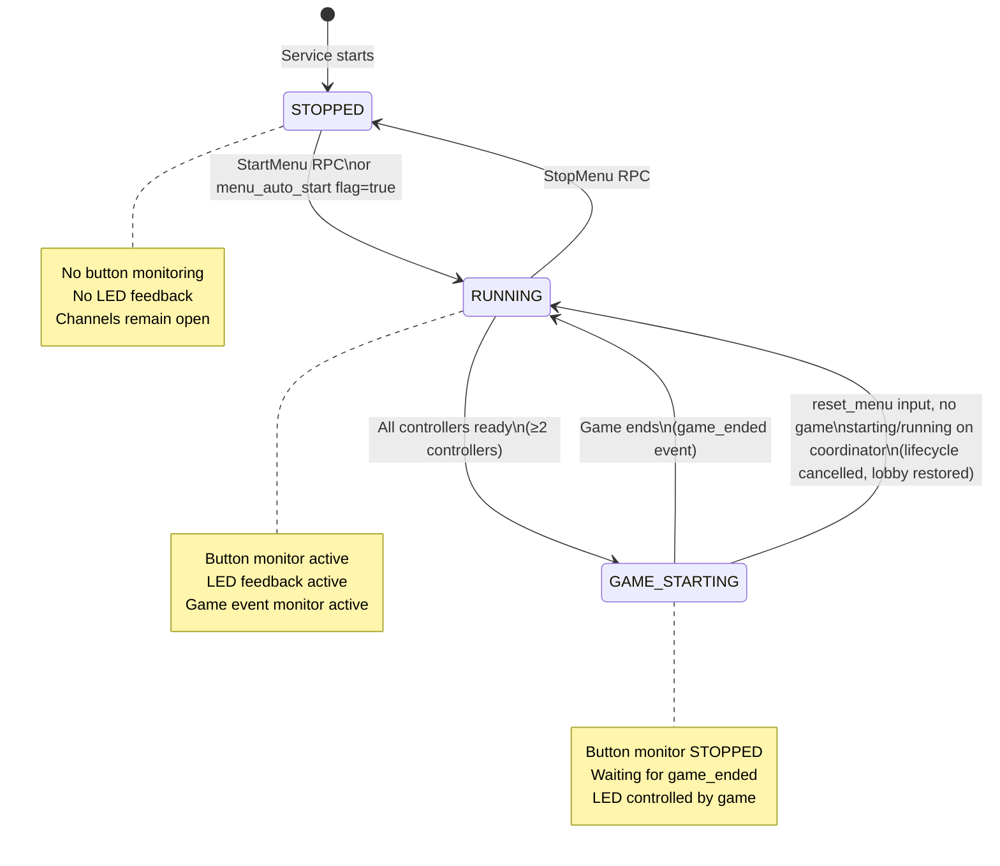
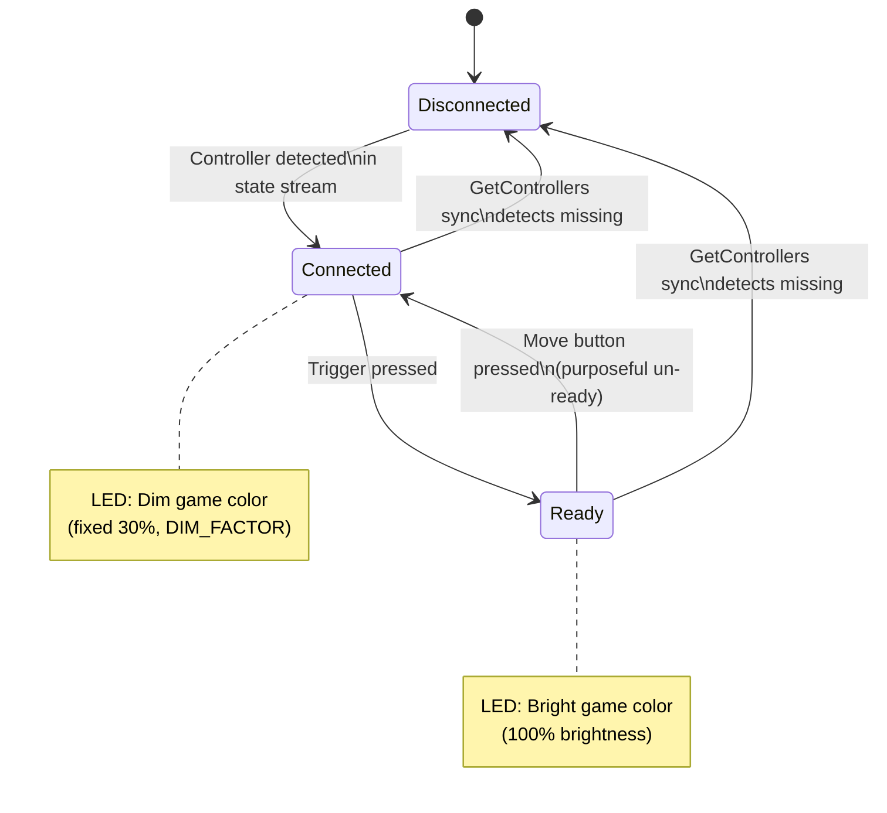
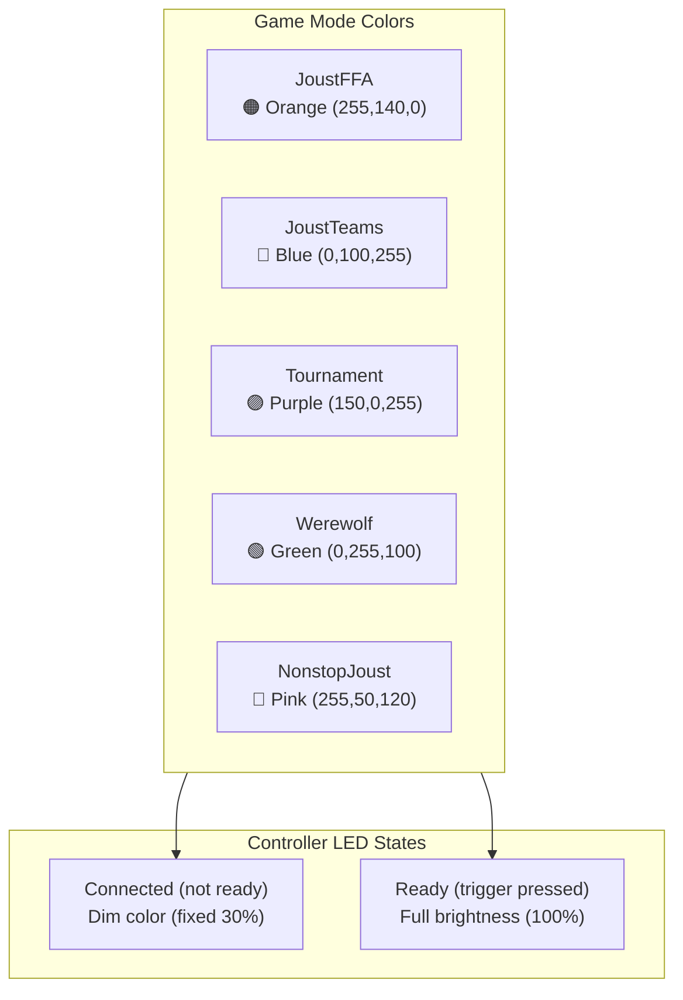
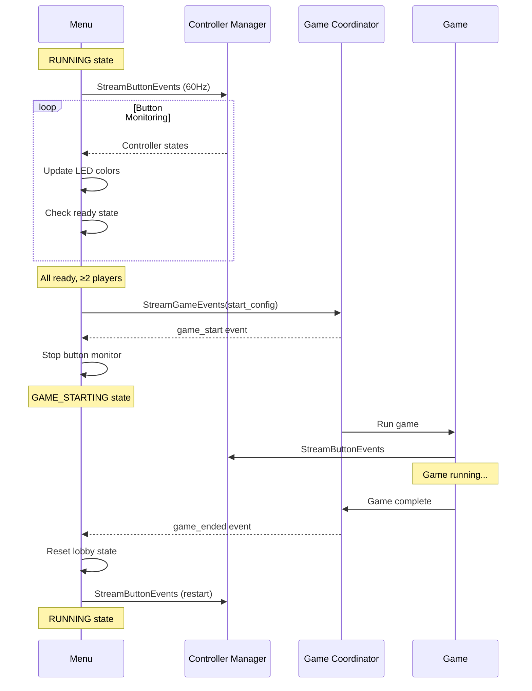

# Menu Service

**Part of JoustMania Microservices Architecture**

## Overview

The Menu Service manages the game selection menu and lobby experience. It handles:

- Game mode selection (JoustFFA, JoustTeams, Tournament, Werewolf, NonstopJoust)
- Controller lobby state (connected/ready detection)
- LED feedback based on game mode and player ready state
- The operator pad's commands (`ProcessInput`, UC-015): settings, agent level, force start
- Event streaming for UI updates

## Quick Reference

| Property | Value |
|----------|-------|
| **gRPC Port** | 50054 |
| **Metrics Port** | 8000 |
| **Proto Definition** | `proto/menu.proto` |
| **Health Check** | gRPC health protocol |

## gRPC API

### StartMenu

Starts the menu and begins controller monitoring.

```protobuf
rpc StartMenu(StartMenuRequest) returns (StartMenuResponse);
```

**Response:**
- `success`: Whether the menu started successfully
- `error`: Error message if failed (e.g., "Menu already running")

During a game (starting, running or restoring the lobby) `StartMenu` answers `success` but does not enter
the lobby; when the game lifecycle ends the menu is RUNNING (UC-010 A12). A STOPPED menu ignores button
presses, and a ready auto start already under way when `StopMenu` lands is dropped (UC-010 BR-014).

### StopMenu

Stops the menu and clears all lobby state.

```protobuf
rpc StopMenu(StopMenuRequest) returns (StopMenuResponse);
```

### ProcessInput

Process menu input from controllers or web UI.

```protobuf
rpc ProcessInput(ProcessInputRequest) returns (ProcessInputResponse);
```

**Input Types:**

| Type | Data | Description |
|------|------|-------------|
| `button_press` | `{button: "trigger"}` | Start game with current selection |
| `button_press` | `{button: "select"}` | Cycle to next game mode |
| `web_command` | `{command: "start_game"}` | Start game from web UI |
| `web_command` | `{command: "select_game", game_name: "..."}` | Select specific game mode |
| `reset_menu` | `{}` | Cancel GAME_STARTING state, return to RUNNING; recovers a stale game lifecycle when the coordinator reports no active game (UC-010 BR-008) |

### StreamMenuEvents

Stream real-time menu events.

```protobuf
rpc StreamMenuEvents(StreamMenuEventsRequest) returns (stream MenuEvent);
```

**Event Types:**

| Event | Data | Description |
|-------|------|-------------|
| `menu_started` | `{}` | Menu has started |
| `menu_stopped` | `{}` | Menu has stopped |
| `selection_changed` | `{game_name, source?, serial?}` | Game mode changed |
| `game_requested` | `{game_name, source?, serial?}` | Game start requested |
| `game_start_cancelled` | `{game_name, player_count, minimum_players}` (roster below the mode's minimum), `{}` (`reset_menu`) or `{game_name, reason}` (start stream failed before its first event; `reason` = `coordinator_unreachable` or `start_failed`, UC-010 A3) | Game start was cancelled |
| `game_start_rejected` | `{game_name, source, error}` | Web `start_game` named an unknown or unimplemented mode; no game starts |

## Lobby Feedback

Controllers receive LED feedback based on their state and the selected game mode.

> **Full Reference:** See [UC-010](../../docs/use_cases/UC-010.md) and [UC-011](../../docs/use_cases/UC-011.md) for the lobby LED states.

### Game Mode Colors

| Game Mode | Color | RGB |
|-----------|-------|-----|
| JoustFFA | Orange | (255, 140, 0) |
| JoustTeams | Blue | (0, 100, 255) |
| Tournament | Purple | (150, 0, 255) |
| Werewolf | Green | (0, 255, 100) |
| NonstopJoust | Pink | (255, 50, 120) |

### Controller States

| State | LED Behavior | Transition |
|-------|--------------|------------|
| Connected (not ready) | Dim game color (fixed 30%, `DIM_FACTOR`) | Trigger → Ready |
| Ready | Bright game color (100% brightness) | Move → Connected |

### Auto-Start

When all connected controllers are ready (trigger pressed) and there are at least 2 controllers, the game automatically starts.

## State Diagrams

### Menu Service States



### Controller State Machine

Each connected controller goes through these states in the lobby:



### LED Color Flow



### Lobby Decision Flow

```mermaid
flowchart TD
    Start([Menu RUNNING]) --> Stream[Stream controller states<br/>from Controller Manager]

    Stream --> Update{Controller<br/>state update?}
    Update -->|No| Stream
    Update -->|Yes| NewCtrl{New<br/>controller?}

    NewCtrl -->|Yes| AddConnected[Add to connected set<br/>Set dim game color]
    NewCtrl -->|No| CheckTrigger{Trigger<br/>pressed?}

    AddConnected --> CheckTrigger

    CheckTrigger -->|Yes, not ready| MarkReady[Add to ready set<br/>Set bright game color<br/>Play beep sound]
    CheckTrigger -->|Yes, already ready| SyncControllers
    CheckTrigger -->|No| CheckMove

    CheckMove{Move button<br/>pressed?} -->|Yes, is ready| UnReady[Remove from ready set<br/>Set dim game color]
    CheckMove -->|No| Stream2
    UnReady --> Stream

    MarkReady --> SyncControllers[Sync with GetControllers<br/>Remove disconnected]

    SyncControllers --> CheckAllReady{All connected<br/>are ready?}

    CheckAllReady -->|No| Stream2
    CheckAllReady -->|Yes| CheckMinPlayers{≥2 players?}

    CheckMinPlayers -->|No| Stream2
    CheckMinPlayers -->|Yes| StartGame[🎮 Start Game!<br/>State → GAME_STARTING<br/>(no game_requested: only a force start publishes it)]

    Stream2([Next event]) --> Stream
    StartGame --> StopMonitor[Stop button monitor]
    StopMonitor --> WaitEnd([Wait for game_ended event])
    WaitEnd --> ResetLobby[Reset lobby state<br/>Clear ready controllers<br/>Restart button monitor]
    ResetLobby --> Start
```

### Game Event Integration



## Host settings (operator pad)

The controller admin mode (four face buttons, UC-012 and UC-013) is gone since #2819. The host changes
the settings, the mode and the agent level, and force-starts, with the operator pad (UC-015, UC-016),
whose commands arrive as `ProcessInput` `web_command`s (`services/menu/settings_ops.py`); the
flag-service scripts, the web and Flagsmith change the same flags. Only `sensitivity`, `num_teams`,
`force_all_start`, `game_instructions`, the mode and the shield mode are settable from the pad; the
per-mode tunables stay baseline-only ([Ownership Model §3.1](../../docs/OWNERSHIP_MODEL.md#31-device-settable-flags)).

## Configuration

### Environment Variables

| Variable | Default | Description |
|----------|---------|-------------|
| `LOG_LEVEL` | `INFO` | Logging level (DEBUG, INFO, WARNING, ERROR) |
| `CONTROLLER_MANAGER_HOST` | `controller-manager` | Controller manager hostname |
| `CONTROLLER_MANAGER_PORT` | `50052` | Controller manager port |
| `FLAGD_HOST` | `flagd` | flagd service hostname |
| `FLAGD_PORT` | `8015` | flagd gRPC port |
| `FLAG_SERVICE_URL` | `http://flag-service:8070` | Flag service HTTP API; the pad's settings are written here with `persist: true` (`lib/flag_service_writer.py`) |
| `GAME_COORDINATOR_HOST` | `game-coordinator` | Game coordinator hostname |
| `GAME_COORDINATOR_PORT` | `50053` | Game coordinator port |
| `OTEL_EXPORTER_OTLP_ENDPOINT` | `http://localhost:4317` | OpenTelemetry endpoint |
| `OTEL_SERVICE_NAME` | `menu-service` | Service name for tracing |

## Metrics

Metrics are pushed over OTLP to the collector (no `/metrics` endpoint); names are listed in [docs/specs/telemetry.md §6](../../docs/specs/telemetry.md#6-metrics).

### Button Monitoring Metrics

| Metric | Type | Labels | Description |
|--------|------|--------|-------------|
| `menu_button_dispatch_seconds` | Histogram | event_type | Time to dispatch one button-stream event |

### System Metrics

| Metric | Type | Description |
|--------|------|-------------|
| `process_cpu_seconds_total` | Counter | Total user and system CPU time in seconds |
| `process_resident_memory_bytes` | Gauge | Resident memory size in bytes |
| `process_threads` | Gauge | Active thread count |

## Testing

```bash
# Run unit tests
cd services/menu
pytest tests/

# Test with grpcurl
grpcurl -plaintext localhost:50054 list
grpcurl -plaintext localhost:50054 joustmania.menu.MenuService/GetMenuStatus
```

## Dependencies

- **controller-manager**: Streams controller states, sets LED colors
- **settings**: Gets/updates game configuration
- **game-coordinator**: Receives game start requests

## Development

See [DEVELOPMENT.md](../../docs/DEVELOPMENT.md) for development workflow.
